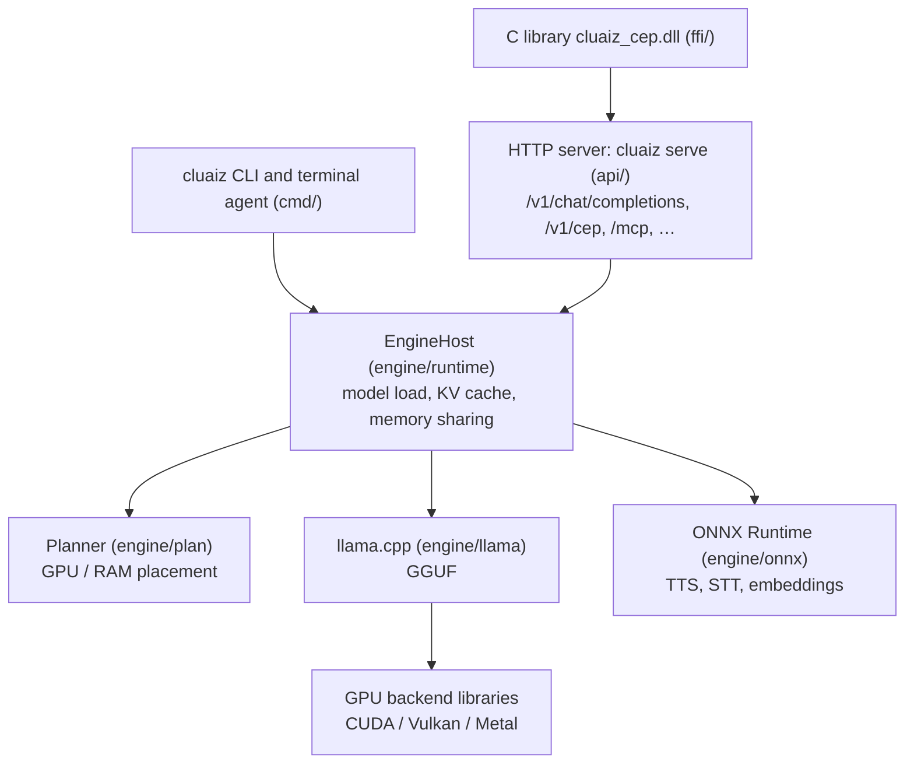

# System Architecture Overview

One program, `cluaiz`, holds the CLI, the terminal agent, the HTTP server and the model runtimes.

---

## Layers

### CLI and terminal agent (`cmd/`)
* `cluaiz run` chats in the terminal; `cluaiz agent` reads, searches and edits files in a folder
  and runs commands, asking before changes.
* The CLI loads models in its own process; it does not need a running server.

### HTTP server (`api/`)
* Axum and Tokio. Chat streams with Server-Sent Events.
* Builds each chat prompt from history, recall, notes, project files and tool cards, then runs
  the tool loop.
* Load settings come from `settings.json` → `optimization` ([load and speed
  settings](../engine/llm_optimization.md)).

### Runtimes and GPU backends
* At start, llama.cpp loads the GPU backend libraries found next to the executable
  (`ggml_backend_load_all_from_path`). Without one, it runs on the CPU (AVX2, AVX-512 or NEON).
* The planner reads the [hardware profile](../engine/system_control.md) and the model size and
  chooses the GPU layers and context size.

More: [ARCHITECTURE.md](../../ARCHITECTURE.md).
