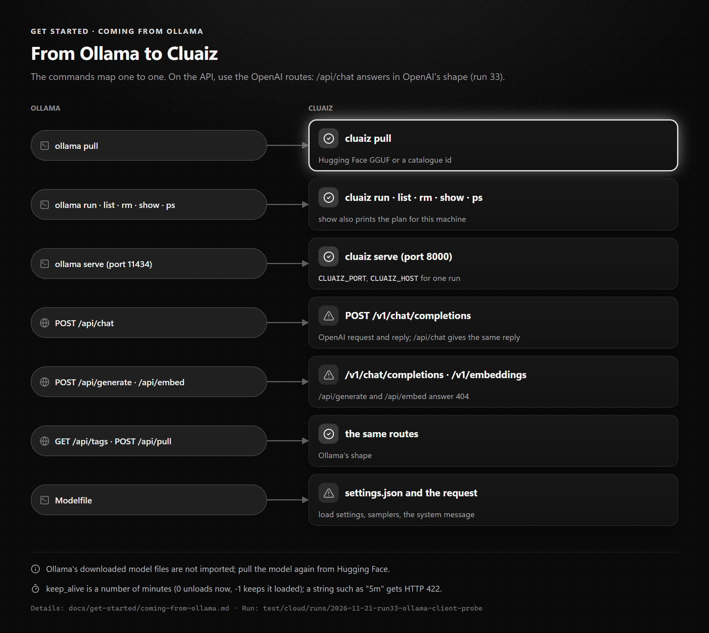

# Coming from Ollama

If you use Ollama today, most of what you know carries over: the same kind of model files (GGUF,
run by llama.cpp), the same command names and a local HTTP server. This page lists what is the
same, what is different, and what to change in your code. Each API difference below was checked
in [run 33](../../test/cloud/runs/2026-11-21-run33-ollama-client-probe/SUMMARY.md) (Engine 0.1.0,
Windows, Qwen3-0.6B).



## Commands

| Ollama | Cluaiz | Note |
|---|---|---|
| `ollama pull <model>` | `cluaiz pull <model>` | a Cluaiz catalogue id (`qwen3:8b`) or a Hugging Face repository (`unsloth/Qwen3.5-4B-GGUF:Q4_K_M`) |
| `ollama run <model>` | `cluaiz run <model>` | `cluaiz run <model> "prompt"` answers once |
| `ollama list` | `cluaiz list` | the first column is the installed ID; use it as `model` in API calls |
| `ollama show <model>` | `cluaiz show <model>` | also prints the plan this machine would get: GPU layers, context, KV cache type |
| `ollama ps` | `cluaiz ps` | the model the running server has loaded |
| `ollama rm <model>` | `cluaiz rm <model>` | |
| `ollama serve` | `cluaiz serve` | port 8000, not 11434 |
| `ollama create` with a Modelfile | no equivalent | see [Modelfile settings](#modelfile-settings) |

Cluaiz adds commands Ollama does not have, for example `cluaiz agent` (a coding agent in the
current folder), `cluaiz status` (the hardware the planner sees) and `cluaiz bench`. The full list:
[Commands reference](../cmd/commands_reference.md).

## Models

Cluaiz does not read Ollama's model store. Download the model again with `cluaiz pull`; the files go
to `~/.cluaiz/models` (or `<CLUAIZ_HOME>/models`). A stopped download continues where it stopped.

The installed ID is not the repository name: `cluaiz list` prints it, for example
`qwen3-0.6b-gguf-Q4_K_M` (the model of run 33). Use that ID as `model` in API calls. More: [Model
downloading](model-downloading.md).

## Server address

| Ollama | Cluaiz |
|---|---|
| `http://localhost:11434` | `http://localhost:8000` |
| `OLLAMA_HOST` | `CLUAIZ_HOST` and `CLUAIZ_PORT` for one run; `cluaiz permission port <n>` to save a port |
| no key by default | no key by default; with `api_auth.required` on, send `Authorization: Bearer <token>` ([permission.json](../engine/permission.md)) |

## API: what to change in your code

**Chat.** Send OpenAI requests to `POST /v1/chat/completions`. Any OpenAI client library works by
setting its base URL to `http://localhost:8000/v1` ([OpenAI compatibility](../api/inference/openai_compatibility.md)).

```python
from openai import OpenAI

client = OpenAI(base_url="http://localhost:8000/v1", api_key="unused")  # a token when keys are on
reply = client.chat.completions.create(
    model="qwen3-0.6b-gguf-Q4_K_M",          # the ID from `cluaiz list`
    messages=[{"role": "user", "content": "Hello"}],
)
print(reply.choices[0].message.content)
```

`POST /api/chat` exists, but it is the same handler as `/v1/chat/completions`: it takes the OpenAI
request and answers in OpenAI's shape (`choices[0].message`, not Ollama's `message` and `done`). It
does not stream unless `stream: true` is sent, and then it streams Server-Sent Events, not Ollama's
one JSON object per line. The Ollama Python and JavaScript libraries expect Ollama's shape, so their
`chat()` calls do not work against Cluaiz today.

| Ollama route | In Cluaiz (run 33) | Use instead |
|---|---|---|
| `POST /api/chat` | HTTP 200 in OpenAI's shape | `POST /v1/chat/completions` |
| `POST /api/generate` | HTTP 404 | `POST /v1/chat/completions` with one user message |
| `POST /api/embed`, `/api/embeddings` | HTTP 404 | `POST /v1/embeddings` ([Embeddings](../api/inference/embeddings.md)) |
| `GET /api/tags` | HTTP 200 in Ollama's shape | works; `modified_at` is a fixed date, not the file's |
| `POST /api/pull` | Ollama's request | works ([Pull a model](../api/models/pull_model.md)) |
| `GET /api/ps` | HTTP 404 | CEP `system.ps`, or `cluaiz ps` |
| `POST /api/show` | HTTP 404 | CEP `models.inspect`, or `cluaiz show` |
| `GET /api/version` | HTTP 404 | `GET /health` returns the version |

**Request fields.**

| Ollama field | In Cluaiz |
|---|---|
| `options.temperature`, `options.top_p`, `options.seed` | top-level `temperature`, `top_p`, `seed` (OpenAI names); `options` is ignored |
| `options.num_predict` | `max_tokens` |
| `options.num_ctx` | `llama.n_ctx` in the request, or `optimization.custom_context_window` in settings; by default the planner chooses the context from free memory |
| `think: false` | `think_mode: "off"`; `think` is ignored (run 33: the model still thought) |
| `keep_alive: "5m"` | `keep_alive: 5` (minutes as a number); `0` unloads after the answer. A string gets HTTP 422 |
| `format: "json"` or a schema | `response_format` (OpenAI form) |

## Modelfile settings

There is no Modelfile. What it sets goes elsewhere:

| Modelfile line | In Cluaiz |
|---|---|
| `FROM` | `cluaiz pull` |
| `PARAMETER temperature`, `top_p`, ... | `settings.json` → `samplers` (default for every chat), or the request fields |
| `PARAMETER num_ctx`, `num_gpu` | `settings.json` → `optimization` (`custom_context_window`, `n_gpu_layers`), or the request's `llama` object; unset means the planner decides |
| `SYSTEM` | a `system` message in the request |
| `TEMPLATE` | the chat template inside the GGUF file is used |

Settings reference: [Engine configuration](../reference/engine-configuration.md) and [Load and
speed settings](../engine/llm_optimization.md).

## What works differently

- **Placement.** Before a load, the Engine measures free RAM and VRAM and chooses GPU layers,
  context size and KV cache type for this machine ([how](../engine/llm_optimization.md)). `cluaiz
  show <model>` prints that plan without loading.
- **One chat model at a time** is loaded for chat. Embedding and speech models load beside it when
  memory allows; requests to one model wait in line.
- **Beyond chat:** the same server runs speech, transcription, embeddings, document reading, tools,
  memory and an agent loop ([API overview](../api/README.md)).

## Not available yet

- An Ollama-shaped reply on `/api/chat`, `/api/generate`, `/api/embed`, `/api/ps`, `/api/show`.
- Importing models from Ollama's store.
- A Modelfile or saved model variants.
