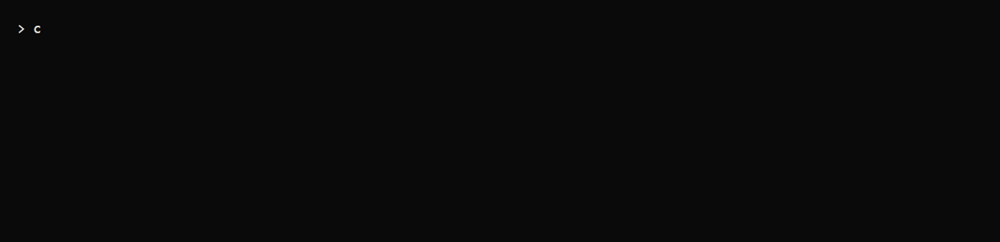

<!-- name: Quickstart
description: Install Cluaiz with one command and run your first model. -->

# Quickstart


Install Cluaiz with one command, download a model and ask it something. You can also build it from source.

Cluaiz is one native program: it needs no Docker and no Python.

---

## 1. Install with one command

The recommended method to deploy the node is using the official single-line automated installation scripts. These scripts analyze your host operating system, configure local workspaces, fetch target architecture libraries, and register path variables automatically.

### Windows

Execute this command inside a standard or Administrator **PowerShell** prompt:

```powershell
powershell -c "irm https://cluaiz.com/install.ps1 | iex"
```

*   **Bypass Flag (`-ExecutionPolicy Bypass`):** Instructs PowerShell to bypass local script signing policies temporarily to execute the installer.
*   **Request Method (`irm` / `Invoke-RestMethod`):** Downloads the raw PowerShell script from the secure gateway.
*   **Execution block (`iex` / `Invoke-Expression`):** Runs the downloaded installer script directly inside the active terminal process.
*   **Behind the Scenes:** The installer downloads the Windows core from the newest GitHub release, adds the GPU pack for your GPU (NVIDIA: CUDA; AMD / Intel Arc: Vulkan), checks every file against the release's `SHA256SUMS.txt`, unpacks them into `~\.cluaiz\bin` and adds that folder to your user PATH. It installs the Microsoft Visual C++ runtime if it is missing.

---

### Linux and macOS

Execute this command inside any **Bash**-compliant terminal:

```bash
curl -fsSL https://cluaiz.com/install.sh | bash
```

*   **Silent Secure Flags (`-fsSL`):** Sets curl to fail silently on server errors, suppress progress bars, allow redirects, and connect securely over SSL.
*   **Piped Shell (`| bash`):** Directs the downloaded shell instructions directly to the bash shell interpreter.
*   **Behind the Scenes:**
    *   It downloads the core for your OS and processor (Linux x64 / ARM64 with glibc 2.39+, macOS 14 or newer on Apple Silicon) from the newest GitHub release. The core picks the fastest CPU code for your processor at start, so there is no separate AVX2 / AVX-512 download.
    *   On Linux it adds the CUDA pack when `nvidia-smi` finds an NVIDIA GPU, or the Vulkan pack for an AMD GPU. Set `CLUAIZ_GPU=cpu|cuda|vulkan` to choose yourself.
    *   Every file is checked against the release's `SHA256SUMS.txt`, unpacked into `~/.cluaiz/bin`, and that folder is added to your shell profile (`.bashrc` / `.zshrc` / `.profile`).

See [Platform Support](../deployments/platforms.md) for what each GPU pack covers.

### Update and uninstall

```bash
cluaiz self update --check        # is a newer release out?
cluaiz self update                # install it; models and settings stay
cluaiz self uninstall             # remove Cluaiz, its models and its PATH entry (asks first)
cluaiz self uninstall --keep-models
```

An update downloads only the packs that changed. Each pack in `~/.cluaiz/bin/packs/<pack>.txt` (for example `core.txt`, `llama-cuda13.txt`) records its SHA-256, the release it came from (`since`) and the files it put in place; a pack whose SHA-256 matches the new release's `SHA256SUMS.txt` and whose files are all still there is kept. A release that reuses its GPU drivers ships them unchanged, so usually only the core (about 50 MB) is downloaded. Set `CLUAIZ_REINSTALL=1` to download every pack again.

On Windows the update installer opens in its own window once the command exits (a running `cluaiz.exe` is locked). Close the Cluaiz App or stop `cluaiz serve` first. Apps can ask whether an update is out with the CEP method [`system.update_check`](../api/cep/system/system/system.update_check.md).

---

## 2. Build from source

For developers and contributors who want to configure custom target compilation flags, cluaiz can be built manually from source:

### What you need
Ensure your local machine has the following tools installed and registered in your PATH:
*   **Compiler:** Rust Toolchain (v1.75 or later).
*   **Linkers:** C++ build compilers (GCC/Clang on Unix/macOS, MSVC C++ Build Tools on Windows).

### Build
1.  **Clone the Repository:**
    ```bash
    git clone https://github.com/cluaiz/cluaiz.git
    cd cluaiz
    ```

2.  **Compile the Core Workspace:**
    ```bash
    cargo build --release --bin cluaiz
    ```
    *Note: The `--release` flag compiles the Rust codebase with maximum level-3 loop optimizations and strips debugger symbols to ensure maximum execution speeds.*

3.  **Verify Binary Generation:**
    Verify that the compiled binary is generated under the release sub-directory:
    ```bash
    ./target/release/cluaiz --version
    ```

---

## 3. First steps

Open a new terminal (so the updated PATH is read) and check the install:

```bash
cluaiz --version
cluaiz status          # the CPU, GPU and memory the planner sees
```


Download a model and make it the default chat model:

```bash
cluaiz pull unsloth/Qwen3-4B-GGUF
cluaiz list                                        # the installed id, e.g. qwen3-4b-gguf-Q4_K_M
cluaiz model set-chat qwen3-4b-gguf-Q4_K_M
```

Then use it:

```bash
cluaiz run                                         # chat in the terminal
cluaiz run qwen3-4b-gguf-Q4_K_M "Explain a KV cache in two sentences."
cd path/to/a/project && cluaiz agent               # an agent that reads, edits and runs things in this folder
cluaiz serve                                       # the API for other apps
```

With a default chat model set, plain `cluaiz` in a terminal opens the agent in the current folder.



Recorded with Cluaiz 0.1.0 on a Windows laptop (RTX 3050) and Qwen3.5-0.8B Q4_K_M:
`cluaiz list`, then `cluaiz run qwen3.5-0.8b-gguf-Q4_K_M --think off --temp 0 "What is the capital of Japan? One short sentence."`.
`--think off` skips the model's thinking for a short answer. To make the recording again:
`docs/tools/gifs/first-run.tape`.

*   [Terminal chat (`cluaiz run`)](../cmd/chat.md): formatted answers, chat commands, options.
*   [Coding agent (`cluaiz agent`)](../cmd/agent.md): tools, what it asks before doing, limits.
*   [Command reference](../cmd/commands_reference.md): every command.
