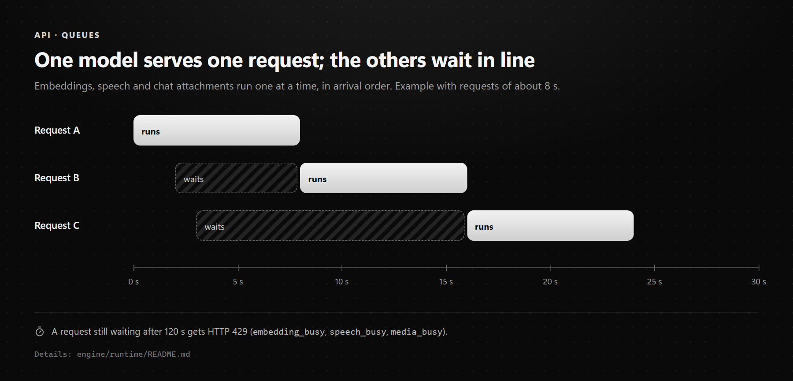
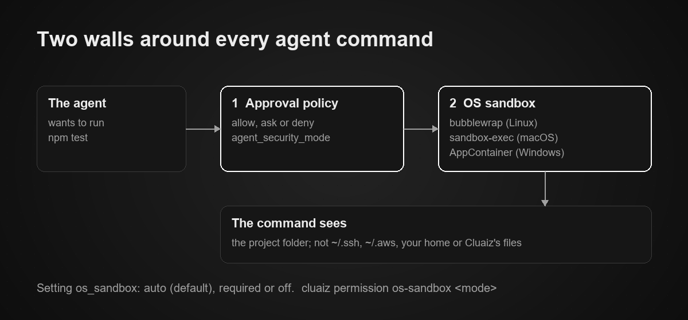

<!-- name: Troubleshooting
description: Start from the message the Engine prints: the cause, the fix and the page that explains the setting. -->

# Troubleshooting

Start from the message you see. Each entry gives the cause and the fix, and links to the page that
explains the setting. Messages are quoted as the Engine prints them.

For GPU drivers, VRAM and build problems, see [Hardware troubleshooting](../architecture/hardware-troubleshooting.md).

## The server does not start

### `port 8000 is already in use by another program`

Another program, often an earlier `cluaiz serve`, holds the port.

- Stop that program, or
- choose another port for good: `cluaiz permission port 8011`, or
- for one run only: `CLUAIZ_PORT=8011 cluaiz serve` (PowerShell: `$env:CLUAIZ_PORT=8011; cluaiz serve`).

Settings: [permission.json](../engine/permission.md#network-access-and-api-tokens).

## A request fails

### HTTP 401: `API Authentication is required. Provide a valid Bearer token in the Authorization header.`

API tokens are on (`api_auth.required` is `true`, which `cluaiz token create` sets). Send the key:

```bash
curl http://localhost:8000/v1/models -H "Authorization: Bearer <your key>"
```

`cluaiz token list` shows the keys. The opposite case, no 401 although you created a key: restart
`cluaiz serve`; a running server keeps the setting it started with. `/health` answers without a token, so an uptime check that passes
does not prove the key is right. More: [Network access and API tokens](../engine/permission.md#network-access-and-api-tokens).

### HTTP 400: `Requested model '<name>' was not found`

The `model` field names a model that is not installed under that ID. `cluaiz list` shows the installed
IDs; they are not always the Hugging Face repository name. See [Model downloading](model-downloading.md).

### HTTP 429: `embedding_busy`, `speech_busy` or `media_busy`



The embedding model, the speech model or the attachment pipeline runs one request at a time. A request
that arrives while another runs waits in line and runs next; it gets 429 only after waiting 120 seconds
behind earlier requests. Seeing it means requests arrive faster than one model can serve them for two
minutes: send smaller batches, or retry after a pause. (Before Engine `fe21984c`, 2026-11-20, the
second request got 429 at once.)

Reference: [Embeddings](../api/inference/embeddings.md), [Speech](../api/inference/audio_speech.md),
[Chat attachments](../api/inference/chat_completions.md).

## Agent commands and tools

### `OS sandbox: not available here (bubblewrap not found ...)`



On Linux, Cluaiz confines agent commands, MCP servers and plugins with bubblewrap. Without it, `auto`
mode runs them unconfined (with this warning) and `required` mode refuses to run them.

1. Install it: `sudo apt install bubblewrap` (Debian, Ubuntu) or `sudo dnf install bubblewrap` (Fedora).
2. **Ubuntu 23.10 and later** block it even when installed (AppArmor). Add the profile from
   [permission.json](../engine/permission.md) (field `os_sandbox`) and load it with
   `sudo apparmor_parser -r /etc/apparmor.d/bwrap`.
3. WSL1 and containers without user namespaces cannot run it at all; use `auto` there.

`/permissions` in `cluaiz agent` shows the state. Tested on Ubuntu 24.04 in run 28
(`test/cloud/runs/2026-11-21-run28-linux-os-sandbox/`).

### Windows: `OS sandbox: available (AppContainer) but off`

On Windows, `auto` does not confine, because Node.js from its installer and a Python installed under
your user folder cannot start inside an AppContainer. `cluaiz permission os-sandbox required` confines
every command; tools installed under `Program Files` keep working, per-user installs do not.

### A confined agent command cannot find `cargo`, `node` or `python`

Linux and macOS give back, read-only, the toolchain folders on your `PATH` that live under your home
folder (`~/.cargo` and `~/.rustup`, `~/.nvm`, `~/.pyenv`, `~/.local/bin`). A tool that is not on the
`PATH` of the process that started Cluaiz is not found. A command that downloads into such a folder
(`~/.cargo/registry`, `~/.npm`) fails, because the folder is read-only inside the sandbox.

## Speed and loading

| Symptom | Cause and fix |
| :--- | :--- |
| A laptop generates at about half its usual speed | On battery, Windows limits the GPU's power. Plug in the charger. |
| A model forced fully onto a small GPU is very slow on Windows | What does not fit spills into shared GPU memory (system RAM over PCIe). Leave placement on auto, or use fewer GPU layers. |
| Speeds or limits look wrong after a driver update or other change | The deep hardware scan is cached; a change in total RAM, CPU threads or NVIDIA GPUs re-runs it by itself at the next start. For anything else, run `cluaiz calibrate`. |
| The first answer on a Tesla T4 or RTX 20 takes a minute | The GPU pack has no ready-made code for that GPU and the driver compiles it once; later answers are at full speed. |
| "Does not fit" when loading a model | The plan needs more free memory than there is. Close other apps, lower the context, or use a smaller quantization (the message says how much is missing). |

## Windows says "Windows protected your PC"

The release executables are not signed with a commercial certificate yet, so Windows SmartScreen may show
this. Choose **More info**, then **Run anyway**.

## Still stuck

Open an issue with the command, the full message and `cluaiz --version`:
[github.com/cluaiz/cluaiz/issues](https://github.com/cluaiz/cluaiz/issues), or ask on
[Discord](https://discord.gg/mab8kBURz).
