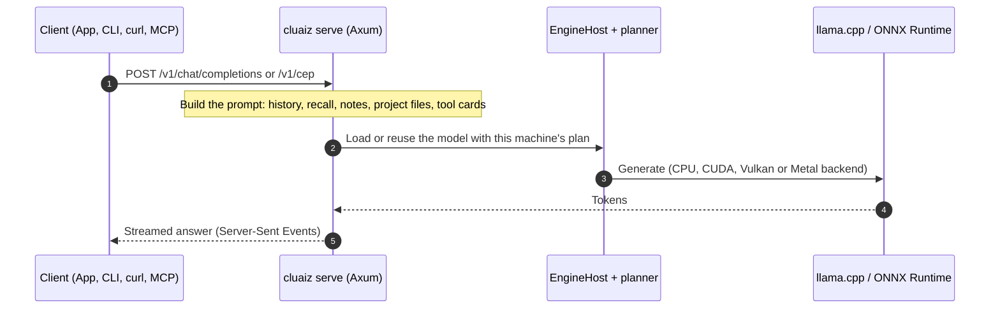

<!-- name: Welcome to the Cluaiz docs
description: Start page of the Cluaiz Engine docs, with links to each part. -->

# Welcome to cluaiz Documentation

Cluaiz is the AI engine where models, voice, vision, memory, tools, agents and workflows work as one.
It runs language, speech, vision and embedding models on your own computer or server, can use cloud
providers through the same API, and comes with a terminal coding agent, an OpenAI-compatible HTTP API
and its own JSON-RPC protocol (CEP).


Pick the path that matches what you want to do; the [documentation map](#documentation-map) below links
the pages for each step.

---

## Install

No containers and no Python environment are needed.

### Windows (PowerShell)
```powershell
powershell -c "irm https://cluaiz.com/install.ps1 | iex"
```

### Linux & macOS (Bash)
```bash
curl -fsSL https://cluaiz.com/install.sh | bash
```

The installer picks the GPU pack for your machine (CUDA 12 or 13 for NVIDIA, Vulkan for AMD and
Intel, otherwise CPU) and checks every file against the release's `SHA256SUMS.txt`.

Then:

```bash
cluaiz pull qwen3:8b
cluaiz run qwen3:8b        # chat in the terminal
cluaiz agent               # coding agent in the current folder
cluaiz serve               # HTTP API on port 8000
```

---

## How a request runs



The CLI and the agent load models in their own process; they do not need the server.

---

## Documentation map

### 1. Start
*   **[Introduction to cluaiz](introduction.md)**: What the Engine is made of and where your data lives.
*   **[Quickstart Guide](quickstart.md)**: Install, first model, building from source.
*   **[Your first API request](first-api-request.md)**: Serve a model, get an answer, stream it, add an API key.
*   **[Troubleshooting](troubleshooting.md)**: Start from the message you see: port in use, 401, 429, OS sandbox.
*   **[Coming from Ollama](coming-from-ollama.md)**: Which commands map one to one, and what to change in API code.

### 2. How-to
*   **[System Architecture Overview](architecture.md)**: The layers of the program.
*   **[Hardware Troubleshooting](../architecture/hardware-troubleshooting.md)**: GPU driver, VRAM and build problems.

### 3. Reference
*   **[Engine Configuration](../reference/engine-configuration.md)**: The settings files: `settings.json`, `permission.json`, `hardware_profile.json`.
*   **[Terminal Commands](../reference/terminal-commands.md)**: What each `cluaiz` command does.
*   **[HTTP API Interface](../reference/api.md)**: The routes, CEP and where each is documented.

### 4. Explanation
*   **[C Library (FFI)](../architecture/unified-brain-ffi.md)**: The C-ABI library and how GPU backends are loaded.
*   **[KV Cache Reuse](../engine/prefix_caching_architecture.md)**: How a chat's next turn reuses the KV cache in memory and from disk.
*   **[CEP (Cluaiz Engine Protocol)](../api/cep/README.md)**: One JSON-RPC 2.0 protocol for every engine operation, over HTTP, MCP and the in-process C library.
