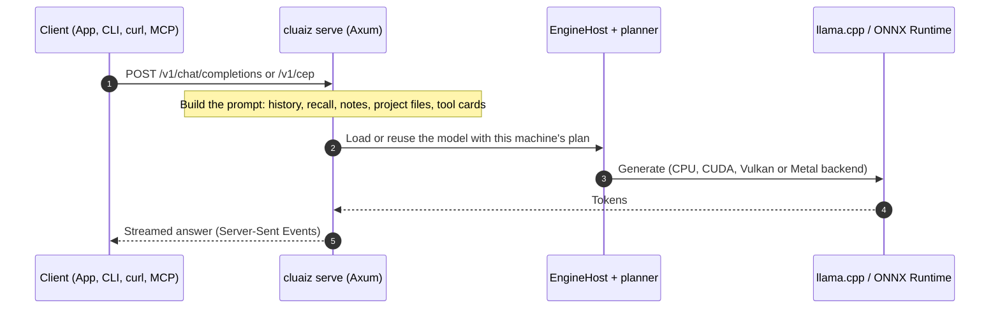

# Welcome to cluaiz Documentation

`cluaiz` is a local AI engine: it runs language, speech and embedding models on your own
computer, with a terminal coding agent, an OpenAI-compatible HTTP API and its own JSON-RPC
protocol (CEP).

---

## 🚀 Install

No containers and no Python environment are needed.

### Windows (PowerShell)
```powershell
powershell -c "irm https://cluaiz.com/install.ps1 | iex"
```

### Linux & macOS (Bash)
```bash
curl -fsSL https://cluaiz.com/install.sh | bash
```

The installer picks the GPU pack for your machine (CUDA 12 or 13 for NVIDIA, Vulkan for AMD and
Intel, otherwise CPU) and checks every file against the release's `SHA256SUMS.txt`.

Then:

```bash
cluaiz pull qwen3:8b
cluaiz run qwen3:8b        # chat in the terminal
cluaiz agent               # coding agent in the current folder
cluaiz serve               # HTTP API on port 8000
```

---

## 🏛️ How a request runs



The CLI and the agent load models in their own process; they do not need the server.

---

## 🗺️ Documentation map

### 📖 1. Start
*   **[Introduction to cluaiz](/docs/get-started/introduction)** — What the Engine is made of and where your data lives.
*   **[Quickstart Guide](/docs/get-started/quickstart)** — Install, first model, building from source.

### 🛠️ 2. How-to
*   **[System Architecture Overview](/docs/get-started/architecture)** — The layers of the program.
*   **[Hardware Troubleshooting](/docs/architecture/hardware-troubleshooting)** — GPU driver, VRAM and build problems.

### ⚙️ 3. Reference
*   **[Engine Configuration](/docs/reference/engine-configuration)** — The settings files: `settings.json`, `permission.json`, `hardware_profile.json`.
*   **[Terminal Commands](/docs/reference/terminal-commands)** — What each `cluaiz` command does.
*   **[HTTP API Interface](/docs/reference/api)** — The routes, CEP and where each is documented.

### 🧠 4. Explanation
*   **[C Library (FFI)](/docs/architecture/unified-brain-ffi)** — The C-ABI library and how GPU backends are loaded.
*   **[KV Cache Reuse](/docs/engine/prefix_caching_architecture)** — How a chat's next turn reuses the KV cache in memory and from disk.
*   **[CEP (Cluaiz Engine Protocol)](/docs/api/cep/README)** — One JSON-RPC 2.0 protocol for every engine operation, over HTTP, MCP and the in-process C library.
