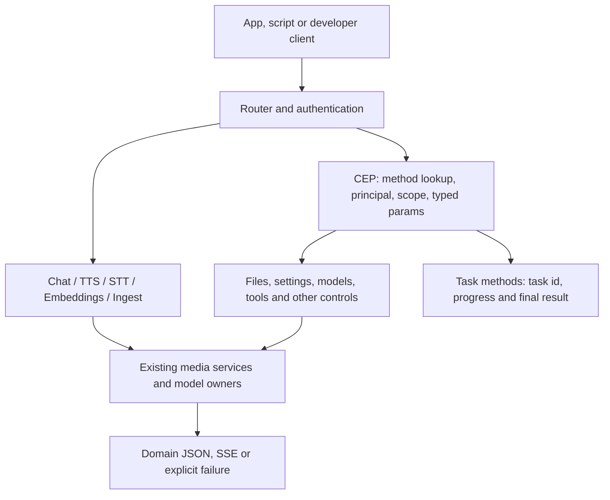

# Cluaiz API reference

Use this page to choose an endpoint and understand common request rules. Each domain reference contains accepted fields, defaults, payload variants, code examples, responses and errors.

## HTTP routes

The default base URL is `http://127.0.0.1:8000`; use your configured host/port. These are local Cluaiz APIs. Familiar URLs do not mean that every third-party SDK option or response format is implemented.

| Domain | Method | Path | Request → response | Detailed contract |
|---|---|---|---|---|
| Chat | POST | `/v1/chat/completions` | `messages` and model controls → chat completion JSON or SSE deltas | [Chat](../api/inference/chat_completions.md) |
| Chat | POST | `/api/chat` | Same handler and contract as the chat route | [Chat](../api/inference/chat_completions.md) |
| TTS | POST | `/v1/audio/speech` | `input` text, optional voice/language/model → JSON WAV data URI or audio SSE | [Text to speech](../api/inference/audio_speech.md) |
| STT | POST | `/v1/audio/transcriptions` | JSON `input_source` or `file` → transcription JSON or token SSE | [Speech to text](../api/inference/audio_transcriptions.md) |
| Embeddings | POST | `/v1/embeddings` | Text, text batch, or one compatible image input → float vector list | [Embeddings](../api/inference/embeddings.md) |
| Ingest | POST | `/v1/ingest` | `source`, optional model and controls → final ordered source results | [Ingest](../api/inference/ingest.md) |
| Models | GET | `/v1/models` | No body → installed model list in the `object/data` shape | [List models](../api/models/list_models.md) |
| Models | GET | `/api/tags` | No body → installed model list in the tags shape | [List models](../api/models/list_models.md) |
| Models | POST | `/api/pull` | Model identifier/download controls → pull progress/result | [Pull](../api/models/pull_model.md) |
| System | GET | `/health` | No body → Engine liveness JSON | [Health](../api/system/health.md) |
| Engine controls | POST | `/v1/cep` | JSON-RPC `method/params` → `result` or `error`; long methods return a task | [CEP](../api/cep/README.md) |
| MCP | POST | `/mcp` | MCP messages → MCP replies for eligible read-only CEP methods | [MCP facade](../api/cep/README.md#mcp) |

There are twelve HTTP routes. Ingest is a direct HTTP endpoint, not a CEP method. Chat controls, model management, files, settings, notes, context, tools and approvals remain CEP methods. Optional `audio.run` reuses the direct audio execution owner; direct TTS/STT clients do not need its task envelope.

## Which API should receive a file?

| Goal | Send | Processing |
|---|---|---|
| Extract document/image text | Ingest `source`, omit model | Native text/OCR; inspect omissions/warnings |
| Generate text from image/PDF pixels | Ingest with generative vision package | Model plus matching projector; no saved chat session |
| Ask follow-up questions about media | Chat `messages[].content` media parts | Prepared media/context for a compatible chat package |
| Convert PDF to text vectors | Ingest with text embedding package | Native text/OCR → chunks → actual vectors |
| Convert image/PDF pages to visual vectors | Ingest with ONNX image graph | Actual pixels → image/page vectors, not OCR prose |
| Embed prepared text or one image | Embeddings `input` | A text string here is not a file locator |
| Transcribe recording | STT `input_source` or `file` | Shared audio decoding and an STT model |
| Read/write/list filesystem objects | CEP `fs.*` | Filesystem operations, rather than interpretation |

Ingest is not a universal audio/video inference endpoint. Use STT for recording transcription, TTS for speech generation, and Chat with a compatible model for supported audio/video questions. These APIs do not create a persistent vector database automatically.

## Request and execution boundaries



Direct HTTP routes take their domain payload itself. For example, Ingest:

```json
{"source":"data:text/plain;base64,SGVsbG8gQ2x1YWl6IQ==","output_controls":{"return_text":true}}
```

CEP controls take a JSON-RPC envelope:

```json
{"jsonrpc":"2.0","id":1,"method":"models.list","params":{}}
```

Do not wrap direct inference inputs in `params`, or send `/v1/ingest` as a CEP method name. Discovery lists CEP methods, not direct HTTP routes.

## Authentication and local files

Every route except `/health` follows `api_auth.required`. When enabled, send `Authorization: Bearer <configured-key-or-session-token>`; missing/invalid credentials return HTTP 401. When disabled, the middleware does not require a token.

Direct inference executes as the owner. Local files are canonicalized on the Engine computer, using the current workspace for relative paths. The owner's access is not restricted to that workspace. A browser-local filename does not transfer bytes: send a real data URI or permitted URL. Remote fetching, decoding and model admission have separate checks. CEP principal scopes/roots are separate; never hand an owner token to an untrusted extension. See [security and authentication](../architecture/security-and-auth-architecture.md).

## Model selection

1. Read CEP `models.list` for installed `id`, format, tasks and experimental metadata. `/v1/models` and `/api/tags` provide their documented list shapes.
2. Send the exact installed ID in `model`. A Hugging Face repository used during installation is not necessarily that runtime ID.
3. Match the task and required assets. ONNX is a format, not a promise that every architecture has an executor. GGUF vision/speech packages need matching projectors; image embedding graphs produce vectors rather than captions.
4. Omitted/automatic model selection follows each domain's active-slot rules. Ingest deliberately differs: omitted/`auto` means native extraction without an LLM.

Selection does not override context/live-memory limits. Missing/incompatible packages return errors rather than fabricated output or silent substitutes. See [model families and limitations](../../modles.md).

## Limits, lifecycle and responses

| Concern | Contract |
|---|---|
| JSON media transport | Shared inline ceiling: `4 * ceil(media.limits.max_input_bytes / 3) + 2 MiB` on Chat, audio, embeddings, ingest and CEP |
| Source/decoded bytes | Media limits still apply after Base64 validation; document batches also check aggregate input/output bytes |
| Ingest chunk size | UTF-8 bytes, not tokenizer tokens |
| Context/output | Model context/output-token limits are separate from file/JSON sizes |
| `keep_alive` | Supported direct domains use minutes: `0` releases after execution, positive schedules expiry, `-1` retains; Ingest has no per-request field |
| Non-stream output | Check status, then parse the documented domain JSON |
| SSE | Chat/audio schemas differ; parse complete event frames, not arbitrary network chunks |
| Partial Ingest | HTTP 200 may contain `status:"partial"`; inspect every source and page warning/omission |
| Failures | Auth errors, domain errors, JSON-parser rejections and nested per-source errors have different bodies; retain raw status/body |

A health response does not prove a selected model executes. Avoid tight-loop retries for resource/busy errors. A smaller download is not a promise of peak runtime memory.

## Reference sources and other transports

- [API overview](../api/README.md): authentication examples and domain links.
- [CEP](../api/cep/README.md): envelope, discovery, scopes, approvals, task lifecycle and per-method references.
- [OpenRPC](../api/cep/openrpc.json): generated registry data; check with `cargo test --release -p cluaiz-api --test cep_docs`.
- [C library](../../ffi/README.md): `cep_call` / `cep_free` embeds CEP in the caller process. Direct HTTP Ingest is not automatically exported as a CEP alias.

Markdown domain pages and `docs/registry.json` supply downstream documentation metadata. Updating these sources does not rebuild or refresh an already running App.
