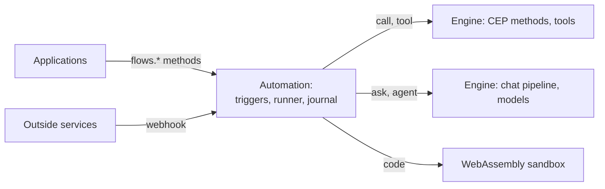

# Automation reference

> **Draft for review.** Automation is built in four parts (not released): the format, all seventeen step kinds, all ten triggers and sixteen methods (see [automation/README.md](../../automation/README.md)). This page is a quick overview of the
> design; every part is explained in depth in [docs/automation](../automation/README.md).

Automation runs **flows**: files of steps that start on a trigger and use the Engine's tools,
methods and models. It is a separate layer, not part of the Engine or the API: it calls the Engine
through CEP methods and the chat pipeline, like any application.
[Where Automation sits](../automation/README.md#where-automation-sits)



## A flow file

```yaml
flow: cluaiz.flow/1
name: morning-news
on:
  - schedule: "0 9 * * *"
steps:
  - id: news
    tool: mcp:web-search/search
    with: { query: "AI news today" }
  - id: short
    ask: "Summarise these results in five bullet points."
    with: { results: "${{ steps.news.output }}" }
```

| Thing | Value | In depth |
| --- | --- | --- |
| Formats | JSON or YAML 1.2, same schema | [The file](../automation/file.md) |
| File names | `<name>.flow.json`, `<name>.flow.yaml`, `<name>.flow.yml` | [Names](../automation/file.md) |
| Places | `<project>/.agents/flows/` (project), `~/.cluaiz/flows/` (user) | [Places](../automation/file.md) |
| Format version | `flow: cluaiz.flow/1` | [Versions](../automation/file.md#versions-of-the-format) |
| Size | At most 1 MB of text | [Validation](../automation/validation.md) |

## Top-level fields

| Field | Required | Meaning |
| --- | --- | --- |
| `flow` | Yes | Format version |
| `name` | Yes | 1–64 characters: `a-z`, `0-9`, `-`, `_` |
| `description` | No | What the flow does |
| `version` | No | The author's version text |
| `timezone` | No | IANA name; default the computer's |
| `inputs` | No | Input name → JSON Schema |
| `outputs` | No | What the run returns |
| `on` | No | Triggers; none means started by hand only |
| `permissions` | No | What the flow may use; computed and confirmed at save |
| `secrets` | No | Names of secrets read as `env:NAME` |
| `limits` | No | `timeout`, `max_wait`, `max_steps`, `max_parallel`, `result_in_memory` |
| `concurrency` | No | `queue` (default), `skip`, `replace`, `parallel` |
| `retention` | No | `{ days, runs }` |
| `steps` | Yes | At least one step |
| `on_error` | No | Steps run when the run fails |
| `ui` | No | The application's own data; never read by Automation |
| `meta` | No | Tags, author, links |

## Triggers

Every trigger may have `id`, `filter`, `dedupe`, `dedupe_for` (default `24h`), `inputs`, `enabled`.
Order of checks: enabled → the kind's own rules → `filter` → `dedupe` → `concurrency` → run.

| Trigger | Starts a run when | In depth |
| --- | --- | --- |
| `manual` | Someone or something starts it (always possible) | [manual](../automation/triggers.md#manual) |
| `schedule` | A cron time comes, in a timezone; `catch_up`: `skip`, `once`, `all` | [schedule](../automation/triggers.md#schedule) |
| `every` | An interval passes (`every: 15m`) | [every](../automation/triggers.md#every) |
| `webhook` | An outside request with the flow's secret arrives | [webhook](../automation/triggers.md#webhook) |
| `poll` | A tool's answer has something new | [poll](../automation/triggers.md#poll) |
| `file` | A file appears, changes or goes in a folder | [file](../automation/triggers.md#file) |
| `engine` | An Engine event: chat finished, model downloaded, task done… | [engine](../automation/triggers.md#engine) |
| `event` | Another flow sends an event (`emit`) | [event](../automation/triggers.md#event) |
| `tool` | The flow is called as a tool by the agent, a chat or an MCP client | [tool](../automation/triggers.md#tool) |
| `startup` | Automation starts | [startup](../automation/triggers.md#startup) |

## Steps

A step has exactly one kind key. Fields every step may have:

| Field | Meaning |
| --- | --- |
| `id` | Name to read its output: `steps.<id>.output` |
| `name` | Text for people |
| `when` | Condition; false skips the step |
| `needs` | Steps it waits for; default the step above |
| `with` | Its input, references resolved |
| `output` | What to keep from the result |
| `retry` | `{ max, delay, backoff, max_delay, jitter, on }` |
| `timeout` | Duration; default by kind (`10m`, `agent` `30m`, `code` `1m`) |
| `on_error` | `stop` (default), `continue`, or steps |
| `approve_before` | A question; waits for a person's yes |
| `idempotency_key` | Never do the same thing twice |
| `secret_output` | Mask the output in records |

| Kind | Does | Main fields | In depth |
| --- | --- | --- | --- |
| `tool` | Runs an installed MCP tool, plugin function or skill | `tool`, `with`, `settings` | [tool](../automation/steps/tool.md) |
| `call` | Runs a CEP method or an Engine route | `call`, `with` | [call](../automation/steps/call.md) |
| `ask` | One answer from a model | `ask`, `with`, `model`, `system`, `output_schema`, `tools`, `attachments`, `think`, `max_tokens` | [ask](../automation/steps/ask.md) |
| `agent` | A model with rounds of tool calls | as `ask`, plus `max_turns`, `tool_search`, `stop_when` | [agent](../automation/steps/agent.md) |
| `code` | Your WebAssembly function | `code`, `fn`, `with`, `memory`, `fuel` | [code](../automation/steps/code.md) |
| `if` | `then` or `else` | `if`, `then`, `else` | [if](../automation/steps/if.md) |
| `switch` | The first case that holds | `switch`, `match`, `default` | [switch](../automation/steps/switch.md) |
| `each` | Steps for every item of a list | `each`, `as`, `do`, `parallel`, `batch`, `stop_on_error`, `delay` | [each](../automation/steps/each.md) |
| `parallel` | Named branches at once | `parallel`, `wait`, `stop_on_error` | [parallel](../automation/steps/parallel.md) |
| `repeat` | Steps again until a condition holds | `repeat`, `until`, `max` (required), `delay`, `on_max` | [repeat](../automation/steps/repeat.md) |
| `wait` | A duration, a time, an event or a webhook | `for`, `until`, `event`, `webhook`, `timeout`, `on_timeout` | [wait](../automation/steps/wait.md) |
| `approve` | A person's yes or no | `approve`, `with`, `timeout`, `on_timeout`, `on_reject`, `notify` | [approve](../automation/steps/approve.md) |
| `set` | Values into `vars` | `set` | [set](../automation/steps/set.md) |
| `run` | Another flow | `run`, `scope`, `with`, `wait` | [run](../automation/steps/run.md) |
| `emit` | Sends an event | `emit`, `with` | [emit](../automation/steps/emit-return-fail.md#emit) |
| `return` | Ends the run with outputs | `return` | [return](../automation/steps/emit-return-fail.md#return) |
| `fail` | Ends the run with an error | `fail`, `kind`, `details` | [fail](../automation/steps/emit-return-fail.md#fail) |

Step statuses: `pending`, `running`, `waiting`, `succeeded`, `failed`, `skipped`, `cancelled`, plus
`reused` and `unknown` in records. [Steps](../automation/steps/README.md)

## Data between steps

| Syntax | Where | Meaning |
| --- | --- | --- |
| `"${{ steps.news.output }}"` | Strings in `with`, `set`, `outputs`, `ask` | A reference. Only a path, never code. A string that is only one reference keeps the value's type |
| `{ var: steps.news.output }` | Inside expressions | The same value inside a condition |
| `{ expr: … }` | `with`, `set`, `output`, `outputs`, `dedupe` | A computed value |
| `env:NAME` | Fields that take secrets | A secret; never readable as a value, masked in records |
| `$${{` | Strings | A literal `${{` |

Context paths: `inputs`, `trigger`, `steps.<id>.output` (and `.status`, `.error`, `.attempts`,
`.ms`, `.tokens`), `vars`, `item`, `index`, `round`, `error`, `result`, `run`, `now`. A missing path
is `null`, not an error. Large values become file references (`{ "$file": … }`).
[References](../automation/references.md)

## Expressions

An expression is a JSON object with one operator: `{ gt: [{ var: steps.order.output.total }, 5000] }`.
Rules: no truthiness (conditions must be booleans), `null` means missing, no automatic type
changes, text comparison is exact. [Expressions](../automation/expressions.md)

| Group | Operators |
| --- | --- |
| Values | `var`, `literal`, `default`, `choose` |
| Logic | `all`, `any`, `not` |
| Comparison | `eq`, `ne`, `gt`, `gte`, `lt`, `lte`, `between` |
| Text | `contains`, `starts_with`, `ends_with`, `matches`, `find`, `lower`, `upper`, `trim`, `replace`, `replace_pattern`, `split`, `join`, `concat`, `substring`, `size` |
| Lists | `in`, `size`, `empty`, `some`, `every`, `filter`, `map`, `pluck`, `find_item`, `first`, `last`, `slice`, `sort`, `unique`, `flatten`, `sum`, `avg`, `list_min`, `list_max`, `count`, `concat_lists`, `range` |
| Objects | `get`, `has`, `keys`, `values`, `entries`, `from_entries`, `merge`, `pick`, `omit`, `object` |
| Types | `exists`, `is`, `type_of`, `to_number`, `to_integer`, `to_text`, `to_bool`, `parse_json`, `to_json` |
| Numbers | `add`, `sub`, `mul`, `div`, `mod`, `round`, `floor`, `ceil`, `abs`, `min`, `max` |
| Time | `before`, `after`, `within`, `weekday`, `time_between`, `add_time`, `diff_time`, `start_of`, `format_time`, `parse_time`, `to_time`, `to_unix_ms` |
| Change between runs | `changed`, `previous` |
| Encoding | `base64_encode`, `base64_decode`, `url_encode`, `sha256` |

## Errors

The error object: `{ kind, message, step, details }`. Retried by default: `network`, `rate_limit`,
`timeout`. [Errors and retries](../automation/errors.md)

| Kinds | |
| --- | --- |
| Outside | `network`, `rate_limit`, `timeout`, `provider`, `model`, `tool`, `unavailable` |
| Data | `invalid_input`, `invalid_output`, `expression` |
| Rules | `permission`, `approval_rejected`, `not_callable`, `limit` |
| Targets | `not_found`, `conflict` |
| Other | `code`, `cancelled`, `failed` |

## Permissions

| Field | Allows |
| --- | --- |
| `tools` | Tools (`mcp:github/*`) |
| `methods` | CEP methods and Engine routes (`fs.*`) |
| `folders` | Folders for files and `file` triggers |
| `network` | Hosts `code` steps may reach |
| `models` | Models for `ask` and `agent` |
| `scopes` | `read`, `write`, `exec`; `admin` is never granted |
| `outside_content` | The flow handles outside content |

A run acts as `flow:<name>` with only these. The owner confirms them at save; a changed file asks
again. A model step that reads private data, gets outside content and can send data out gets the
warning `untrusted_with_tools` and needs approval. [Permissions](../automation/permissions.md)

## Limits

| Limit | Default | Most |
| --- | --- | --- |
| `timeout` (running time only) | `1h` | `7d` |
| `max_wait` | `7d` | `90d` |
| `max_steps` | `10000` | `1000000` |
| `max_parallel` | `4` | `64` |
| `result_in_memory` | `1MB` | `16MB` |

Settings for all flows: `max_running_runs` 16, `max_model_steps` 1, `run_retention_days` 30,
`run_retention_count` 200, `max_run_bytes` 1GB. Durations: `500ms`, `30s`, `10m`, `2h`, `7d`,
`1h30m`. Sizes: `512KB`, `4MB`. All *proposed*. [Limits](../automation/limits.md)

## Runs

Run statuses: `queued`, `running`, `waiting`, `succeeded`, `failed`, `cancelled`. Each run has a
folder `<Cluaiz folder>/flows/runs/<flow>/<run_id>/` with `run.json`, `journal.jsonl`, `flow.json`
and `files/`. After a restart, finished steps are kept, and a step with an `idempotency_key` that was
mid-call becomes `unknown`. [Runs and records](../automation/runs.md)

## Validation

Errors stop a save; warnings do not. [Validation](../automation/validation.md)

- Errors: `parse_error`, `unknown_version`, `missing_field`, `unknown_field`, `wrong_type`,
  `invalid_value`, `name_mismatch`, `no_kind`, `many_kinds`, `duplicate_id`, `invalid_id`,
  `unknown_step`, `not_reachable`, `cycle`, `unknown_node`, `not_callable`, `invalid_input`,
  `unknown_operator`, `bad_arguments`, `bad_pattern`, `bad_duration`, `bad_time`, `bad_cron`,
  `bad_timezone`, `unknown_flow`, `unknown_secret`, `secret_in_text`, `bad_inputs_schema`,
  `repeat_without_max`, `webhook_without_secret`, `too_large`.
- Warnings: `permission_needed`, `untrusted_with_tools`, `reference_in_code`, `large_each`,
  `large_repeat`, `no_retry_network`, `no_idempotency`, `unused_output`, `model_not_installed`,
  `deprecated`.

## Events

- Engine events: `chat.finished`, `model.downloaded`, `model.loaded`, `model.unloaded`, `task.done`,
  `task.failed`, `approval.requested`, `approval.decided`, `tool.installed`, `tool.removed`,
  `flow.finished`, `flow.failed`, `engine.started`.
- Run events: `run.queued`, `run.started`, `step.started`, `step.retrying`, `step.finished`,
  `step.output_delta`, `run.waiting`, `run.resumed`, `run.finished`.

[Events](../automation/events.md)

## Methods

Called at `POST /v1/cep`, like the Engine's methods. [Methods](../automation/methods/README.md)

| Method | Scope | Does |
| --- | --- | --- |
| [`flows.schema`](../automation/methods/flows.schema.md) | read | The flow file's JSON Schema |
| [`flows.nodes`](../automation/methods/flows.nodes.md) | read | Everything a step can run here, with schemas |
| [`flows.validate`](../automation/methods/flows.validate.md) | read | Check a flow without saving |
| [`flows.save`](../automation/methods/flows.save.md) | write | Save a flow; owner confirms permissions |
| [`flows.get`](../automation/methods/flows.get.md) | read | One flow |
| [`flows.list`](../automation/methods/flows.list.md) | read | All flows with state and last run |
| [`flows.remove`](../automation/methods/flows.remove.md) | write | Remove a flow |
| [`flows.enable`](../automation/methods/flows.enable.md) | write | Turn triggers on |
| [`flows.disable`](../automation/methods/flows.disable.md) | write | Turn triggers off |
| [`flows.run`](../automation/methods/flows.run.md) | exec | Start a run (a task); `dry_run`, `mocks` |
| [`flows.runs`](../automation/methods/flows.runs.md) | read | Runs, newest first |
| [`flows.run_get`](../automation/methods/flows.run_get.md) | read | One run with every step's record |
| [`flows.rerun_from`](../automation/methods/flows.rerun_from.md) | exec | Run again from one step |
| [`flows.draft`](../automation/methods/flows.draft.md) | exec | Write a flow from a description |
| [`flows.explain`](../automation/methods/flows.explain.md) | read | A flow in plain words |
| [`flows.fix`](../automation/methods/flows.fix.md) | exec | Propose a fix from a failed run |

## Webhooks

`POST /v1/hooks/{flow}` (*proposed*): proved by the flow's secret (`X-Cluaiz-Hook-Secret`) or an
HMAC (`X-Cluaiz-Signature: sha256=…`), not by the API token. Answers `202` with `run_id`, or `200`
with outputs for `respond: result`. Errors: `401`, `404`, `405`, `413`, `415`, `429`, `503`.
[Webhooks](../automation/webhooks.md)
