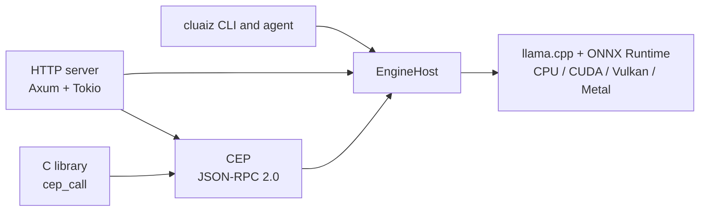

# Master Reference Index

Reference pages for the Cluaiz Engine.

---

## Reference sections

* **[C library and FFI](c-pointer-fii.md)**: `cep_call` / `cep_free` and memory rules at the C boundary.
* **[System dictionary](dictionary.md)**: Terms used in these docs.
* **[Terminal commands](terminal-commands.md)**: What each `cluaiz` command does.
* **[HTTP API](api.md)**: The routes and CEP (`/v1/cep`), with links to every method.
* **[Engine configuration](engine-configuration.md)**: The settings files and their sections.
* **[Automation](automation.md)**: Flows on one page: file, triggers, steps, expressions, errors, methods. What is not built yet is listed in the [Automation README](../automation/README.md).

---

## Architecture quick reference

The full map is in [ARCHITECTURE.md](../../ARCHITECTURE.md).
