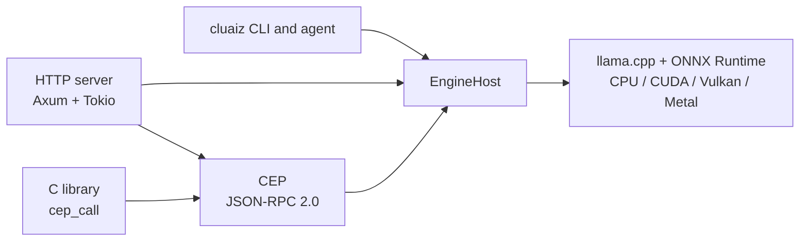

# Master Reference Index

Reference pages for the Cluaiz Engine.

---

## Reference sections

* **[C library and FFI](../reference/c-pointer-fii)** — `cep_call` / `cep_free` and memory rules at the C boundary.
* **[System dictionary](../reference/dictionary)** — Terms used in these docs.
* **[Terminal commands](../reference/terminal-commands)** — What each `cluaiz` command does.
* **[HTTP API](../reference/api)** — The routes and CEP (`/v1/cep`), with links to every method.
* **[Engine configuration](../reference/engine-configuration)** — The settings files and their sections.
* **[Automation](../reference/automation)** — Flows on one page: file, triggers, steps, expressions, errors, methods. What is not built yet is listed in the [Automation README](../automation/README.md).

---

## Architecture quick reference

The full map is in [ARCHITECTURE.md](../../ARCHITECTURE.md).
