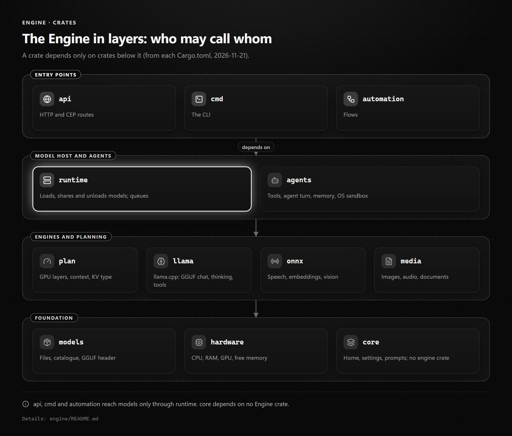
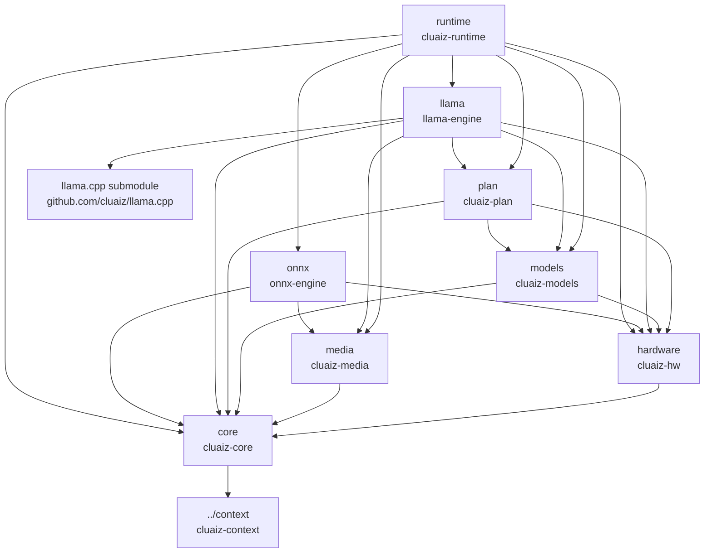
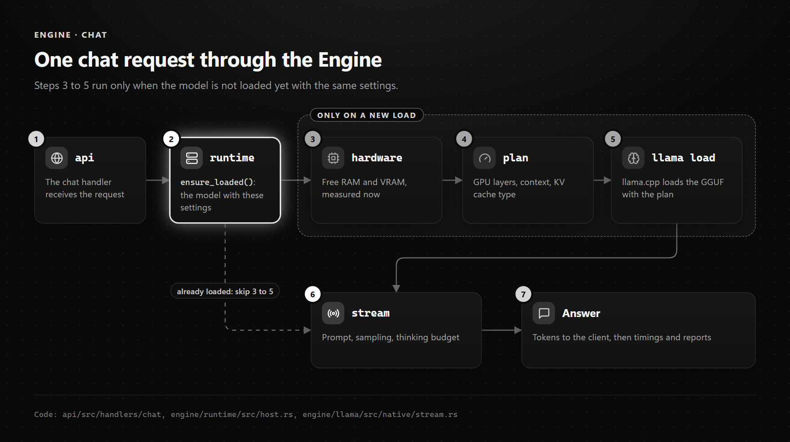
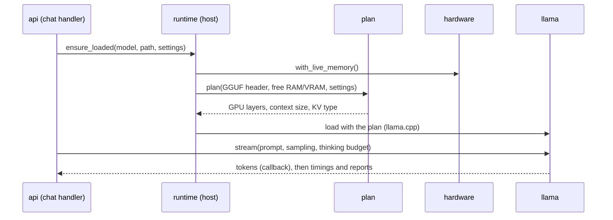

<!-- name: engine
description: The compute layer: settings, hardware, model files, placement, media decoding, the llama.cpp and ONNX backends, and the runtime host. -->

# Component: `engine/` (the compute layer)

## Technical specification

- **Purpose:** everything that runs a model: settings and paths (`core`), hardware facts (`hardware`),
  model files and the catalogue (`models`), where a model's layers go (`plan`), decoding of images,
  audio and documents (`media`), the two backends, llama.cpp for GGUF (`llama`) and ONNX Runtime
  (`onnx`), and the host that loads, shares and unloads models (`runtime`). Code above this folder
  (API, agent, CLI, automation) reaches a model only through `engine/runtime`.
- **Platform support:** Windows, Linux, macOS. GPU backends: CUDA and Vulkan on Windows and Linux,
  Metal on macOS (llama.cpp build features `GGML_CUDA` / `GGML_VULKAN` / `GGML_METAL`,
  `llama/build.rs`); for ONNX Runtime, DirectML on Windows and CUDA when cuDNN is present
  (`onnx/src/engine.rs`, `onnx/src/cudnn_driver.rs`), else CPU.
- **Reusability level:** the Engine's core. Each crate has its own README with the details; this file
  is the map between them.

## How the crates depend on each other

Taken from each crate's `Cargo.toml` on 2026-11-21. An arrow means "depends on".

Rules this graph keeps: `core` depends on no other engine crate (only `context`, the token-budget
rules); `hardware` only on `core`; nothing inside `engine/` depends on `api`, `agents` or `cmd`.

## One chat request through the engine

Details of each step: [`runtime/README.md`](runtime/README.md), [`plan/README.md`](plan/README.md),
[`llama/README.md`](llama/README.md).

## Crates

| Folder | Crate | What it owns | README |
|---|---|---|---|
| [`core/`](core/) | `cluaiz-core` | home folder and paths (`EnvironmentManager`), settings cached in memory (`Settings`, `OptimizationControl`, thinking budget rules), byte units, chat envelope, managed prompts, provider list, tool-call form | [core](core/README.md) |
| [`hardware/`](hardware/) | `cluaiz-hw` | CPU, RAM, disk and GPU facts, saved profile, live free memory | [hardware](hardware/README.md) |
| [`models/`](models/) | `cluaiz-models` | download, catalogue and installed-model registry, GGUF header reader, model taxonomy | [models](models/README.md) |
| [`plan/`](plan/) | `cluaiz-plan` | load placement: GPU layers, context, KV cache type, memory margins | [plan](plan/README.md) |
| [`media/`](media/) | `cluaiz-media` | bounded sources (file, HTTP, inline), image and audio decoding, documents, video through FFmpeg | [media](media/README.md) |
| [`llama/`](llama/) | `llama-engine` | the llama.cpp backend: load, stream, thinking control, tool grammar, MTP, multimodal | [llama](llama/README.md) |
| [`onnx/`](onnx/) | `onnx-engine` | ONNX Runtime models: speech to text, text to speech, embeddings, vision | [onnx](onnx/README.md) |
| [`runtime/`](runtime/) | `cluaiz-runtime` | the host: load, share and unload models for every backend (`ensure_loaded` plans with `cluaiz-plan`, `host.rs:295`), speech and media admission queues | [runtime](runtime/README.md) |

The llama.cpp source is a git submodule at `llama/llama.cpp`, from the `cluaiz/llama.cpp` fork (commit
`17d1465f0`, 2026-11-15, on 2026-11-21). Why a fork and what it changes: [`llama/README.md`](llama/README.md).

## Tests

Unit tests live next to the code (`src/**`, `#[test]`), integration tests in each crate's `tests/`.
Counts of test functions on 2026-11-21 (`#[test]` / `#[tokio::test]`, ignored ones need a model file
or hardware):

| Crate | Unit | Integration | Ignored | Run on 2026-11-21 (Windows 11) |
|---|---|---|---|---|
| core | 57 | 0 | 0 | `cargo test -p cluaiz-core --lib`: 57 passed |
| hardware | 6 | 0 | 1 | `cargo test -p cluaiz-hw`: 5 passed, 1 ignored |
| media | 39 | 14 | 5 | `cargo test -p cluaiz-media`: 49 passed, 4 ignored |
| models | 46 | 12 | 8 | `cargo test -p cluaiz-models`: 50 passed, 8 ignored |
| plan | 54 | 1 | 1 | `cargo test -p cluaiz-plan`: 54 passed, 1 ignored |
| llama | 18 | 2 | 5 | not run here (builds llama.cpp with CUDA) |
| onnx | 69 | 2 | 11 | not run here (ONNX Runtime native build) |
| runtime | 23 | 0 | 0 | not run here (depends on both backends) |

Machine runs with real models (speed, memory, platforms) are recorded in
[`test/cloud/BENCHMARKS.md`](../test/cloud/BENCHMARKS.md), one folder per run in `test/cloud/runs/`.

**Build rule:** build the Engine with `cargo build -p cmd` only. A build of another package or of the
whole workspace can rebuild llama.cpp with CUDA (about 25 minutes on the dev machine).

## Decisions and why

| Decision | Why | Alternative not taken |
|---|---|---|
| Upper layers reach models only through `runtime` | one owner decides what is resident in memory; two callers loading separately would load a model twice | each handler holding its own backend handle |
| `core` and `hardware` depend on nothing else in `engine/` | every other crate uses them; a cycle would make them impossible to test alone | shared types placed in the backends |
| llama.cpp from a pinned fork submodule | changes the Engine needs before upstream has them (listed in `llama/README.md`) stay reviewed and reproducible | following upstream `master` |

## Pending

| Item | Why it matters | Needs |
|---|---|---|
| READMEs of every crate audited against this standard | some predate the decisions/tested/Pending rules (`.agents/skills/readme/SKILL.md` section 4) | the audit in progress, one crate per commit (`hardware` and `core` thinking rules done) |
| llama, onnx and runtime tests run in one place with the counts | the table above has no fresh result for them | a CI job or a recorded run with the native builds |
