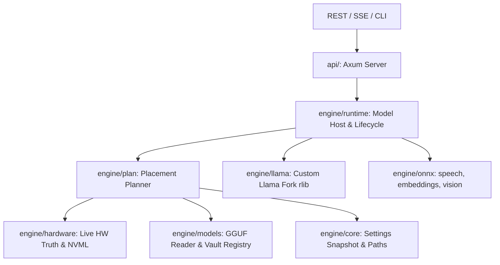

# Cluaiz Compute Subsystem (`engine/`)

The part of Cluaiz that runs models: hardware detection, the placement planner, model files and the two backends, llama.cpp (GGUF) and ONNX Runtime. Everything above it (API, agent, tools, automation) reaches models only through `engine/runtime`.

## Architecture & Data Flow

## Sub-crates & Directories

| Subsystem | Crate Name | Description |
|---|---|---|
| [`core/`](core/) | `cluaiz-core` | Environment paths, RAM-cached settings, units (`GiB`/`MiB`), and engine traits. |
| [`media/`](media/) | `cluaiz-media` | Bounded local/HTTP/inline sources, image/audio decoding and explicit PCM preparation. ONNX consumes the common decoders; typed API/llama delivery remains pending. Core owns decoded-buffer/settings contracts. |
| [`hardware/`](hardware/) | `cluaiz-hw` | Direct hardware truth, NVML GPU probing, CPU/RAM discovery. |
| [`models/`](models/) | `cluaiz-models` | HuggingFace downloader, model vault registry, and single GGUF reader with SWA math. |
| [`plan/`](plan/) | `cluaiz-plan` | Pure mathematical placement planner (Candidates A-F, budgets, and context window). |
| [`llama/`](llama/) | `llama-engine` | Safe Rust wrapper linking the custom llama.cpp fork directly as an `rlib`. |
| [`onnx/`](onnx/) | `onnx-engine` | ONNX Runtime models: speech to text (Whisper, Moonshine), text to speech (Kokoro, Piper/VITS), embeddings and vision. |
| [`runtime/`](runtime/) | `cluaiz-runtime` | The engine host: loads, shares and unloads models for every backend. |
