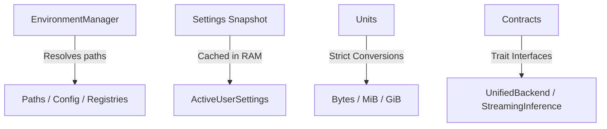

# 🧠 Cluaiz Core (`engine/core`)

Central foundational module for the Cluaiz compute engine. Responsible for single-source-of-truth configuration, paths, unit conversion, and core engine contracts.

## 📐 Architecture

## 📦 Components

| Module | Responsibility |
|---|---|
| [`env.rs`](src/env.rs) | Dynamic root discovery (Dev, Portable, Installed). Zero hardcoded paths. |
| [`settings.rs`](src/settings.rs) | In-memory cached active user settings. Eliminates repeated disk reads. |
| [`units.rs`](src/units.rs) | Strict `GiB`, `MiB`, `bytes` conversion functions. |
| [`contracts.rs`](src/contracts.rs) | Standard engine interfaces implemented by `llama` and `onnx`. |
