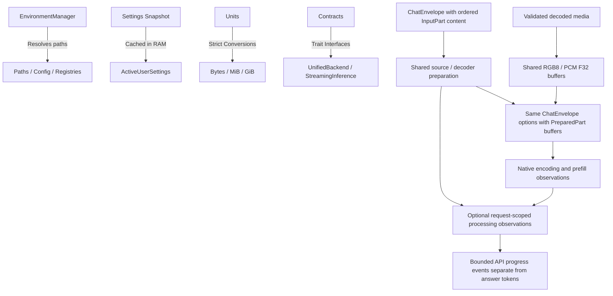

# 🧠 Cluaiz Core (`engine/core`)

Central foundational module for the Cluaiz compute engine. Responsible for single-source-of-truth configuration, paths, unit conversion, and core engine contracts.

`model_assets` describes required files of explicitly supported export manifests. Its data-owned selector, layout requirements, default precision and asset roles are shared by model discovery and native loading. The initial asset descriptor covers the Audio8 valid-prefix FP16 export; prompts, samplers and tensor execution remain backend-owned. Paths pass a shared lexical check plus canonical containment at filesystem consumers. This introduces no models/ONNX dependency cycle or GPU dependency in core.

## 📐 Architecture

## 📦 Components

| Module | Responsibility |
|---|---|
| [`env.rs`](src/env.rs) | Dynamic root discovery (Dev, Portable, Installed). Zero hardcoded paths. |
| [`settings.rs`](src/settings.rs) | In-memory cached active user settings. Eliminates repeated disk reads. |
| [`units.rs`](src/units.rs) | Strict `GiB`, `MiB`, `bytes` conversion functions. |
| [`contracts.rs`](src/contracts.rs) | Standard engine interfaces implemented by `llama` and `onnx`; shared finite L2 embedding normalization rejects empty, zero and non-finite output, and `InvalidEmbeddingInput` distinguishes input rejection from native failure. |
| [`media.rs`](src/media.rs) | Backend-neutral RGB8 and PCM F32 buffers with layout validation and shared immutable storage. |
| [`chat.rs`](src/chat.rs) | One message/envelope definition for text and typed content; generation settings survive content preparation. Existing token estimates/history trimming remain text-only. |
| [`media_limits.rs`](src/media_limits.rs) | Single definition of media byte ceilings, errors and default resource guards. |
| [`processing.rs`](src/processing.rs) | Optional request-scoped backend/transport-neutral stage observations, real work counts, cancellation and source-to-prepared attachment identity. Retains a terminal snapshot for bounded transports; does not infer percentages. |
| [`settings_tests.rs`](src/settings_tests.rs) | Existing settings tests, relocated without changing their visibility or production behavior. |

## Decoded media contract

- **Image:** `DecodedImage::new` accepts non-zero width/height and exactly `width * height * 3` packed RGB8 bytes. Dimension multiplication is checked for overflow.
- **Audio:** `DecodedAudio::new` accepts a non-zero sample rate/channel count and finite, non-empty interleaved PCM F32 samples forming whole frames. It preserves amplitude and sample rate.
- **Ownership:** cloning either value shares its immutable `Arc` buffer. Accessors borrow samples/pixels; no backend owns a second copy just to read them.
- **Failure:** invalid layout returns `MediaBufferError` before backend execution. File-size and decode-allocation budgets belong to the decoding layer, before constructing these buffers.
- **Scope:** these types validate already-decoded data. File decoding, resampling, projector execution and API media delivery are separate implementation steps; this module does not establish end-to-end media inference.
- **Configuration:** `ActiveUserSettings.media` holds `MediaSettings`: shared `limits`, non-zero `http_timeout_ms` and non-zero `projector_workspace_bytes`. Workspace defaults to 1 GiB as a configurable preflight estimate, not a measured native peak or OS reservation. Existing settings files without this section/field load defaults. Imports use the defining core modules directly.

## Typed request contract

- **Shared shape:** `ChatMessage<Content = String>` and `ChatEnvelope<Content = String>` keep the existing text defaults and JSON keys. `ChatMessage::new`, its text token estimate, history trimming and `ChatEnvelope::to_prompt` retain their text behavior.
- **Input:** `media::InputPart<Source = String>` distinguishes ordered text, image, audio, document and video parts. Serde uses a strict `type` tag plus `text` or `source`; unknown types/fields reject. The generic source can hold a resolved owner inside a preparation layer without making core depend on media/HTTP/filesystem libraries.
- **Prepared:** `media::PreparedPart` has text, validated RGB8 image or validated interleaved PCM F32 audio. It is not serialized into a prompt; typed envelopes have no legacy `to_prompt` method. Document/video providers do not yet produce prepared parts.
- **Conversion:** `ChatEnvelope::try_map_messages` awaits one message transformation and retains samplers, thinking settings, budget message, template kwargs, grammar and response format. Any preparation error is returned; no empty/default success envelope is substituted.
- **Accounting:** `PreparedPart::retained_bytes` counts text allocation capacity or decoded RGB/PCM bytes; `modality` reuses `contracts::Modality`. This is content accounting, not a media token estimate or total-process memory limit.
- **Execution boundary:** `cluaiz_media::request::prepare_chat` consumes these contracts. Chat API image/audio parts now reach the paired native runtime through this typed form. CLI legacy text remains supported; typed ONNX/document/video delivery and broader acceptance remain separate phases.
