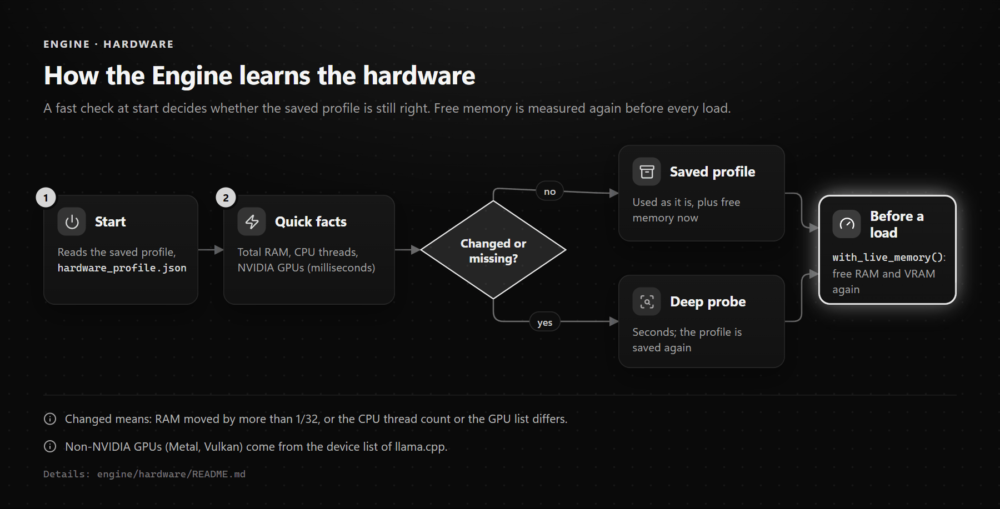
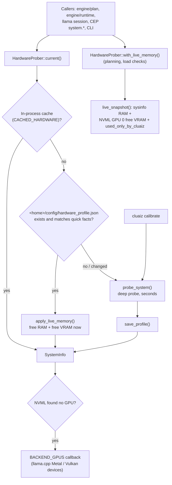

# Component: `engine/hardware/` (crate `cluaiz-hw`)

## Technical specification

- **Purpose:** the one place that finds out what machine the Engine runs on (CPU, RAM, disks, GPUs)
  and how much RAM and VRAM is free right now. The load planner (`engine/plan`), the runtime
  (`engine/runtime`), llama and ONNX sessions, the CLI (`cluaiz status`, `show`) and CEP `system.*`
  read it. It decides nothing itself.
- **Platform support:** Windows, Linux, macOS. NVIDIA GPUs through NVML (not on macOS). Other GPUs
  (Metal, Vulkan) come from llama.cpp's backends through a callback (`set_backend_gpus`).
- **Reusability level:** shared engine utility; no dependency on other engine crates except
  `cluaiz-core` (home folder, byte units).
- **Dependencies:** `sysinfo` 0.30 (CPU, RAM, disks, OS name), `nvml-wrapper` 0.12 (NVIDIA), `raw-cpuid`
  (x86 cache sizes), `libc` on macOS (`host_statistics64`).

## Architectural flow

### What the quick facts are

At each process start the saved profile is compared with facts read in milliseconds
(`quick_facts`, `prober.rs:87`): total RAM, logical CPU threads, and each NVIDIA GPU's name and total
VRAM. Any of them changed (RAM by more than 1/32, to allow small differences between boots) means
the deep probe runs again (`hardware_changed`, `prober.rs:107`). A fact that reads as zero is not a
change.

## API contract

| Construct | Kind | Used by |
|---|---|---|
| `HardwareProber::current()` | static fact snapshot (free memory as of process start) | CEP `system.info`, chat types, CLI bootstrap, llama session, ONNX cuDNN driver, builder CI |
| `HardwareProber::with_live_memory()` | the same, with free RAM and free VRAM measured now | `engine/runtime` (host, native load, ONNX host, speech), CEP `models.*`, `cluaiz status` / `show`, llama session |
| `HardwareProber::probe_live_memory()` | `(free RAM, free VRAM of GPU 0)` in bytes, 0 when unknown | llama session, ONNX engine |
| `HardwareProber::calibrate()` | runs the deep probe again and saves it | `cluaiz calibrate` (`cmd/src/main.rs`) |
| `HardwareProber::set_backend_gpus(fn)` | registers llama.cpp's GPU list (first call wins) | `engine/llama/src/native/core.rs` |
| `SystemInfo`, `CpuSubsystem`, `MemorySubsystem`, `StorageSubsystem`, `GpuSubsystem` | serde types; the whole `SystemInfo` is sent as JSON by CEP `system.info` and the snapshot methods | everywhere above |
| `GpuSubsystem::used_only_by_cluaiz` | `Option<bool>`, live, not saved | `engine/plan/src/margin.rs` (a smaller VRAM margin when nothing else can take GPU memory) |
| `MemorySubsystem::is_unified_memory`, `GpuSubsystem::integrated` | RAM shared with the GPU (Apple Silicon, AMD APU, Intel iGPU) | `engine/plan` (count GPU layers in RAM), `cluaiz status` |
| `telemetry.rs`: `get_pulse`, `LivePulse`, `EngineGear` | background polling thread | nothing (see Pending) |

### Which fields drive decisions, which are only reported

| Field | Used for a decision | Notes |
|---|---|---|
| `memory.total_bytes`, `available_bytes`, `is_unified_memory` | yes, the planner and load checks | macOS free RAM computed as Activity Monitor does (below) |
| `gpus[*].vram_total_bytes`, `vram_free_bytes`, `integrated`, `used_only_by_cluaiz` | yes, the planner | only GPU 0 gets a live free-VRAM reading |
| `cpu.physical_cores`, `logical_threads` | yes (thread counts, change detection) | |
| `cpu.l1/l2/l3_cache_kb`, `isa_features`, `base/boost_clock_mhz`, `gflops_fp32` | no, reported in JSON only | `boost_clock_mhz` is `base x 1.25`, an estimate, and `gflops_fp32` is built on it |
| `memory.bandwidth_gbps`, `memory_latency_ns`, `speed_mts` | no, reported only | from a 64 MB read loop and a pointer chase (`benchmark_memory`) |
| `storage[*]` (speeds, drive type) | no, reported only | see Failure |
| `gpus[*].pcie_*`, `compute_capability` | no (`compute_capability` is shown by CEP `system.info`) | |
| `GpuSubsystem::estimated_vram_bandwidth_gbps()` | no caller | a table by VRAM size, not a measurement |

## Deep file breakdown

- `src/prober.rs`
  - **Cache layers:** an in-process `RwLock<Option<SystemInfo>>`, then `hardware_profile.json` in the
    home's `config/`. The deep probe (memory benchmark, disk write test, PowerShell/WMI calls) takes
    seconds, so it runs once per machine, not per process.
  - **Live memory:** `live_snapshot` opens one NVML session and reads GPU 0's free memory and whether
    any other process or a display uses it (`used_only_by_this_process`: no active display, not a
    Windows WDDM device, every compute and graphics process is this one).
  - **Zero is a real reading:** `apply_memory_snapshot` writes 0 free bytes when the OS says 0, and
    keeps the old number only when the query failed (test below). Before this, an exhausted GPU kept
    showing its start-up free memory.
  - **macOS free RAM:** `macos_available_ram` = total minus app memory (internal pages not purgeable),
    wired and compressor pages, from `host_statistics64`. Why: sysinfo 0.30 reported 0.00 GB free on a
    16 GB M5 Mac once memory was compressed, and the planner refused a 2.9 GB model (comment at
    `prober.rs:671`, test `macos_free_ram_is_total_minus_app_wired_and_compressed`).
  - **Windows Server names:** sysinfo calls every build from 22000 "Windows 11"; for a server the long
    product name and kernel build are used instead (`os_name_and_version`).
- `src/types.rs`: the serde types. `used_only_by_cluaiz` is `#[serde(skip)]` (changes all the time);
  `integrated` has a default so older profiles load.
- `src/telemetry.rs`: a 1-second polling thread that fills `LivePulse` and an `EngineGear` (CPU or GPU
  over 95% = Emergency, over 80% = Survival, CPU over 40% = Balanced). Started lazily by `get_pulse()`;
  no code calls it.
- `src/lib.rs`: re-exports.

## Decisions and why

| Decision | Why | Alternative not taken |
|---|---|---|
| Deep probe once, saved in `hardware_profile.json`, re-run on a quick-facts change | the deep probe takes seconds; RAM added or a resized VM must still be noticed (test `saved_profile_is_stale_after_ram_cpu_or_gpu_changes`) | probe at every start; or never re-probe without `calibrate` |
| Free memory measured live for planning (`with_live_memory`) | free RAM and VRAM change between start-up and a model load | plan from the start-up numbers |
| Non-NVIDIA GPUs from llama.cpp's backends, not a second probing library | llama.cpp is what will use the GPU; its device list and free memory are the numbers that matter for a load | a vendor library per GPU type |
| macOS free RAM computed from `host_statistics64` | sysinfo's figure was 0 on a compressed-memory Mac (above) | trust sysinfo |
| `used_only_by_cluaiz` is `None` when unreadable | the planner then keeps its normal margin rather than guessing a smaller one | default to `false` or `true` |

## Tested

| Test (`cargo test -p cluaiz-hw`) | What it proves |
|---|---|
| `test_zero_free_memory_is_not_replaced_by_stale_startup_values` | a failed query keeps the old number; a reading of 0 is written as 0 |
| `saved_profile_is_stale_after_ram_cpu_or_gpu_changes` | same facts (RAM 100 MB less) = not stale; zeros = not stale; RAM, threads or GPU list changed = stale |
| `macos_free_ram_is_total_minus_app_wired_and_compressed` | the Activity Monitor formula on the M5 numbers; more in use than the total gives 0, not an overflow |
| `backend_gpus_fill_in_only_when_nvml_finds_none` | Metal/Vulkan devices are used only when NVML found nothing |
| `integrated_backend_gpu_shares_the_ram` | an integrated GPU marks the memory as unified |
| `this_machine_matches_a_fresh_probe` (ignored) | a fresh deep probe on this machine is not seen as a change; run with `--ignored` |

Result on 2026-11-21 (Windows 11): 5 passed, 1 ignored.

Real machines: every run in [`test/cloud/BENCHMARKS.md`](../../test/cloud/BENCHMARKS.md) loads models
through these numbers. The macOS RAM formula and the backend GPUs come from the M5 Mac run
[`test/mac/runs/2026-10-28-m5-air-16gb/`](../../test/mac/runs/2026-10-28-m5-air-16gb/SUMMARY.md) (free RAM read
as 0.00-0.75 GB of 16 GB, Metal unused; fixed in `07cf30fa`, not rerun on a real Mac since). Not tested anywhere: the telemetry thread, the storage benchmark, AMD or Intel GPUs
through Vulkan on Windows.

## Failure and recovery

| Failure | What the code does |
|---|---|
| `hardware_profile.json` missing or unreadable | deep probe, then saved |
| Profile cannot be saved | ignored; the next process probes again |
| NVML missing (no NVIDIA driver, macOS) | no NVIDIA GPUs; backend GPUs fill in if llama.cpp registered them |
| A live query fails | the old free-memory number is kept (`apply_memory_snapshot`) |
| `wmic` missing (not installed on this Windows 11 machine on 2026-11-21) | `speed_mts` stays 0 |
| Disk benchmark cannot write to the drive root (`C:\` without admin rights) | read and write speed 0 (seen in a saved profile on 2026-11-21) |
| A poisoned cache lock | recovered (`PoisonError::into_inner`): the last cached profile is still used, as `telemetry.rs` does |

## Sources

- sysinfo 0.30 (`System`, `Disks`), nvml-wrapper 0.12 (`Device::memory_info`,
  `running_compute_processes`, `driver_model`), Apple `host_statistics64` / `vm_statistics64`
  (through `libc`).
- Planner use of these numbers: [`engine/plan/README.md`](../plan/README.md).

## Pending

| Item | Why it matters | Needs |
|---|---|---|
| `telemetry.rs` has no caller | dead code that a reader may think drives "gears" | remove it, or wire it to a real consumer |
| Only GPU 0 gets a live free-VRAM reading | a second NVIDIA GPU is planned from its start-up number | read every device in `live_snapshot` |
| Disk benchmark writes to the drive root | gives 0 without admin rights on Windows; the numbers are unused anyway | write in the Cluaiz home, or drop the benchmark |
| `detect_drive_type` reads the first physical disk for every drive on Windows and prefixes "NVMe/" | wrong label for a second or SATA disk | per-disk query, or drop the field |
| `wmic` is gone on current Windows | memory speed is always 0 there | `Get-CimInstance Win32_PhysicalMemory`, or drop the field |
| Reported-only estimates (`boost_clock_mhz`, `gflops_fp32`, `estimated_vram_bandwidth_gbps`) | they are marked as estimates in the code (`types.rs`) and here, but the JSON field names do not say so | rename them in a versioned API change, or remove them (the App may read them) |
