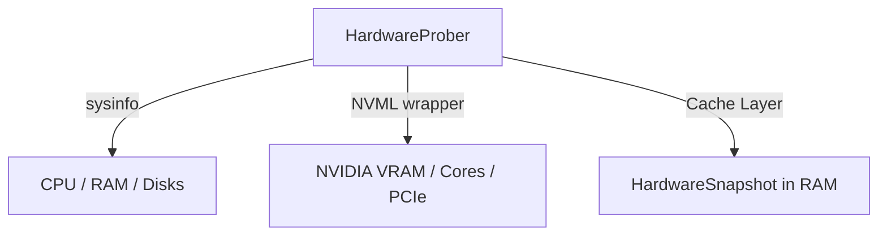

# 🖥️ Cluaiz Hardware (`engine/hardware`)

Single Source of Truth (SSOT) hardware prober and metric evaluator for Cluaiz.

## 📐 Architecture

## 📦 Components

| Module | Responsibility |
|---|---|
| [`types.rs`](src/types.rs) | Typed data structures for CPU, RAM, NVMe/SSD, and GPU metrics. |
| [`prober.rs`](src/prober.rs) | Hardware discovery and fast (<5ms) live RAM/VRAM memory queries. |
