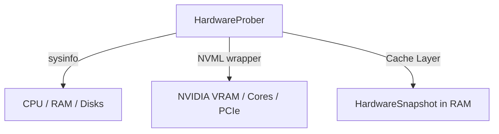

# 🖥️ Cluaiz Hardware (`engine/hardware`)

Single Source of Truth (SSOT) hardware prober and metric evaluator for Cluaiz.

## 📐 Architecture

## 📦 Components

| Module | Responsibility |
|---|---|
| [`types.rs`](src/types.rs) | Typed data structures for CPU, RAM, NVMe/SSD, and GPU metrics. |
| [`prober.rs`](src/prober.rs) | Hardware discovery and fast (<5ms) live RAM/VRAM memory queries. |

## Live telemetry

[`src/telemetry.rs`](src/telemetry.rs): a background thread that polls CPU and RAM from the OS and the GPU through NVML, kept as `ObservableHardwareState` (`LivePulse` with `CpuPulse`, `RamPulse`, `GpuPulse`, `AcceleratorPulse`, and an `EngineGear`: `Pulse` idle, `Balanced`, `Survival` under high pressure, `Emergency` critical).
