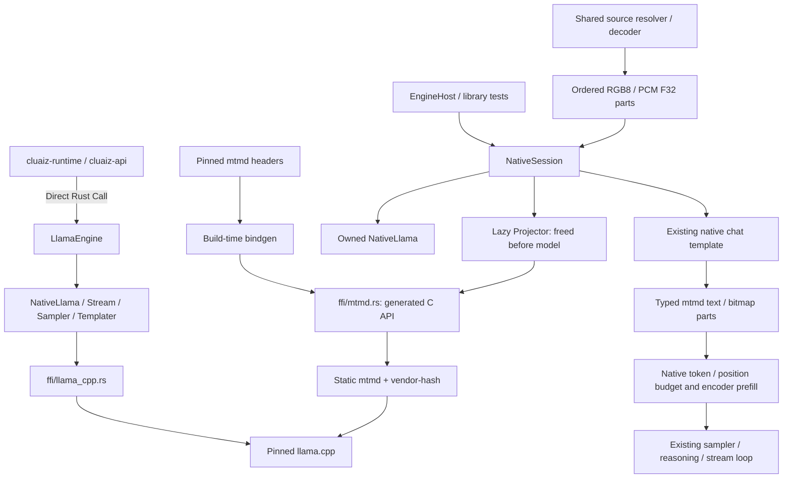
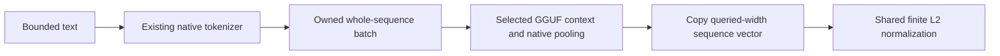
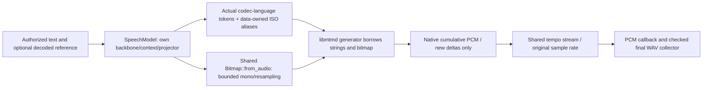
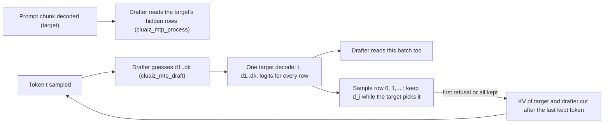

# Cluaiz Llama Engine (`engine/llama`)

Direct Rust API wrapping custom `llama.cpp` C/C++ memory. Compiled as an `rlib` to eliminate dual-static memory copies between Exe and DLL.

`native::speech::SpeechPlacement` accepts the runtime-selected layer count, independent projector device, KV/operation offload flags, generation/batch threads and mmap preference. Explicit CPU mode disables all GPU use. `planning_settings` and `backbone_workspace_bytes` share this owner's fixed context/batch/F16 layout with admission; codec workspace stays in the media policy. Successful `SpeechTimings` separate preparation, frame generation, native codec decoding and output (including consumer backpressure), excluding model load. These measurements are diagnostic, not realtime or peak-memory guarantees.

The native fork backports [upstream EmbeddingGemma-2 support](https://github.com/ggml-org/llama.cpp/pull/30054). The existing text embedding owner queries its projected output width (768 for the installed Q8_0 test package); it does not substitute the 512-wide hidden state. This does not expose GGUF image/audio embeddings through the API. `llama-revision.txt` pins generated fallback clones to the reviewed fork revision; a dirty fallback clone is preserved and refused rather than overwritten. An explicit local native checkout remains the development source.

## Architecture

## Components

| Module | Responsibility |
|---|---|
| [`native/core.rs`](src/native/core.rs) | Safe model instantiation, parameter loading, and memory envelope binding. |
| [`native/stream.rs`](src/native/stream.rs) | Token generation loop, chunked prefill, and reasoning control emission. |
| [`native/sampler.rs`](src/native/sampler.rs) | Llama.cpp native sampler chain (temp, top_p, min_p, penalties). |
| [`native/templater.rs`](src/native/templater.rs) | Direct C-ABI Jinja chat templating from the custom fork. |
| [`ffi/llama_cpp.rs`](src/ffi/llama_cpp.rs) | Raw `extern "C"` bindings to compiled `llama.cpp`. |
| [`ffi/mtmd.rs`](src/ffi/mtmd.rs) | Header-generated multimodal bindings, typed parts, token/position queries and evaluation helpers. |
| [`native/session.rs`](src/native/session.rs) | Paired model/projector lifetime, memory preflight, prepared media/text generation and pointer-free model telemetry used by EngineHost. |
| [`native/media.rs`](src/native/media.rs) | Private projector/bitmap/chunk owners, queried audio preparation, template association and native encoder prefill. |
| [`native/context.rs`](src/native/context.rs) | Shared native batch ownership and context shifting. |
| [`native/speech.rs`](src/native/speech.rs) | Experimental libmtmd speech generator, independent backbone/projector, vocabulary-derived language guard and optional authorized speaker PCM through the shared bitmap owner. |
| [`ffi/reasoning.rs`](src/ffi/reasoning.rs), [`ffi/reasoning_bridge.cpp`](src/ffi/reasoning_bridge.cpp) | Narrow C ABI to the pinned upstream reasoning-budget sampler; no copied budget state machine. |
| [`llama.cpp/`](llama.cpp/) | The underlying C/C++ inference engine with custom M-RoPE and chat C-ABI patches. |
| [`native/projection.rs`](src/native/projection.rs) | What a model and context will take per device, from llama.cpp's own no-alloc dry run (the one behind `--fit`), so the planner can correct its byte estimate (`project`, `ProjectedMemory`, `DeviceBytes`). Nothing is allocated. |
| [`native/load_steps.rs`](src/native/load_steps.rs) | What a chat-model load is doing, for an observer set on the loading thread (`observe`): weights read in percent (llama.cpp's `progress_callback`, set only when someone observes), a fallback llama.cpp's own load took, context creation, warmup. Used by `engine/runtime` load events. |
| [`native/tokenizer.rs`](src/native/tokenizer.rs) | One native tokenizer (`VocabHandle`) for chat and embedding contexts. |
| [`native/media_tests.rs`](src/native/media_tests.rs) | Tests of the media owners. |
| [`ffi/chat.rs`](src/ffi/chat.rs) | Narrow C ABI to `chat_bridge.cpp` for native tool calls: llama.cpp's common chat layer renders tools in the model's own format (`ChatTools::apply`), gives the lazy tool-call grammar, parses the output (`ChatParser::parse`, partial too) and turns a JSON schema into a grammar (`json_schema_grammar`). |
| [`native/speculative.rs`](src/native/speculative.rs), [`ffi/speculative_bridge.cpp`](src/ffi/speculative_bridge.cpp) | MTP speculative decoding, experimental, off unless `CLUAIZ_MTP=on` (`CLUAIZ_MTP_DRAFT` = guesses per step, default 3 as llama-server). A model with NextN layers (Qwen3.5 / 3.6, GLM-4.5+, DeepSeek-V3, ...) is loaded with `load_mtp`; llama.cpp's own `draft-mtp` drafter (`common_speculative`) guesses the next tokens on an MTP context; `stream.rs` decodes the token and its guesses in one batch and keeps a guess only when the target's sampler picks it, so the answer is the target's. The drafter sees every target decode (prompt chunks too). Media prompts do not draft; a context shift stops drafting for that answer. Its memory is not in the load plan yet. |
| [`moe_override.rs`](src/moe_override.rs) | `--n-cpu-moe N`: the routed experts of the first N blocks stay in RAM (a CPU buffer), everything else of those blocks (attention, shared weights, KV) on the GPU; the same tensor overrides llama.cpp builds (`CpuMoeOverrides`). |

## Native text embedding boundary

`native::embedding::EmbeddingModel` takes an embedding-enabled `NativeLlama`, retaining its existing model/context destructor. It queries native pooling and output width rather than selecting a model by name. Mean, CLS and last-token sequence pooling are accepted; no-pooling, reranking and encoder-decoder models return an error. Whole-sequence evaluation uses the existing RAII batch and tokenizer; inputs beyond the active sequence limit are rejected without truncation. Sequence output is copied before the next native operation and normalized through `cluaiz_core::contracts::normalize_embedding`. This boundary alone does not wire the HTTP endpoint or certify arbitrary GGUF exports.

The opt-in `tests/embedding.rs` fixture takes external model paths/text, checks repeated and distinct inputs, one supplied semantic ranking, normalized finite output, oversize refusal and recovery. This is selected-model acceptance, not general retrieval quality or GPU/platform certification. Speech integration additionally accepts `CLUAIZ_TTS_TEST_GPU_LAYERS` and `CLUAIZ_TTS_TEST_CODEC_GPU` for actual split-placement PCM/tempo/cancellation/recovery checks; neither is a production setting.

## GGUF speech ownership

`SpeechModel` does not borrow or evict the chat model. Speaker sources are authorized/decoded above this layer; it never opens arbitrary user paths. Native input rate is queried from the projector and shared PCM conversion/copy budgets apply. The reference bitmap and input strings outlive the generator. `speak_pcm` polls the existing public native helper every 16 generated frames and once at the end, validates its cumulative F32 layout/rate, and forwards only newly generated samples through shared tempo. Native decoder state is retained across flushes; more frequent flushing can affect quality/performance and requires model acceptance. The old `speak` entry collects the same output as a checked PCM16 WAV. Cancellation and callback errors stop at prompt/frame boundaries; a single native operation/load is not preempted. The generator is dropped before the projector/context/model; a frame-limit failure returns an error instead of truncated success (a streaming caller may already have received earlier valid parts). Language support is queried from actual codec-language vocabulary tokens; ISO aliases are data in `native/data/speech_languages.json`. The pinned API is experimental, and arbitrary voice/model/language quality needs native acceptance rather than a registry declaration.

The opt-in `speech_stream` integration test accepts `CLUAIZ_TTS_TEST_THREADS` (integer, default 2) and `CLUAIZ_TTS_TEST_GPU` (boolean, default false) alongside its externally supplied model, projector, text and output paths. It prints native load time and first-utterance synthesis time separately. These controls belong to the test harness; they do not change production placement or establish real-time audio quality.

## Native reasoning control

- **Tags and budget:** actual template/model tags and the existing context-aware token budget configure the upstream sampler. A prompt already inside reasoning starts counting immediately; otherwise the gate waits for a real start sequence. No model-name rules or fixed reasoning tags are used.
- **Ownership:** `SafeSampler` owns a composed chain: the reasoning gate precedes the existing already-prefilled user chain. The borrowed `ReasoningHandle` is used only on that generation thread while the root lives. Root destruction frees both samplers once. Initialization errors leave the old chain with its caller.
- **Skip:** `NativeSession` retains the request's `Arc<AtomicBool>`; no global skip pointer is used. Before sampling, the gate receives the manual-force request. It forces the configured optional message and real end sequence through normal accept/decode/history handling, then sampling continues. The API parser waits for that sequence rather than declaring reasoning complete itself.
- **Unclosed thinking:** when the model ends its turn (end of generation) while its thinking is still open, its answer or tool call is inside the thinking, where the parser does not take it. The gate then forces the same end sequence once and sampling continues, so the model writes its answer or call outside thinking (with the tool-call grammar awake). This happens at most once per generation.
- **Report:** `ThinkingReport.ended_by` distinguishes an accepted native `skip`, automatic `budget` forcing, thinking `closed` after the model ended inside it, and a natural `model` end. The HTTP control acknowledgment alone does not prove that the model has reached the answer.
- **Limits:** a skip is observed between native sampling/decode operations. It cannot make an in-flight kernel instantaneous or guarantee answer correctness, brevity or every model's instruction following. Cancellation remains a separate control. Platform/model coverage requires actual acceptance runs.

## Multimodal linkage contract

- **Build inputs:** `build.rs` reads this checkout's `mtmd-helper.h`, including `mtmd.h`, `llama.h` and ggml headers. It generates the allowlisted C API into `OUT_DIR`; no generated binding file is committed.
- **Build dependencies:** bindgen requires a discoverable libclang installation in addition to the existing CMake/C++ toolchain. `LIBCLANG_PATH` can point to its library directory. Cross builds require the target's headers/sysroot as well.
- **Static targets:** `LLAMA_BUILD_MTMD=ON`, `BUILD_SHARED_LIBS=OFF`. Cargo explicitly links `mtmd` and its `vendor-hash` dependency alongside the existing llama/ggml libraries. Header-only vendor dependencies are compiled into mtmd.
- **Standalone programs:** tools, examples, server and app remain disabled. `MTMD_VIDEO=OFF` disables mtmd's FFmpeg subprocess decoding; the shared media crate owns source decoding.
- **ABI:** parameter structs and callback signatures come from the same pinned headers used to compile C++. Generated size/alignment/offset tests check the Rust layout on the build target.
- **Native buffers:** `mtmd_bitmap_init` copies validated RGB8; `mtmd_bitmap_init_from_audio` copies PCM F32 samples. The latter expects audio already prepared for the loaded encoder's sample rate and mono layout. A bitmap must be freed exactly once; chunk lists have a separate native free function.
- **Failure boundary:** missing libclang, incompatible headers or unresolved static symbols fail the build. Raw FFI remains unsafe; callers must retain model/context lifetimes and serialize encoder evaluation.
- **Current limit:** prepared image/audio prefill and generation are connected to EngineHost and the existing chat API. Whole-message media history fitting, document/video providers and further platform acceptance remain P4/P8/P9 work. Runtime availability uses actual loaded encoder/pairing evidence; declarations alone do not initialize a projector.

## Paired projector lifecycle

- **Ownership:** `NativeSession` consumes a loaded `NativeLlama`. Its optional projector field precedes the model field, so the native projector and callback state are freed before their model. Native model pointers are not exposed mutably through this owner.
- **Reuse identity:** canonical projector path, size/modified time, actual encoder threads, GPU preference, RAM/VRAM buffer settings and weight/workspace estimates. Per-request decoded size is excluded, so a different image size alone does not reload the encoder. A different load identity unloads the previous projector before new allocations. Under host-RAM pressure, the idle projector is reclaimed before a fresh admission attempt; Chat model placement/context/KV remain unchanged. Stat checks cannot detect a same-size/same-time content replacement; metadata is checked again after load.
- **Budget:** `cluaiz_plan::media_budget` reuses existing safety-buffer policies against freshly queried free memory after old-projector unload. Unknown/zero free memory is not replaced by a stale cached value. Host cost includes weights, workspace and retained decoded copies; GPU cost also includes weights/workspace plus its safety buffer. CPU placement is chosen when the GPU estimate does not fit.
- **Estimate boundary:** callers supply non-zero weight/workspace estimates; weights must cover at least the file size, decoded data obeys media limits. This is a preflight estimate, not an OS reservation or a measured native peak. It does not eliminate races with other processes or promise allocation success. Encoder expansion/workspace still needs measurement with actual requests.
- **Encoder evidence:** successful `mtmd_init_from_file` performs upstream embedding-width checks. `mtmd_support_vision`, `mtmd_support_audio` and `mtmd_get_audio_sample_rate` then populate `ProjectorSupport`. These queries do not prove transcription quality, model answers or an enabled API route.
- **Cancellation/error:** a retained atomic flag is passed to the native load-progress callback. Native null results, invalid rates and changed-file checks return errors; local owners drop on Rust-side failure. Prepared generation probes free memory again for configured workspace and the additional geometry-derived native conversion peak; it no longer charges the full configured decoded ceiling. Already-resident source Arcs and weights are not counted as new allocations. Failed/cancelled prefill or a stopped consumer clears the partial model memory and returns an error. No automatic driver-failure retry is implemented here.
- **Lifecycle tests:** an ignored Rust test takes `CLUAIZ_MEDIA_MODEL` and `CLUAIZ_MEDIA_PROJECTOR`. It loads real weights on CPU and checks support against package declarations, same-session reuse, changed-thread reload, unload, missing file and paired drop. No complete native-leak/OOM assertion is made.

## Prepared media generation contract

- **Interface:** `NativeSession::stream_prepared` consumes `ChatEnvelope<Vec<PreparedPart>>`, the output token budget, the loaded model's `StructuralDNA`, request settings and a streaming consumer. It requires a successfully loaded paired projector. Source resolution stays in `cluaiz_media`; this native adapter receives decoded buffers only.
- **Audio:** common `prepare_mono` and `resample_linear` prepare finite PCM F32 at the encoder's queried rate. Channel mixing retains amplitude without automatic peak normalization. The native constructor copies samples; the pinned implementation uses a checked 32-bit sample count internally. The adapter does not duplicate audio decoding or implement the model's learned encoder.
- **Image:** validated RGB8 dimensions and byte layout go to the real copying bitmap constructor. Native mtmd owns model-specific resizing, patches and learned encoding. Unsupported loaded encoder inputs fail before evaluation.
- **Association:** collision-checked request placeholders keep ordered text/media positions through the existing chat template. Every placeholder must survive exactly once and in order. They are replaced with typed text/bitmap parts before tokenization; literal user text such as `<__media__>` is not interpreted as a bitmap delimiter.
- **Accounting:** aggregate retained media and conservative conversion/copy peaks obey the configured decoded ceiling. Native token and position queries, rather than pixel/sample counts, determine context usage. The larger native count must fit `n_ctx - (max_tokens + 16)`. On overflow, the configured context-shifting policy may remove complete oldest turns using the shared core turn selector, then count the remaining prompt again before learned encoding. The leading system message and the latest user turn/attachments (including its tool continuation) stay intact; Off refuses overflow. Removed native bitmaps are freed and retained IDs still refer to the original uploaded parts. Context reports include removed messages and the measured reduction in occupied positions. A current document/image that cannot fit is refused explicitly with active/input/output counts; no silent content truncation, context increase or multimodal KV shift is used.
- **Prefill:** the adapter orchestrates pinned native `mtmd_encode_chunk`, `mtmd_helper_decode_image_chunk` and text `mtmd_helper_eval_chunk_single` calls in the original order. Upstream still owns positioning, batching and attention behavior. Post-decode callbacks expose actual processed embedding batches; encoding counts represent native slices associated by copied bitmap IDs with the uploaded part. Last-text-chunk logits enter the existing sampler/reasoning/output loop. Raw bitmap copies are released after prefill; source Arcs needed by API/tool continuations remain owned. Sampler history receives real text tokens, without invented media token IDs.
- **Cache boundary:** media turns accept no text-only prefix cache and return no prefix token history from `NativeSession`. An existing text-only caller retains its original API and prefill path. Agent continuation and mixed-history cache reuse are not yet integrated.
- **Budget boundary:** conversion accounting retains the full original source-buffer footprint while native copies coexist, including API-held Arc clones. Rendered text/template allocations and native workspace expansion are covered only by the conservative workspace policy, not measured individually. Caller-supplied workspace estimates are not measured peaks or OS reservations. Source decode/tokenization cancellation latency and GPU/Linux/macOS behavior remain unmeasured.
- **Observed audio proof:** on Windows CPU, the ignored `test_session_media_online_audio_and_text_regression` loaded the installed Gemma E4B Q4_K_M plus BF16 companion and fetched a public [PyTorch speech demo](https://docs.pytorch.org/audio/2.5.0/tutorials/speech_recognition_pipeline_tutorial.html). Actual model output was `i had that curiosity beside me at this moment`, matching the published transcript. Native logs showed 85 audio tokens. The same test rejected an excessive output reservation and a stopped consumer, then successfully ran text chat again: `1 passed; 0 failed`, 38.86 seconds. Model/projector/demo URL and expected text come from test environment variables; the expected transcript is never supplied to the model prompt.
- **Observed image proof:** `test_session_encoded_images_change_answers_and_recover_text` used the same installed CPU model/projector pair and the same question for three encoded 128x128 fixtures: red PNG returned `Red`, blue PNG returned `Blue`, and blue JPEG returned `Blue`. Actual data URIs pass through `SourceResolver`, `prepare_chat`, the shared RGB decoder, native image encoder and the existing generation loop. Native logs show 81 image tokens per fixture. Ground-truth colors are asserted only in the test, never supplied in the prompt. The temporary resolver directory is empty after requests and plain text generation succeeds afterward: `1 passed; 0 failed`, 61.13 seconds. Image encoding, base64 and temporary-directory dependencies are test-only; no production decoder/encoder was added by this test.
- **HTTP evidence:** `api/tests/media_contract.rs` additionally exercises actual loopback JSON/SSE chat routes, including one image plus inline audio request and image-preserving continuation. The final native CPU run passed in 104.92 seconds with fixture-specific configured workspace/decoded ceilings; see the API README for scope and resource refusal evidence.
- **Proof limits:** the speech and solid-color fixtures do not certify App UI behavior, photographs, multiple images in one turn, full transcript accuracy across languages, driver failure recovery or full model/platform coverage. Upstream logs label audio experimental.

## MTP speculative decoding (experimental)

- **Status:** built and measured on one machine (RTX 3050 Laptop 4 GB, CUDA, Windows). Off by default,
  switched on with `CLUAIZ_MTP=on`. Commit `d9ae0a48`.
- **Files:** `native/speculative.rs` (Rust owner `MtpDrafter`), `ffi/speculative_bridge.cpp` (C ABI),
  `native/stream.rs` (prefill hook, draft and check in the generation loop), `native/core.rs` (load),
  `native/sampler.rs` (`sample_token_at`).

### What it does

Some models ship multi-token-prediction ("NextN") layers trained to predict tokens further ahead:
Qwen3.5 / 3.6, GLM-4.5 and later, DeepSeek-V3, Step-3.5, MiMo and others (`src/models/*.cpp` in the
pinned llama.cpp lists the graphs that use them). The NextN layers guess the next few tokens; the
target model checks all guesses in one decode; every guess its own sampler would have picked is a
token gained without a decode of its own. The text does not change, because a guess is kept only when
the target's sampler picks the same token.

### Decisions and why

| Decision | Why | Alternative not taken |
|---|---|---|
| Use llama.cpp's own drafter (`common_speculative`, type `draft-mtp`) through a C bridge | Same code as `llama-server --spec-type draft-mtp`; head modes per model (Gemma 4 shared KV, Step-3.5 chained heads, Qwen single head) stay upstream's job and follow llama.cpp updates | Re-implementing the drafter in Rust: duplicate logic that drifts from upstream |
| Target decode and the check stay in Rust (`stream.rs`) | The Engine's sampler chain (reasoning budget, lazy tool grammar, JSON schema check, penalties) must judge every token; llama.cpp's `common_sampler` is not the Engine's chain | `common_sampler_sample_and_accept_n`: would bypass the Engine's sampler |
| Each kept guess goes through the normal per-token path before the next row is sampled | Grammar and thinking state change after a token (the end of thinking wakes the tool grammar); sampling row i+1 before handling token i would use stale state | Sampling all rows first, then emitting |
| Load with `load_mtp` only when MTP is asked for | NextN tensors are skipped unless asked (`llama-model.cpp:4118`); loading them always costs memory for nothing | Always load |
| Target context gets `n_rs_seq = draft size` | Hybrid / recurrent models (Qwen3.5) can roll back refused guesses only with recurrent snapshots (`common_params_speculative::need_n_rs_seq`) | Checkpoint and restore the whole state per step |
| MTP context `n_outputs_max = 1` | The drafter reads one token per step (`common_base_params_to_speculative`). Without it the context kept logits for 512 rows: +0.63 GB on a 248k vocabulary, spill into shared GPU memory, 26 t/s instead of 68 (measured, fixed before the commit) | llama.cpp's default (n_batch outputs) |
| Draft size 3 (`CLUAIZ_MTP_DRAFT`) | llama-server's default `--spec-draft-n-max 3`; reports show acceptance falls with longer drafts (72% at 3, 83% at 2, 44% at 6 in the sources below) | Larger drafts |
| No drafting for media prompts and after a context shift | The drafter did not see the media embeddings; after a shift its positions no longer match the target's. Both only lower acceptance, so there is no gain to keep | Feeding media rows to the drafter (not built) |
| Off by default | Measured on one GPU only; several setups lose speed (table below); its memory is not in the load plan | On by default |

### Measured

RTX 3050 Laptop 4 GB, Windows, CUDA. `unsloth/Qwen3.5-2B-MTP-GGUF` Q4_K_M (NextN inside the file),
`n_gpu_layers 99`, context 4096, temperature 0, `/v1/chat/completions`, three runs after one warm-up.
llama.cpp b12534 (official Windows CUDA 12.4 build) on the same file and settings, run in the same
hour.

| Run | Without MTP | With MTP | Guesses kept |
|---|---|---|---|
| Cluaiz, 222-token answer | 67.8 t/s | 85.1 t/s | 64% |
| llama-server b12534 | 66.6 t/s | 82.0 t/s | 145 / 228 |
| Cluaiz, thinking on (268 tokens) | 66.0 t/s | 95.3 t/s | 75% |
| Cluaiz, JSON schema answer (39 tokens) | 50.9 t/s | 76.0 t/s | 79% |

- Text: identical with and without MTP in all six Cluaiz comparisons (byte compare of the answers).
- VRAM after load: 1.83 GB without, 1.96 GB with MTP.
- Placement changes the text: runs with 22 and 23 GPU layers gave different greedy answers, so text
  and speed comparisons pin `n_gpu_layers`. llama-server's own plain and MTP answers also differed.

### Where MTP is expected to lose (from sources, not measured here)

Speculative decoding speedup is `E / (v + g*c)`: `E = (1 - a^(g+1)) / (1 - a)` tokens per target run
(acceptance `a`, draft size `g`), `v` = time to check `g+1` tokens over the time for one, `c` = drafter
cost over target cost (Leviathan et al., Equation 1 and Theorem 3.8; the theorem assumes `v = 1`).
With all weights in VRAM a decode is limited by reading the weights once, so `v` stays near 1. It
grows, and MTP can lose, when:

| Setup | Reason | Source |
|---|---|---|
| MoE with experts in RAM (`n_cpu_moe`) | each checked token can route to other experts: more expert bytes read and computed on the CPU | ik_llama.cpp issue 1630; PR 22673 comment (6 GB laptop, 35B-A3B: best gain at draft 2) |
| Low VRAM | NextN weights and the MTP context push layers off the GPU or spill to shared memory | PR 22673 (27B: +2.49 GiB); our 26 t/s run above |
| Metal with K-quants at draft 1-2 | the small-batch kernel `mul_mv_ext` covers Q2_K..Q6_K only for 4-8 rows, IQ2/IQ3/IQ4_XS not at all | `llama.cpp/ggml/src/ggml-metal/ggml-metal-ops.cpp:2763-2790`; issue 23752 (M1 Max, 9B Q4_K_M: 25.3 t/s plain, 21.9 at draft 2) |
| Long prompts | the drafter reads the target's hidden rows on every prompt chunk | PR 22673: prefill 1315 -> 665 t/s, "mainly due to Device-To-Host (D2H) embedding transfers" |
| Sampling at temperature > 0 | the sampled token must equal the drafter's greedy guess | follows from sample-and-match; not measured |

### Failure and recovery

- Drafter cannot be made (no NextN layers, context creation fails): logged, the model runs without MTP.
- Drafter fails to read a batch: drafting stops for that answer; generation continues plain.
- Target cannot drop refused guesses (`llama_memory_seq_rm` false): the answer stops with `stop = error`
  and an error line. Not seen in tests.
- Generation stops with guesses unchecked: the KV of both contexts is cut back to the last kept token.

### Sources

- Leviathan, Kalman, Matias, *Fast Inference from Transformers via Speculative Decoding*, arXiv 2211.17192 (formulas read from the PDF).
- llama.cpp PR 22673 (MTP support): https://github.com/ggml-org/llama.cpp/pull/22673
- llama.cpp issue 23752 (MTP slower on an M1 Max): https://github.com/ggml-org/llama.cpp/issues/23752
- ik_llama.cpp issue 1630 (MoE offload with speculative decoding): https://github.com/ikawrakow/ik_llama.cpp/issues/1630
- Pinned llama.cpp: `common/speculative.cpp` (`common_speculative_impl_draft_mtp`, `common_speculative_init_result`), `examples/speculative-simple/speculative-simple.cpp` (the loop this follows).

### Pending

| Item | Why it matters | Needs |
|---|---|---|
| Auto on/off: MTP only when it does not change the placement, off with experts in RAM, measured per model and placement in `cluaiz bench` | MTP should be on by default where it is faster and off where it is slower | design proposed 2026-11-19; not built |
| Memory of MTP in the load plan | a model that just fits may spill with MTP on | planner work (parked) |
| Tests: GPU + RAM split, MoE `n_cpu_moe`, CPU only, weights larger than RAM, draft 1-4, temperature > 0, long prompt prefill | each can turn the gain into a loss (table above) | laptop runs |
| Metal and Vulkan runs | reports disagree on Metal; Vulkan had wrong output in early reports | a Mac and a Vulkan machine |
| Gemma 4 MTP sidecar file (`mtp-*.gguf`) | `pull` downloads it, the Engine does not use it | load it as a draft model (`common_speculative_init_result` takes its path) |
| A setting / CLI flag and drafted/accepted counts in the engine report | env var only today; numbers only in the log | after Auto is decided |
