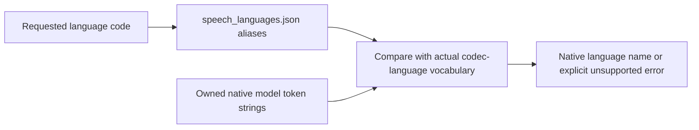

# Component: Native speech policy data

## Technical Specification
- **Purpose:** ISO language aliases for the native speech input adapter and regression inputs. This data is not an advertised model-support list.
- **Platform Support:** Embedded JSON, platform neutral; native acceptance depends on the compiled backend and model.
- **Reusability Level:** Private to the native speech wrapper.

## Architectural Flow

## API Contract
- **Consumer:** `speech.rs::resolve_language`; embedded with `include_str!`, parsed by serde_json.
- **aliases:** ISO code to native codec-language token name. Region subtags are reduced before alias resolution. Names already present in the vocabulary can be used directly.
- **tests:** Requested code, actual supported-name fixture and expected name/error. Test data does not generate speech or replace model output.
- **Source:** Pinned llama.cpp `tools/mtmd/mtmd-helper-gen.cpp::tts_lang_codes`; aliases describe the existing protocol. Support is queried from the loaded model, not assumed from these aliases.

## Deep File Breakdown
- **speech_languages.json:** Declarative aliases and test cases. No model paths, synthesized recordings, language-specific Rust word replacement or network fetch.

## Failure and Recovery
- **Invalid JSON:** Returns an error through native speech input preparation.
- **Missing alias:** Uses the normalized requested name; if the vocabulary lacks it, returns an error naming the request and supported names.
- **Missing language token:** Does not silently choose another speech model. Omitted/auto language is handled by the caller/native default, independently of this support check.
