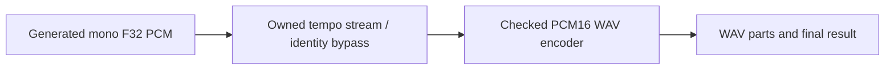
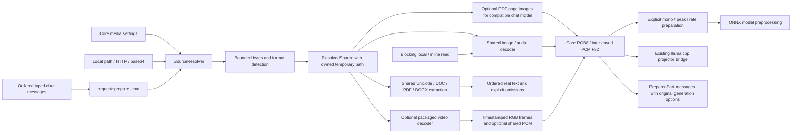

# Component: Cluaiz Media

## Technical specification

- **Purpose:** shared bounded source preparation, extensible format detection, owned temporary assets, image-to-RGB8 and audio-to-PCM F32 decoding, and model-independent document text extraction/chunking. Core remains the sole owner of decoded-buffer and settings/limit contracts.
- **Platform evidence:** unit tests target the available Windows host. Opus decoding uses native libopus through the existing audiopus dependency; its other-platform build/package/runtime behavior remains unverified.
- **Reuse:** imported directly by API/CLI consumers and either inference backend, without depending on a model registry or inference engine.
- **Speech output:** `wav::encode_pcm16` writes checked mono PCM16 WAV and rejects invalid samples/rates/RIFF sizes or configured decoded-buffer budgets. ONNX and native GGUF speech share it. Encoding failures propagate to the request.
- **Tempo:** `tempo::Tempo` owns one Sonic native stream through pinned `sonic-rs-sys` bindings (MIT bindings, Apache-2.0 Sonic). Speed 1 bypasses transformation; other supported speeds use pitch-preserving tempo at the original sample rate. Writes are buffered into Sonic-derived analysis quanta so caller chunk sizes do not change output; `finish` drains the tail once. Byte preflights bound Rust output and estimate native workspace, not an OS memory reservation. Other-platform native builds and human quality need separate acceptance.

## Architectural flow

## API contract

- **Policy:** `MediaLimits::new(max_input_bytes, max_decoded_bytes)` requires non-zero ceilings supplied by the caller. The policy supports Serde configuration round trips.
- **Checks:** `check_input_bytes` validates a file/running download count; `check_decoded_bytes` validates planned decoded bytes. Exact limits are accepted; one byte above returns `MediaLimitError::Exceeded` with the resource kind and counts.
- **Ownership:** import buffers directly from `cluaiz_core::media` and byte limits directly from `cluaiz_core::media_limits`. No forwarding module or duplicated implementation exists in this crate.
- **Source:** `SourceResolver::resolve` accepts local paths, file URIs, HTTP(S) URLs and padded base64 data URIs. A caller-provided authorization callback receives the canonical local path before any content read.
- **Blocking source:** `source::read_local_or_inline` reuses the same bounded file read/data URI parser for existing synchronous backend callers. It accepts local/file URI/inline sources; remote URLs must first pass through `SourceResolver`. No nested Tokio runtime is created. Backend request-boundary permission enforcement remains a caller responsibility.
- **Lifetime:** cloned `ResolvedSource` values share a generated temporary path. The last owner removes generated assets; user-owned local files are never removed by this owner.
- **Detection:** `FormatRegistry` uses content signatures plus explicit custom registrations. MIME/extension hints are not proof of a working decoder; specific contradictory hints return an error.
- **Planner descriptors:** `unique_extensions` preserves every supplied decoder extension alias and removes identical duplicates only; it does not expand MIME registries into invented support. Native video format enumeration retains one verified package-identity result; manifest/declared-file stamp changes invalidate it, and missing packages are retried on a later query. Chat planning reports video-to-image preparation separately from native inputs, and omits that route if no loadable decoder exists. Actual decoding still validates the selected file and uses the existing provider owner. Text-extension aliases remain document-extraction metadata and are omitted from Chat planning.
- **Audio:** `audio::decode_audio(Vec<u8>, limits)` consumes encoded bytes and returns original interleaved F32 channels/rate without model-specific mono conversion or peak normalization. Symphonia identifies containers/codecs; native Opus is selected only for a confirmed Opus codec with a supported mono/stereo mapping-zero header. Opus output uses the decoder's 48 kHz rate and applies header gain.
- **Preparation:** `resample::prepare_mono` averages channels. `PeakNormalization::Preserve` retains amplitude; `LimitToUnit` explicitly retains legacy ONNX STT scaling only for peaks above one. `resample_linear` changes the rate with the prior linear-interpolation algorithm, generalized to interleaved channels. Unchanged layouts share the original Arc buffer.
- **Typed request:** `request::prepare_chat` takes `ChatEnvelope<Vec<InputPart>>` and returns `ChatEnvelope<Vec<PreparedPart>>`. It preserves roles, part order, text and every generation option. Source resolution uses the supplied canonical-path authorization policy; image/audio decoding uses the existing common decoders on Tokio blocking workers. There is no filename-to-text fallback.
- **Request budget:** retained text/RGB/PCM content is counted across all messages; each decoder receives the remaining decoded-workspace ceiling. Temporary input files are dropped after bytes are read; prepared data owns shared buffers for later consumers/continuations. Other request metadata, encoded source strings, decoder-library internals and model allocations are not a proven total-process memory bound.
- **Document providers:** Unicode text/code, legacy DOC and PDF/DOCX text extraction are shared. BOM-marked UTF-16 uses the same content reader; ordinary UTF-8 needs no language-specific parser. Legacy DOC uses a native Rust reader with optional features disabled, borrowing text without requesting rich rendering or image decoding. Packaged native OCR recognizes image/scanned-page text when its assets are present. Parser-owned allocations are not a proven process-wide memory bound.
- **Video:** `video::decode` / `decode_with_assets` return timestamped shared RGB frames and optional PCM using the existing audio decoder. The optional native decoder has one actual implementation in [`providers/ffmpeg`](providers/ffmpeg/README.md); main-engine startup never links FFmpeg. `InputPart::Video` expands in place to alternating real timestamp text/image parts and optional full-track audio, preserving surrounding message content. It is sampled image analysis, not an intrinsic temporal-model or audio/video synchronization claim.
- **Video policy:** `settings.media.video` defaults to 1000 ms sampling, 16 sampled frames, 30000 ms duration/decode deadline, 4194304 native pixels, 100000 packets and 10000 decoded frames. Zero values fail deserialization. Exceeding a ceiling rejects rather than silently truncating. Model context is checked by the existing native media/token path; these sampling limits do not guarantee a clip fits every model.
- **Dependencies:** core, reqwest, Tokio, tempfile, base64, infer, mime_guess, image, Symphonia, audiopus/libopus and Rayon. Hound is a test dependency. Neither ONNX nor llama.cpp is imported.

## Files and failure behavior

- `src/lib.rs`: actual source/format modules; callers import core contracts from their owning module.
- `src/source.rs`: bounded source reads, reusable HTTP client and temporary-file lifetime.
- `src/formats.rs`: extensible signature registry and MIME validation.
- `src/image.rs`: encoded image decoding with source/decoded workspace ceilings. Model resize/normalization is performed by its backend consumer.
- `src/audio.rs`: container probing, track/codec decode, bounded PCM accumulation and validation. Original ONNX loader implementation is relocated here, with errors propagated instead of ignored and fallback limited to actual Opus tracks.
- `src/resample.rs`: channel averaging, explicit peak policy and bounded linear rate conversion.
- `src/request.rs`: actual ordered request preparation, aggregate content budgets and source-to-buffer ownership transfer. Consumers import this implementation directly.
- `src/request_tests.rs`: real PNG/WAV preparation with preserved options/order, shared cloned buffers, permission/decode/provider failures, aggregate budgets and strict wire-part parsing.
- `src/audio_tests.rs`: generated integer/float WAV, source-to-preparation flow, truncated/corrupt/oversized inputs, a genuinely encoded Ogg Opus packet and tiny mono/stereo streaming-layout WebM fixtures. The WebM tests check actual PCM and reject conflicting/unsupported Opus headers and insufficient workspace. Compiled only for tests.
- `src/source_tests.rs`: isolated source/lifetime/boundary tests, compiled only for tests.
- Zero configuration is rejected by construction and Serde. An empty source count can pass the size check; its eventual decoder must validate content.
- HTTP content length and every streamed chunk are checked against the source ceiling. Data URI size is checked before base64 decode. Local files are checked before and after bounded reads, including on later `read_bytes` calls.
- Default settings provide configurable encoded/decoded ceilings and a non-zero HTTP timeout; these are resource guards, not performance measurements.
- `image::decode_image` gives the existing image reader the remaining allocation ceiling; the reader checks its actual decoded color buffer before allocating pixels. Before RGB conversion and shared-buffer ownership, we check the larger of decoded-buffer + RGB output and two RGB buffers (the Vec-to-Arc copy). RGB8 storage is reused during conversion. Codec-internal allocations remain best-effort library limits, not a proven whole-process memory cap. It returns packed RGB8 without resizing; alpha is dropped and EXIF orientation handling is not implemented yet.
- Audio rejects unsupported codecs, non-finite samples, changing rate/channels, empty decoded results and shorter output than a declared frame count. Checks precede our PCM conversion/growth/Arc and preparation allocations; codec-owned allocations made inside decoder libraries are not a proven process-wide memory ceiling.
- Linear conversion is not an anti-aliasing resampler. Gapless trimming remains disabled to preserve prior STT behavior; Opus pre-skip/end trimming is not implemented in the native fallback. Other channel mappings are explicitly unsupported.
- Opus output channels come from the validated `OpusHead` header ([RFC 7845 section 5.1](https://www.rfc-editor.org/rfc/rfc7845.html#section-5.1)); any supplied channel mask or layout must agree. Symphonia's MKV/WebM reader supplies a layout without a channel mask, so requiring the mask alone incorrectly rejected valid browser-style recordings. The native decoder remains limited to mono/stereo mapping family 0.
- Test evidence on Windows: audio cases cover WAV PCM16/F32, generated mono Ogg Opus and mono/stereo streaming-layout WebM Opus; ordered-request tests cover real PNG/WAV buffers and typed cloning. AAC/MP3/FLAC/Vorbis/MP4 and other-platform audio execution remain unverified. Decoder tests do not establish browser microphone capture, App transcript insertion or ASR quality.
- ONNX STT and image embeddings directly import shared decoding; their model transforms/graphs remain backend-owned. No forwarding loader remains. Native chat retains prepared owners across continuations. Document preparation defaults to native text. The chat boundary can enable PDF page images when the selected package declares image input and has a projector; ordered page buffers use the existing PDF renderer, cancellation and cumulative decoded-byte limit. DOC/DOCX/code/text remain native text. OCR/PDF/video native assets are optional; other-platform/full installer acceptance remains separate. Workspace preflight remains an estimate rather than a certified native/process memory ceiling.
- `source::local_source_path` lets the API authorize a local locator using its existing workspace/permission gate before resolution. Relative paths are normalized against the request workspace. Only those approved canonical paths pass the decoder's local-read callback; remote/inline source temporaries remain decoder-owned.
- `formats::audio_mime` uses the MIME registry for inline audio hints; `attachment_formats` obtains image and currently enabled audio-reader extensions from codec-library descriptors. Audio advertisement retains extensions whose primary registered MIME is audio, keeping generic video formats out until their provider exists. A listed container can still fail on an unsupported codec/track; it does not advertise video understanding.
- [`src/documents/`](src/documents/README.md) is the sole document extraction/chunking owner. The previous model-crate ingestion/chunker implementation is removed; API and CLI import this owner directly. Partial page/visual recognition remains visible to preview clients and is refused by chat. Internal legacy PDF parser allocations are not fully covered by the output limits.
- `src/native_assets.rs` resolves `EnvironmentManager::media_dir()/native-assets.json` (`bin/media`), checks platform/schema, relative canonical containment and declared file SHA-256 digests, and loads explicit native libraries. It performs no model/runtime download or PATH fallback. Hashes detect package damage; manifest authenticity remains an installer responsibility.

## Release package procedure

- **Owner:** `.github/workflows/cluaize-cmd.yml` stages shared native assets once, separately from the executable. Neither inference-kernel workflow owns a second copy of the media package.
- **Input:** a reviewed Windows x64 ZIP with `native-assets.json` at its root. Supply workflow-dispatch inputs `native_media_url` / `native_media_sha256`, or repository variables `NATIVE_MEDIA_WIN_X64_URL` / `NATIVE_MEDIA_WIN_X64_SHA256`. The URL must use HTTPS; the expected SHA-256 must identify those exact archive bytes.
- **Tag behavior:** the Windows native-package job runs for version tags and fails if the package identity is absent/invalid. For other runs it is selected when a package URL is supplied/configured. CLI compilation remains a separate matrix job; a successful executable build alone does not establish native-package delivery.
- **Validation:** archive digest and ZIP entry containment precede extraction. The existing builder's `media-assets --source <expanded> --output <new-directory>` then checks schema/platform, canonical file containment and every declared digest, copying only declared files. The Windows alpha manifest must include OCR, PDF rendering and video-provider declarations. Upload output is `cluaiz-native-media-win-x64`; preserve included notices/source records.
- **Installation:** the launcher places artifact contents under its selected Cluaiz home at `bin/media`. This workflow does not install into a user's home, update a running daemon, download models, publish a release or certify corresponding-source/license compliance.
- **Executed locally, 2026-10-15:** workflow structure validation passed; the actual PowerShell staging block verified/staged the existing 36-file package. The transfer boundary was replaced with a local archive copy for that test. A wrong archive digest and a `../` ZIP entry were rejected before extraction. Hosted GitHub execution and remote transfer remain unverified.

## Observed support boundary

`SourceResolver::with_progress` optionally connects shared preparation to the backend-neutral `cluaiz_core::processing` observer. Reading and decoding emit actual start/end stages per original content part; video frame expansion retains the uploaded part and frame index for subsequent native observations. These operations supply no estimated percentage. Cancellation is checked between parts and propagated to the existing blocking preparation policy. Source authorization still precedes reads. The observer is optional; existing decoder consumers do not require an API or inference backend.

| Path | Recorded execution | Remaining acceptance |
|---|---|---|
| Shared image/audio/document preparation | Windows tests exercise actual buffers, extraction, ordering and error cases | Arbitrary formats, parser/codec allocation bounds and other targets |
| GGUF image/audio and extracted-document chat | Selected Windows CPU models through router fixtures and the actual main executable | App UI acceptance; other models/GPUs |
| Sampled-video chat | Selected Windows CPU vision model answered actual red/blue frames through router JSON/SSE and main-executable JSON | Temporal-model tokens, synchronized soundtrack inference and App acceptance |
| Native video provider | Windows/Linux x86_64 actual pixels/timestamps and SDK-free staged-library loads | Full Linux model runtime, macOS/ARM and clean installers |
| ONNX STT/TTS and text/image embeddings | Selected Windows CPU graphs through router fixtures and the actual main executable; repaired installed image package returns vectors; missing helpers reject before load | Complete required assets for each selected package; other graph families/devices and App acceptance |
| Native OCR/PDF package | Windows x64 scanned/mixed PDFs and English/Hindi OCR fixtures | Other platforms, general diagram interpretation and clean-machine deployment |
| Release workflow | Local syntax, real staging, digest/traversal rejection | Hosted run with reviewed package source; installer/public release acceptance |

These scopes are independent: decoder tests do not establish model inference, router tests do not establish App behavior, and a verified archive does not establish a clean-machine installation. Exact API payloads and model-specific proof output are in [`api/README.md`](../../api/README.md).
