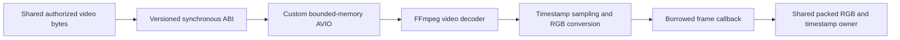

# Component: Optional FFmpeg video provider

## Technical specification

- **Purpose:** the single native video demux/frame-decode owner. It emits timestamped RGB frame views to shared media and never invokes a model or an external command.
- **Build boundary:** separate `cdylib`, outside the default Cargo workspace. `ffmpeg-next = 8.1.0` uses codec, format and software-scaling features. The main engine has no link-time FFmpeg dependency.
- **Platform evidence:** real encoded-video/ABI tests on Windows x86_64 and Ubuntu 24.04 x86_64 under WSL. Other targets are unverified.
- **Reuse:** both inference backends consume the shared core `DecodedImage` representation. A backend still needs an implemented compatible task; video decoding does not implement ONNX generative chat.

## Architectural flow



## API contract

- **Interface:** `cluaiz_video_api_v1` returns the versioned C function table defined once in `../../src/video/abi.rs`. That source is compiled by the provider and its consumer. No Rust collection or allocator ownership crosses the ABI.
- **Input lifetime:** one synchronous `decode` call borrows encoded bytes and callback state. Native IO/format/codec/scaler/frame owners are destroyed before return. Frame views expire at callback return; the consumer copies checked rows into its own packed RGB allocation.
- **IO policy:** custom read/seek callbacks access only the supplied bytes. `AVFormatContext.io_open` refuses secondary files/protocols. Native interrupt callbacks consult the same cancellation/deadline signal as frame delivery.
- **Sampling:** use actual presentation timestamps, relative to the first decoded frame. At most one frame is selected per configured interval. Missing/backward timestamps, excess duration/frame/packet/pixel budgets and decoder errors fail the request. No silent tail truncation or assumed constant frame rate.
- **Audio:** this provider reports track presence. Actual PCM decoding remains in shared `audio::decode_audio`; it is not duplicated here.

## Files

- `src/lib.rs`: ABI/version, decode loop, real timestamp sampling, bounded RGB conversion, registry-derived container extensions and error translation.
- `src/memory_input.rs`: exclusive custom AVIO/format ownership and denied secondary IO.
- `src/tests.rs`: opt-in genuine CFR/VFR/silent fixtures, actual pixels, cancellation after the first frame and playlist rejection without a network connection. Playlist probing can reject before the `io_open` callback; the test does not claim every protocol-denial branch was exercised.
- `build.rs`: package-relative native dependency lookup. Linux uses inherited `$ORIGIN` RPATH so codec dependencies find the packaged resampler; Windows uses the existing explicit runtime library loader.

## Build and packaging

Set `FFMPEG_DIR` to a deliberately staged SDK with `include/` and `lib/`, then run:

```text
cargo build --manifest-path engine/media/providers/ffmpeg/Cargo.toml --release
```

Place this provider and its runtime library dependencies beside each other in the native media package. Register every deployed file/hash/source and the provider key in `native-assets.json`:

```json
{"video":{"library":"<manifest-file-key-for-provider>"}}
```

The existing builder `media-assets --source <package> --output <new-directory>` verifies/stages the package. It does not fetch a model, SDK or runtime asset. Preserve upstream licenses, source/build identity and applicable corresponding-source requirements. The measured acceptance fixture uses prebuilt LGPL v3 FFmpeg libraries; it is not a minimal custom decoder-only FFmpeg build or a public redistribution audit. Do not ship the SDK CLI tools, filters/devices or development headers as runtime requirements.

For native ABI tests, supply `CLUAIZ_VIDEO_TEST_FIXTURES` and run this manifest's release tests with `-- --ignored --nocapture`. The separate `test/media_regression/video_spike` crate checks lazy loading without linking an SDK into its test executable.

## Failure and recovery

- **Missing/damaged package:** shared media returns an explicit video-unavailable error. Pure text requests do not load this provider.
- **Cancellation:** the decoder checks between packets/frames and during custom IO. It cannot preempt an arbitrary instruction already executing inside a native codec.
- **Memory:** checked source, dimensions, output-copy and conservative workspace budgets cover owned buffers. Native parser allocations, codec reference frames, stack use and process-wide memory are not certified caps. H264 coded/padded dimensions can exceed visible pixels and be refused by a tight native pixel limit.
- **Isolation:** this library runs inside the engine process; optional loading is not process isolation or protection against every native crash.
