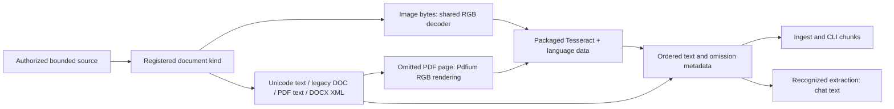

# Shared document extraction

## Reference

`extract` consumes bounded source bytes and their format evidence; it returns ordered `DocumentPart` values with real text, method, optional PDF page number, omissions, warnings and optional OCR confidence. UTF-8 text/code, BOM-marked UTF-16, legacy Word DOC, PDF text, main-body DOCX XML and native image/scanned-page OCR use this owner. Backend-specific neural encoders are not implemented here.

- `mod.rs`: extraction selection, result/provenance and checked text assembly.
- `text.rs`: content-based text/code decoder without a source-extension whitelist. UTF-8 (optional BOM) is checked and copied once into the owned prepared result. BOM-marked UTF-16LE/BE is validated and counted before one exact output allocation; decoding uses no intermediate code-unit array. Empty text, malformed encodings and binary/control data fail. BOM-less non-UTF-8 encodings are not guessed.
- `doc.rs`: pinned `office_oxide` legacy Word reader with optional features disabled. Uses borrowed body and subdocument text; it does not request rich rendering, image decoding, macro execution or external Office processes. Source/output limits apply. Incomplete text or parser recovery warnings produce omissions, which existing chat validation refuses. Extracted text does not interpret graphics/layout or recalculate fields. Ingest, CLI and GGUF document chat reuse this provider; it is not a native model input format.
- `pdf.rs`: page-by-page `pdf-extract` output through a byte-limited writer. The existing project's PDF provider is reused. Encrypted/corrupt input fails; pages with no text and image/form resources are conservatively marked as omitted recognition.
- `pdf_render.rs`: one global serialized PDFium library and scoped document/page/bitmap owners. Configured DPI is checked before BGRA allocation, converted to canonical packed RGB. Pages are rendered individually; retained text reduces the next page's bitmap budget.
- `ocr.rs`: lazy serialized Tesseract 5 C API with packaged traineddata. Shared RGB goes directly into recognition, not through a second image codec. Per-page monitor deadline is configured by the package. Native output/monitor handles are freed on errors; image and adaptive page state are cleared between requests. Language data is retained until explicit unload.
- `docx.rs`: bounded ZIP main-body read and namespace-aware XML events. Paragraphs, table cells, Unicode, standard entities and line breaks preserve order. ZIP entries are never extracted to filesystem paths. DTDs, foreign roots, excessive nesting and truncated XML fail.
- `chunker.rs`: sole shared paragraph/header-aware chunker, moved from model discovery. Long lines obey the byte ceiling at Unicode boundaries; zero/too-small limits fail.

## How to use

Resolve/authorize through `SourceResolver`, read bytes using the same `MediaLimits`, then call `extract`. Use `text(limits, true)` for chat or embeddings that require the full recognized document. Use `text(limits, false)` only while also reporting all omission metadata. Model requests receive actual extracted content.

## Explanation and limitations

PDF text extraction is not OCR. Empty pages can be blank or scanned; visual resources can be decorative or contain useful content. OCR renders such pages when a verified package is available. Missing assets, no readable words, recognition deadline or rendering failure leave page omissions and actual reasons. Existing embedded text is preserved. Chat refuses a still-partial document. A successful OCR part means recognized text was obtained, not that every symbol or diagram was understood; warnings and native mean confidence retain that distinction.

DOCX supports its main body; headers/footers and embedded visual objects are reported as omissions. Legacy DOC exposes recovered body and subdocument text; unsupported/encrypted/malformed documents fail or report incomplete recovery. DOC graphics, full layout reconstruction, tracked-change semantics, full document/XML schema validation and automatic neural vision selection are not implemented by this slice. PDF rendering includes visible annotations for OCR but does not reconstruct their structure.

Source bytes, output text, ZIP main-body inflation and retained request/batch output have checks. The legacy PDF parser's internal decompression/font/object allocations are not fully bounded by these checks; it is not process-isolated. Its Rust panic paths are caught where unwinding permits, which does not certify protection from stack overflow, allocation failure or parser vulnerabilities. The public [pdf-extract API](https://docs.rs/pdf-extract/0.7.12/pdf_extract/) supplies page extraction and output writers; this is not an all-PDF compatibility claim.

## Verification

The legacy DOC reader's internal stream/piece/formatting allocations are not bounded by the output guard and are not process-isolated. Source and emitted-text checks do not establish a process-wide memory bound.

`cargo test -p cluaiz-media --release --offline --test text_documents -- --nocapture` covers BOM-marked Unicode, malformed/oversized text, the requested plain-text/code extensions, genuine CFB/FIB/CLX DOC text, ANSI/Unicode pieces, alternate table streams, encryption/corruption and partial-text refusal. It prints three extraction-only timings per input; these are not model-inference or power-consumption measurements.

`cargo test -p cluaiz-media --release --offline --test documents` runs genuine PDF/DOCX builders, content/page/table order, Unicode/entities, partial-page refusal, corrupt XML/PDF, byte ceilings and ordered source ownership checks. Opt-in real native acceptance is in `tests/native_documents.rs`, configured by `CLUAIZ_NATIVE_MEDIA_TEST_PACKAGE` (and optional `CLUAIZ_OCR_HINDI_IMAGE`). Actual HTTP and selected-GGUF tests live in `api/tests/document_contract.rs`. Other-platform execution remains pending.

## Packaged assets and shutdown

`native-assets.json` names verified library/dependency/license files, explicit language identifiers, traineddata directory, nonzero OCR deadline, PDF library and DPI. Provider assets resolve below the selected Cluaiz environment's `bin/media` directory. The builder's `media-assets --source <verified-package> --output <new-directory>` stages only declared assets and refuses overwrite or damaged hashes. This is build packaging, not a replacement model downloader.

The embedding host must call `release_native_providers()` after stopping requests. CLI document extraction releases its providers before returning; the API waits for graceful Ctrl+C shutdown then releases them. Each lock excludes native use during destruction. Force-killing a process does not run Rust/native cleanup. Tesseract native work can reach its configured deadline; disconnect cancellation inside recognition and PDF rendering is not implemented.

Windows acceptance uses the pinned [charlesw Tesseract 5.2.0 binaries](https://github.com/charlesw/tesseract/tree/b5329d5be92fa670031d94c3875f879651a01f55/src/Tesseract/x64), [tessdata_fast language data](https://github.com/tesseract-ocr/tessdata_fast/tree/87416418657359cb625c412a48b6e1d6d41c29bd), and [PDFium chromium/8100](https://github.com/bblanchon/pdfium-binaries/releases/tag/chromium%2F8100). The maintainer binaries require the compatible MSVC runtime. Linux/macOS/ARM and a clean Windows machine without existing runtime dependencies have not been executed. Bundled notices accompany the staged package; shipping/installer integration remains a separate acceptance step.
