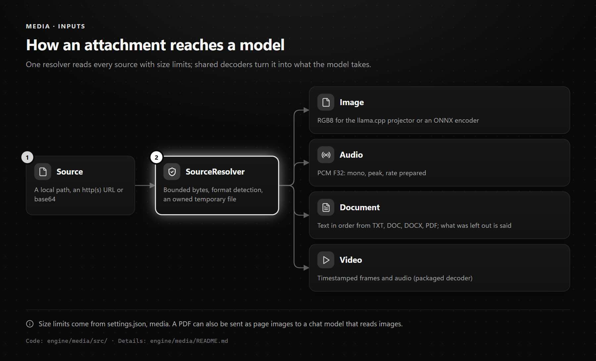
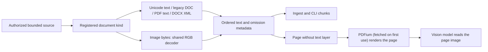

<!-- name: engine/media/src/documents
description: Document extraction: turns PDF, Office and text files into ordered text parts with their method. -->

# Document extraction (`engine/media/src/documents/`)

## Reference

`extract` consumes bounded source bytes and their format evidence; it returns ordered `DocumentPart` values with real text, method, optional PDF page number, omissions and warnings. UTF-8 text/code, BOM-marked UTF-16, legacy Word DOC, PDF text layers and main-body DOCX XML use this owner. It runs no model: a PDF page without a text layer (a scanned page) and an image come back as omissions (`PAGE_WITHOUT_TEXT`, `IMAGE_NEEDS_VISION`) that say a vision model is needed. Reading them is the vision model's job: chat (`request.rs`) and ingest with a vision `model` render only those pages with PDFium and send them as images. There is no OCR engine in the Engine (Tesseract was removed on 2026-11-27; an OCR plugin may come later in the tools registry).

- `mod.rs`: extraction selection, result/provenance and checked text assembly.
- `text.rs`: content-based text/code decoder without a source-extension whitelist. UTF-8 (optional BOM) is checked and copied once into the owned prepared result. BOM-marked UTF-16LE/BE is validated and counted before one exact output allocation; decoding uses no intermediate code-unit array. Empty text, malformed encodings and binary/control data fail. BOM-less non-UTF-8 encodings are not guessed.
- `doc.rs`: pinned `office_oxide` legacy Word reader with optional features disabled. Uses borrowed body and subdocument text; it does not request rich rendering, image decoding, macro execution or external Office processes. Source/output limits apply. Incomplete text or parser recovery warnings produce omissions, which existing chat validation refuses. Extracted text does not interpret graphics/layout or recalculate fields. Ingest, CLI and GGUF document chat reuse this provider; it is not a native model input format.
- `pdf.rs`: page-by-page `pdf-extract` output through a byte-limited writer. Encrypted/corrupt input fails. A page whose text is empty gets the `PAGE_WITHOUT_TEXT` omission. A page with text is read from its text layer; if it also has image/form resources, a warning says only its text was read (not an omission, so chat does not refuse a PDF for a logo). `pages_without_text` lists the pages that need a vision model; `pdf_pages` is the public entry.
- `pdf_render.rs`: one global serialized PDFium library and scoped document/page/bitmap owners. Fixed 150 DPI (`RENDER_DPI`; a US Letter page is 1275x1650), checked before BGRA allocation, converted to canonical packed RGB. Pages are rendered individually.
- `pdfium_fetch.rs`: downloads PDFium the first time a page has to be rendered (decisions below).
- `docx.rs`: bounded ZIP main-body read and namespace-aware XML events. Paragraphs, table cells, Unicode, standard entities and line breaks preserve order. ZIP entries are never extracted to filesystem paths. DTDs, foreign roots, excessive nesting and truncated XML fail.
- `office.rs`: spreadsheets and presentations through `office_oxide` Markdown (sheets as tables, slides with notes), pictures as segments.
- `chunker.rs`: sole shared paragraph/header-aware chunker, moved from model discovery. Long lines obey the byte ceiling at Unicode boundaries; zero/too-small limits fail.

## How to use

Resolve/authorize through `SourceResolver`, read bytes using the same `MediaLimits`, then call `extract`. Use `text(limits, true)` for chat or embeddings that require the full recognized document. Use `text(limits, false)` only while also reporting all omission metadata. Model requests receive actual extracted content.

## Explanation and limitations

PDF text extraction is not OCR. A page without a text layer can be blank or scanned; the Engine does not guess, it marks the page and leaves reading it to a vision model. With no vision model the page stays an omission: ingest returns `partial` with a `vision_needed` sentence (which installed vision models can read it, or that none is installed), and chat with a text-only model refuses the PDF with a message naming the scanned pages. Content that was not read is never sent as if complete.

DOCX supports its main body; headers/footers are reported as omissions. Pictures (`a:blip r:embed`, VML `v:imagedata r:id`) are found in their place and read from the package through `word/_rels/document.xml.rels`; a drawing without a picture (a chart, a shape), a linked picture or a missing media entry is a labelled `Segment::Unread`. `office.rs` reads XLSX, PPTX and legacy XLS/PPT (a compound file that is not a Word document) with the pinned `office_oxide` reader: its Markdown with `[image-base64:…]` markers becomes text and picture segments in order. `segments()` gives these to the vision path (`request.rs`: each picture decoded as an image part, within the decoded byte budget); `extract()` puts a `[Picture N: …]` label in each picture's place saying it was not read. An unread picture is labelled, not an omission, so chat does not refuse the document for it. Legacy DOC exposes recovered body and subdocument text; unsupported/encrypted/malformed documents fail or report incomplete recovery. DOC graphics, full layout reconstruction, tracked-change semantics, full document/XML schema validation and automatic neural vision selection are not implemented by this slice. PDF rendering includes visible annotations but does not reconstruct their structure.

Source bytes, output text, ZIP main-body inflation and retained request/batch output have checks. The legacy PDF parser's internal decompression/font/object allocations are not fully bounded by these checks; it is not process-isolated. Its Rust panic paths are caught where unwinding permits, which does not certify protection from stack overflow, allocation failure or parser vulnerabilities. The public [pdf-extract API](https://docs.rs/pdf-extract/0.7.12/pdf_extract/) supplies page extraction and output writers; this is not an all-PDF compatibility claim.

## Verification

The legacy DOC reader's internal stream/piece/formatting allocations are not bounded by the output guard and are not process-isolated. Source and emitted-text checks do not establish a process-wide memory bound.

`cargo test -p cluaiz-media --release --offline --test text_documents -- --nocapture` covers BOM-marked Unicode, malformed/oversized text, the requested plain-text/code extensions, genuine CFB/FIB/CLX DOC text, ANSI/Unicode pieces, alternate table streams, encryption/corruption and partial-text refusal. It prints three extraction-only timings per input; these are not model-inference or power-consumption measurements.

`cargo test -p cluaiz-media --release --offline --test documents` runs genuine PDF/DOCX builders, content/page/table order, Unicode/entities, partial-page refusal, corrupt XML/PDF, byte ceilings and ordered source ownership checks. Opt-in real native acceptance is in `tests/native_documents.rs`, configured by `CLUAIZ_NATIVE_MEDIA_TEST_PACKAGE` (and optional `CLUAIZ_OCR_HINDI_IMAGE`). Actual HTTP and selected-GGUF tests live in `api/tests/document_contract.rs`. Other-platform execution remains pending.

## PDF renderer download (`pdfium_fetch.rs`)

PDFium is not in the core package and not in the Cluaiz release. The first time a page has to be rendered (a page without a text layer going to a vision model, or an image embedding graph that embeds pages), `ensure()` fetches the official prebuilt from [bblanchon/pdfium-binaries](https://github.com/bblanchon/pdfium-binaries) release `chromium/8179` (published 2026-11-23, values read from the GitHub release on 2026-11-27) into `<CLUAIZ_HOME>/bin`:

| Platform | Archive | Bytes | SHA-256 | Library |
|---|---|---|---|---|
| win-x64 | `pdfium-win-x64.tgz` | 4046589 | `836a77c9053f624839c66010cddea7b675628a36b8831d2330178bb169d241b6` | `bin/pdfium.dll` |
| linux-x64 | `pdfium-linux-x64.tgz` | 3953118 | `b4766a6bf2856efbcc6c3cc7d6ae9022bdc6bb36ddc1acdd92d1f1873f773f4b` | `lib/libpdfium.so` |
| linux-arm64 | `pdfium-linux-arm64.tgz` | 3819293 | `18bb6d568257b28d14f6c3b8bfb48caf73d4615b319ca4d43b424c2a03431d9f` | `lib/libpdfium.so` |
| mac-arm64 | `pdfium-mac-arm64.tgz` | 3643140 | `44b7c6f55dd33454d0909728bd0adf6c86a8e141b36f07a6b6f50e228e1dfb46` | `lib/libpdfium.dylib` |

Decisions:
- Downloaded, not shipped: core size stays the same, and only users who read scanned PDFs pay the 4 MB. Alternative not taken: a separate native media pack (needs an installer step and was never shipped).
- In the Engine, not a plugin: `POST /v1/ingest` and `cluaiz ingest` run without chat and do not call plugins; a plugin needs the user's approval to install.
- Pinned per platform: the byte size and SHA-256 of the archive are checked before extraction (same check as `cudnn_driver::verify_archive_file` in `engine/onnx`). A wrong size or digest deletes the archive and fails with "Downloading the PDF renderer (PDFium chromium/8179, 4.0 MB from ...) failed".
- `decide()`: the library is used only when the file is there, not empty, and `bin/pdfium.version` names this release, platform and digest. Otherwise it downloads again (no stamp after an interrupted install, an older release, another platform). The stamp is written last.
- The download runs on its own thread (the blocking HTTP client must not run on an async runtime thread) under one lock, so two requests download once.
- Other platforms (Windows ARM, macOS x64) get "No PDF renderer build is available for ...".

Shutdown: the embedding host calls `release_native_providers()` after stopping requests; it waits for PDF rendering to finish and unloads PDFium. CLI document extraction calls it before returning; the API calls it after graceful Ctrl+C shutdown. Force-killing a process does not run cleanup. Disconnect cancellation inside a single page render is not implemented.

The native media pack (`native-assets.json` under `bin/media`, staged by the builder's `media-assets`) now carries only the video decoder (`src/native_assets.rs`).

## Tests

Part of `cargo test -p cluaiz-media` (2026-11-21 (Windows 11): 49 passed, 4 ignored). Pending items: [`media/README.md`](../../README.md#pending).
