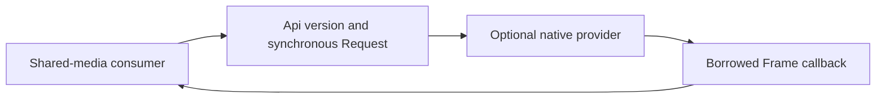

# Component: Video ABI contract

## Technical specification

- **Purpose:** `abi.rs` owns the exact versioned C layout shared by the optional decoder and shared-media consumer. It contains actual interface definitions, not forwarding imports.
- **Platform support:** C ABI, pointer sizes and native library artifacts must match the engine target. Windows/Linux x86_64 acceptance is recorded in the parent provider documentation; other targets are unverified.
- **Reuse:** `src/video.rs` and the separately built `providers/ffmpeg` compile this same source. No parallel definition is maintained.

## Architectural flow

## Interface and lifetime

- **`Api`:** version, decode function and size-query container-registry function. The library owner outlives all function pointers.
- **`Request`:** immutable encoded input, nonzero sampling/resource limits and synchronous callback context. Caller retains every borrowed allocation until return.
- **`Frame`:** actual timestamp, visible dimensions, RGB stride and borrowed accessible byte range. The consumer validates lengths/stride before copying.
- **`Info`:** actual audio-track presence and decoded/sampled counts. A failed call does not yield a successful partial model input.
- **Failure:** nonzero C status plus bounded caller-owned error buffer. No `String`, `Vec`, panic unwinding or cross-library allocator transfer is part of the contract.
