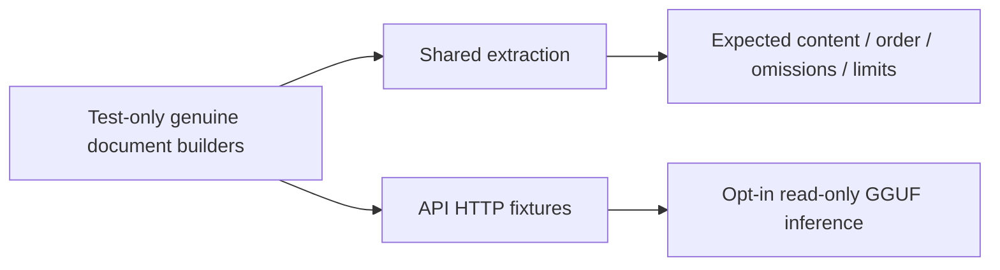

# Shared media acceptance

`documents.rs` exercises real small PDF and OOXML DOCX packages. `support/mod.rs` owns document builders used directly by these tests and the API document tests; it is not compiled into production libraries or CLI binaries.

Run `cargo test -p cluaiz-media --release --offline`. The regular suite requires no model download. `native_documents.rs` includes package/platform/traversal/damage/invalidation checks and opt-in actual OCR/PDFium execution. Supply `CLUAIZ_NATIVE_MEDIA_TEST_PACKAGE` for `-- --include-ignored --nocapture`; optional `CLUAIZ_OCR_HINDI_IMAGE` adds actual Hindi raster recognition. It checks PNG/JPEG, raster-only/mixed PDFs, RGB/stride, different content, empty-result failure, concurrency and unload/reload. `support/raster.rs` contains only test fixture encoding. Video, App acceptance and a whole-process native memory bound remain separate.
