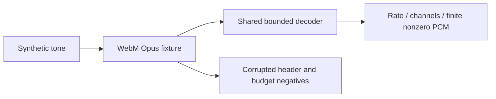

# Audio decoder fixtures

`opus-mono.webm` and `opus-stereo.webm` contain an 80 ms synthetic 440 Hz tone encoded as real Opus in streaming-layout WebM, with unknown segment duration and short clusters. They contain no user recording. The ordinary Rust decoder tests embed these bytes; no encoder, network or model is needed when tests run.

Generated with the already installed FFmpeg 8.0.1, using `-f lavfi -i sine=frequency=440:sample_rate=48000:duration=0.08 -ac CHANNELS -c:a libopus -b:a BITRATE -f webm -live 1 -cluster_time_limit 20 OUTPUT`. Mono uses one channel at 32k; stereo uses two channels at 48k. This is a container/codec regression fixture, not a claim that browser microphone capture or ASR was tested.

