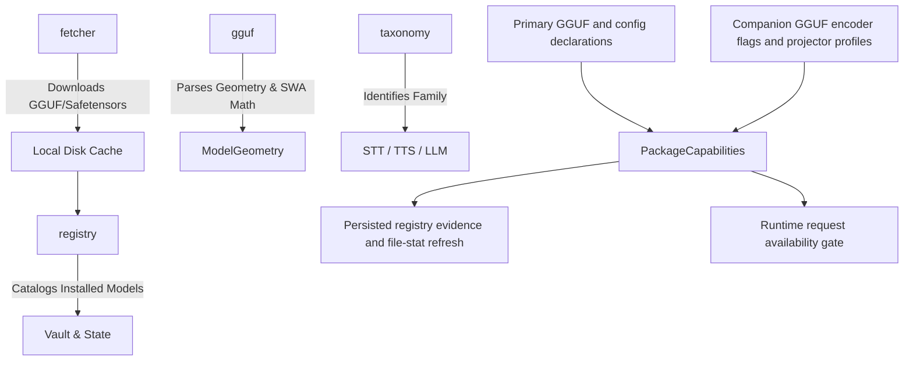
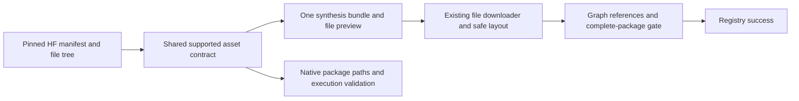
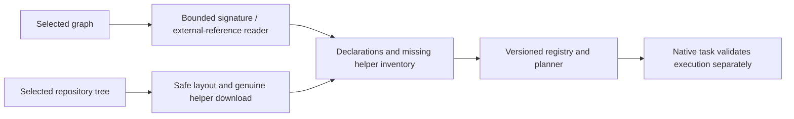

# 📦 Cluaiz Models Subsystem (`engine/models`)

Unified Model Subsystem for Cluaiz: HuggingFace model downloading, registry/vault tracking, multi-modal taxonomy, and single GGUF reader.

## 📐 Architecture

## 📦 Components

| Module | Responsibility |
|---|---|
| [`fetcher/`](src/fetcher/) | HuggingFace file selection, download, required-asset completion and installation gates. |
| [`registry/`](src/registry/) | Installed models catalog, local vault, and state management. |
| [`taxonomy/`](src/taxonomy/) | Audio STT/TTS family classification (Kokoro, Whisper, CosyVoice, etc.). |
| [`prober/`](src/prober/) | Vision mmproj projector and format detection. |
| [`capabilities.rs`](src/capabilities.rs) | Tri-state native input declarations, actual same-folder projector inventory and conservative pairing status. |
| [`gguf.rs`](src/gguf.rs) | Single unified GGUF reader with correct Sliding Window Attention (SWA) math. |

## Native package capability contract

### Anonymous registry resolution

`fetcher/client.rs` owns catalogue resolution. It sends one bounded HTTP request with the original model ID and an optional distinct tagged-base fallback. Missing IDs, rate limits, client rejection and service failure remain distinct. HTTP redirects are not followed. Complete HF coordinates bypass the website; model files still use the existing downloader. No request-count telemetry or delayed batch is sent. Client markers are identification hints, not authentication. Website proxy secrets stay on the server and are never shipped in the Engine.

- **Shared header lifetime:** the single `GgufProber` keeps at most16 immutable GGUF headers in an LRU cache, keyed by canonical file path, byte length and modification time. Callers receive independent copies. Failed/truncated files are not cached; changed/deleted primaries and companions are rechecked. This is a stat cache, not a cryptographic identity guarantee. Geometry can consume the same parsed header through `geometry_from_header`; vocabulary strings beyond the retained summary are consumed without allocating strings, while truncation still fails.
- **Selected planning:** `InstalledStateRegistry::find` reuses the authoritative JSON/versioned-cache reader and resolves one existing primary without refreshing or writing other installed packages. Normal `load` retains migration/full-refresh behavior. Chat planning rebuilds selected config/projector evidence from current files and cached headers; it does not cache settings, live hardware or a complete plan.

- **Declarations:** text comes from tokenizer/text-embedding metadata. Image/audio declarations use explicit primary encoder flags and non-empty vision/audio config objects; null config is an explicit negative, missing/malformed config stays unknown, and contradictory declarations stay unknown. Model/folder name substrings do not enable these native inputs.
- **Projector inventory:** actual companion GGUF headers identify vision/audio encoders, including renamed files. Generic and modality-specific projector types are retained. Different profiles require explicit selection; precision variants of an identical profile use the existing asset selector and quantization parser.
- **Pairing:** projector presence and metadata projection dimensions do not certify model compatibility. The pinned native implementation derives final output width differently by projector type; loaded mtmd must validate the chosen pair. Metadata compatibility therefore remains unknown here.
- **Taxonomy:** native chat audio input is separate from STT/TTS. Chat can declare text/image/audio and still output text; TTS text input/audio output and STT audio input/text output retain their task roles.
- **Refresh:** registry metadata optionally persists `PackageCapabilities`. Canonical primary identity and sorted GGUF/JSON file names, byte lengths and modification times invalidate evidence after primary/projector/sidecar changes. This is a stat fingerprint, not a content hash; replacements preserving every stat are not detected by this cache.
- **Cache migration:** `.json` remains authoritative. `.bin` now stores a `CLREG002` header plus compact JSON snapshot; obsolete positional bincode is rejected and rebuilt from JSON without deleting registrations. This handles generic JSON fields and optional schema fields without a positional binary-layout claim. Existing missing-model cleanup is unchanged. No cache read-speed improvement is claimed.
- **Tests:** generated GGUF v3 fixtures exercise metadata discovery, renamed companions, ambiguity, precision selection, old JSON/cache round trips and asset refresh. Fixtures are compiled only under `cfg(test)`. A separate ignored read-only audit inspects an explicitly provided installed package; it does not load model weights for inference or alter registry/model files.
- **Remaining:** ONNX input-signature verification is a later backend phase. Raw declarations are not proof of model execution; loaded native capabilities, typed API dispatch, real media inference and document/video providers remain pending.

## ONNX graph and helper evidence

### Manifest-owned multi-graph exports

`cluaiz-core::model_assets` owns the supported asset manifest descriptions. Discovery, `PackageCapabilities` and the native Audio8 runtime consume the same asset definition; they do not maintain separate generator/codec/tokenizer filename lists. The initial descriptor covers the Audio8 FP16 valid-prefix export. Unknown manifest families retain generic discovery; this is not automatic support for arbitrary custom ONNX pipelines.

`fetcher/package_bundler.rs` reads bounded manifest metadata, validates its declared layout/default precision and replaces that export's component choices with one full synthesis bundle. Generator precision and codec precision are independent. Optional registration graphs are not standalone synthesis variants. Existing generic ONNX/STT and GGUF shard/projector grouping remain separate owners. Only the manifest default is exposed until runtime selection can share additional precision choices.

The manifest response's `x-repo-commit` pins its graph/weight tree and URLs to one commit. The primary `download_url` carries that revision without a required registry-field migration; older manifests retain `main`. The selected-file size includes metadata and weights. Nonstandard external-data references discovered from graph headers can require additional helpers during installation, so the initial preview is not a universal full-size guarantee.

Normal CLI and manual file selection share contract reconciliation. Single-primary install callers resolve the same full bundle. `validate_package` gates installation and CLI cache decisions; an incomplete cached package enters repair instead of returning “already downloaded”. Known required corrupt graph headers fail. Helper completion re-inspects newly fetched graphs for further external weights, attempting each missing asset once. Valid existing files are reused. Registry success is emitted only after completion; the registry terminal propagates installation errors.

Serialized capability records add an optional `asset_contract`. Refresh compares the current contract as well as file stats, so older records gain the contract without deleting registrations. File/asset presence still does not establish numerical execution, provider support, voice quality or realtime playback.

Document extraction/chunking now belongs to `cluaiz-media::documents`, rather than model discovery. API and CLI consumers import that implementation directly; this crate has no forwarding ingestion module. Model registry/package discovery remains here.

- **Inspection:** `prober/onnx.rs` reads bounded protobuf input/output tensor names, dtype IDs, dimensions/symbols and top-level initializer external-data locations. It seeks past raw/packed weights without creating an ONNX Runtime session. It is signature extraction, not a complete ONNX checker or numerical execution proof. Unsupported/corrupt signatures remain unknown/errors; filenames do not establish capabilities.
- **Package contract:** `capabilities.rs` records primary-first graph signatures and metadata input declarations separately from runtime availability. Recognized tensor roles supply task evidence. Existing category/task declarations are preserved; positive graph tasks are added, including image embeddings for an ingest-category package. A vector is not an OCR answer.
- **Refresh:** recursive file-stat snapshots include nested helper files and weights. Directory symlinks are not traversed; recursion has a depth ceiling. Size/mtime identity is not cryptographic integrity. `CLREG003` invalidates the old binary cache while authoritative JSON registrations/assets remain.
- **Required assets:** tokenizer for ID inputs, processor for pixels/features, pooling config for supported unpooled text output, and referenced top-level initializer external files. Presence is checked inside the canonical package. Sparse/subgraph/attribute external data and all TTS-family-specific voice/phoneme dependencies are not comprehensively inventoried here.
- **Installation:** graph-parent assets move together to package root; shared helper folders such as `1_Pooling` keep their hierarchy. Deduplication uses actual destinations, so pooling config no longer removes/overwrites model config. Invalid/traversing repository paths and destination collisions fail.
- **Completion:** `ModelDownloader::install` calls `complete_onnx_assets` before registration. Missing known helpers come only from the selected repository's real tree. Shared metadata can live at repository root; external weights follow graph-relative location. Missing files/repository, cancellation and download errors propagate without another model's fallback config. Failed helper completion may leave resumable assets without successful registration.
- **Boundary:** asset presence does not validate contents, pairing, semantics or EP/device support; native task execution remains authoritative.

