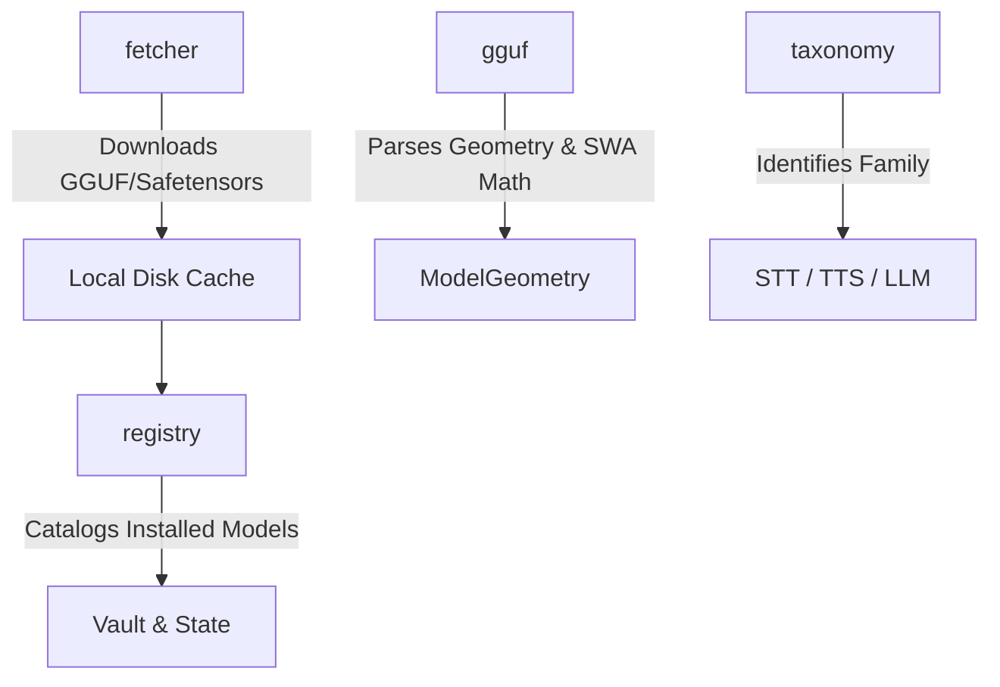

# 📦 Cluaiz Models Subsystem (`engine/models`)

Unified Model Subsystem for Cluaiz: HuggingFace model downloading, registry/vault tracking, multi-modal taxonomy, and single GGUF reader.

## 📐 Architecture

## 📦 Components

| Module | Responsibility |
|---|---|
| [`fetcher/`](src/fetcher/) | HuggingFace parallel chunk downloader with auto-heal and integrity checking. |
| [`registry/`](src/registry/) | Installed models catalog, local vault, and state management. |
| [`taxonomy/`](src/taxonomy/) | Audio STT/TTS family classification (Kokoro, Whisper, CosyVoice, etc.). |
| [`prober/`](src/prober/) | Vision mmproj projector and format detection. |
| [`gguf.rs`](src/gguf.rs) | Single unified GGUF reader with correct Sliding Window Attention (SWA) math. |
