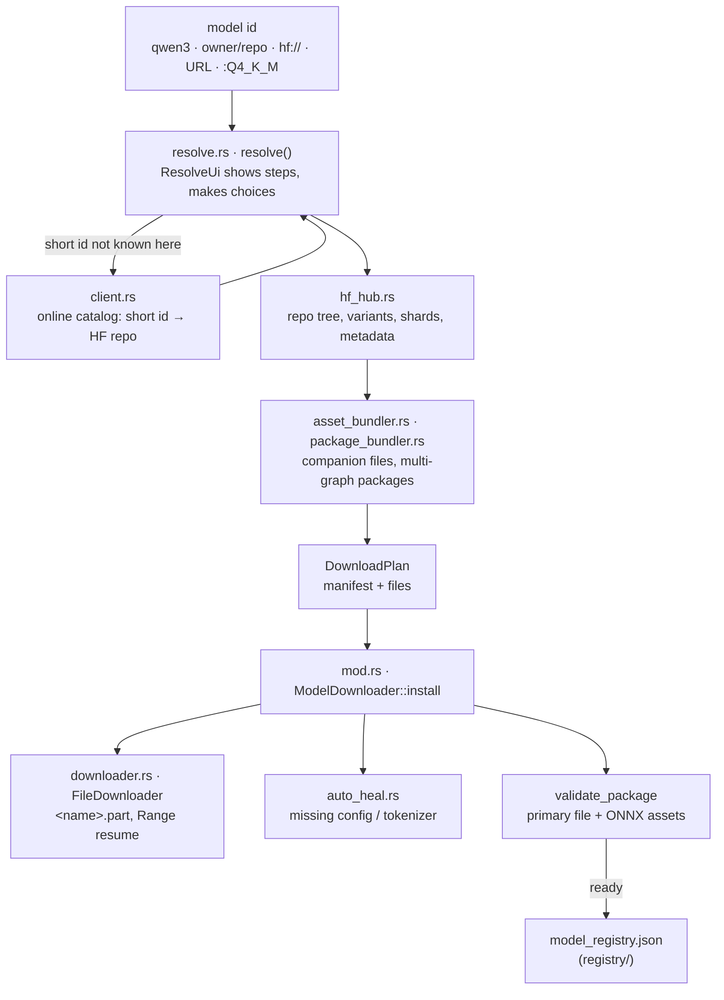

# Component: `engine/models/src/fetcher/`

## Technical Specification

- **Purpose:** Everything between "a model name" and "a registered model on disk": what a model
  id means (a catalog id, a Hugging Face repo, `hf://`, a URL, with an optional `:QUANT`), which
  files of the repository belong to the chosen variant (shards, projector, tokenizer, ONNX
  companions), downloading them resumably, and registering the model only when its primary weight
  file and required assets are there. `cluaiz pull` / `cluaiz run`, the API's `/api/pull` and
  CEP `models.download` / `models.discard` all use it, so a model resolves the same everywhere.
- **Platform Support:** Windows, Linux, macOS. Network: the Cluaiz catalog and Hugging Face over
  HTTPS (`reqwest`).
- **Reusability Level:** Public module of `cluaiz-models` (`cluaiz_models::fetcher`).
- **Crate overview:** [engine/models/README.md](../../README.md) (catalogue resolution,
  download preview, ONNX graph rules).

## Architectural Flow

## API Contract (Interface)

- **Resolution (`resolve.rs`):** `resolve(model_id, all, &dyn ResolveUi) -> Resolved`;
  `Resolved` (on disk already / installed under an id / a `DownloadPlan`); `ResolveStep` (what
  to show: resolving, repo found, not in catalog, catalog failed, scanning, tag matched…);
  trait `ResolveUi` (`step`, choose a variant, whether someone is there, pick files for `--all`);
  `FirstVariant` (the no-one-to-ask answer); `default_variant` (Q4_K_M, else the smallest);
  `pull(…) -> Pulled` (resolve with `FirstVariant`, download, register; progress on a channel,
  stopped by `abort`); `discard(model_id)`.
- **Download (`mod.rs`, `downloader.rs`):** `ModelDownloader::install(manifest, files, tx,
  abort)`, `discard`, `uninstall`, `purge_model`, `cleanup_partial_download`,
  `complete_onnx_assets`, `validate_package`, `model_dir`, `get_models_dir`,
  `get_cached_path`, `is_model_cached`, `download_gguf(_async)`; `FileDownloader`,
  `DownloadEvent`, `ABORTED`, `part_path`.
- **Hub and catalog:** `HuggingFaceHub`, `HfTreeItem`, `HfVariant`, `HfRepositoryMetadata`
  (`hf_hub.rs`); `RegistryClient`, `RegistryResolveError`, `parse_hf_repository`,
  `resolve_model_repo(_with_fallback)` (`client.rs`).
- **Bundling:** `AssetBundler` (`asset_bundler.rs`); `complete_variants`, `complete_custom`,
  `manifest_variant` (`package_bundler.rs`); `AutoHeal` (`auto_heal.rs`).
- **Export Type:** Public Rust API.
- **Dependencies:** `reqwest`, `tokio`, `serde_json`, the crate's `registry/`, `capabilities`
  and `ModelManifest` / `ModelCatalog`.

## Deep File Breakdown

- `resolve.rs`:
  - **Logic:** Splits an optional `:TAG`. A short id that is neither installed nor in the local
    roster is looked up in the online catalog; then the repo is scanned for variants, the tag is
    matched, or the caller chooses (a prompt in the terminal, `FirstVariant` over the API).
  - **Why:** With nobody to ask, the default is Q4_K_M, else the smallest variant: the first one
    listed can be the largest, and a script should not start that download. A free pick of files
    (`--all`) is refused without someone to choose.
- `client.rs`:
  - **Logic:** Catalog resolution: one bounded request with the model id and, for `name:tag`,
    the base id as a fallback. Not found, rate limit, client rejection and service failure stay
    distinct errors; redirects are not followed; complete HF coordinates skip the catalog.
- `hf_hub.rs`:
  - **Logic:** Reads a repository's file tree and metadata, groups files into variants (by
    quantization, multi-shard GGUF sets, ONNX precision), and builds the URL of each asset at the
    manifest's revision.
- `asset_bundler.rs`:
  - **Logic:** Which companion files a variant needs: config and tokenizer files, the `mmproj`
    projector, MTP and helper GGUFs; PyTorch weights are recognised and left out; the bundle's
    size for the preview.
- `package_bundler.rs`:
  - **Logic:** Manifest-owned multi-graph ONNX packages (speech models with several graphs): the
    manifest's declared layout and default precision replace the generic per-file choice with one
    full bundle. Generic ONNX/STT/GGUF grouping stays in `hf_hub.rs`.
- `downloader.rs`:
  - **Logic:** `FileDownloader::download_single_file` writes `<name>.part` and renames it when
    every byte has arrived. A dropped connection continues from the `.part` with an HTTP `Range`
    request for as long as bytes keep arriving; a later run of the same download continues too.
  - **Flow:** Progress goes out as `DownloadEvent`s; the `abort` flag stops it and keeps the
    `.part` (a pause). A server that ignores `Range` sends the whole file and the `.part` starts
    over.
- `mod.rs` (`ModelDownloader`):
  - **Logic:** `install` bundles the files, downloads them into the model's vault folder, keeps
    files already on disk, relocates graph-parent files together, keeps shared helper folders,
    and registers the model in `model_registry.json` only when `validate_package` passes (the
    primary weight file exists; an ONNX package has every required asset).
  - **Flow:** `discard` removes what a stopped download left (an installed model is never
    touched); `uninstall` / `purge_model` delete an installed model; `complete_onnx_assets`
    fetches assets an existing ONNX install is missing.
- `auto_heal.rs`: fetches a missing config or tokenizer file from listed fallback repositories
  when the model's own repository does not have it.
- `package_tests/bundles.rs`: bundle tests for manifest-owned packages.

## Failure & Recovery Logic

- **Connection dropped:** resumes from the `.part` with `Range`; no total timeout, since a large
  file on a slow link takes longer than any fixed limit.
- **User stops (`tasks.cancel`, Ctrl+C):** `ABORTED`; the `.part` stays, so the next pull
  continues. `models.discard` / `discard` deletes it.
- **Server ignores `Range`:** the whole file again; the `.part` starts over.
- **Catalog unavailable or id not found:** a distinct `RegistryResolveError`; a full
  `owner/repo` still works without the catalog.
- **Primary file or ONNX assets missing after download:** nothing is registered; the error names
  the missing assets.
- **Nobody to ask:** the default variant, never a free file pick.
