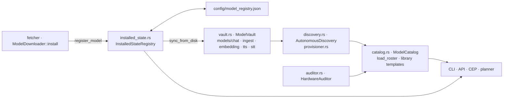

# Component: `engine/models/src/registry/`

## Technical Specification

- **Purpose:** Which models exist and where: the **installed state**
  (`<CLUAIZ_HOME>/config/model_registry.json`, one entry per installed model with its folder,
  files, slot and capabilities), the **vault** (one folder per model category under
  `<CLUAIZ_HOME>/models/`), the **roster** (installed models plus the Cluaiz model library
  templates, used to resolve short ids), discovery of model folders copied in by hand, and a
  RAM/VRAM health check for recommendations.
- **Platform Support:** Windows, Linux, macOS (JSON files and folder scans).
- **Reusability Level:** Single source of truth for installed models: the CLI (`list`, `show`,
  `rm`, `run`), the API (`/v1/models`, a request's `model`), CEP `models.*` and the planner read it.

## Architectural Flow

## API Contract (Interface)

- **`installed_state.rs`:** `InstalledStateRegistry::{get_registry_path, load, find, id_for_path,
  save, register_model, unregister_model, get_models_for_slot, entry_for_folder,
  sync_from_disk}`.
- **`vault.rs`:** `ModelVault::{root_dir, chat_dir, ingest_dir, embedding_dir, tts_dir, stt_dir}`.
- **`catalog.rs`:** `ModelCatalog::{load_roster, fetch_external_registry, load_installation_file,
  get_recommendations}`, `REGISTRY_URL` (the model library on jsDelivr).
- **`discovery.rs`:** `AutonomousDiscovery::index_models(base_path)`; **`provisioner.rs`:**
  `Provisioner::provision_models`.
- **`auditor.rs`:** `HardwareAuditor::audit_performance(ram_required, requires_gpu) -> HealthStatus`.
- **Export Type:** Public Rust API of `cluaiz-models`.
- **Dependencies:** `serde_json`, `tracing`, `cluaiz_core` (home folder), the crate's `types/`,
  `taxonomy/`, `capabilities` and `gguf`.

## Deep File Breakdown

- `installed_state.rs`:
  - **Logic:** `load` reads the file (parsed once and kept in RAM, keyed by the content hash, so
    an unchanged file is not parsed again), drops entries whose folder or primary weight file is
    gone (deleted outside Cluaiz), refreshes capabilities read from the weights, and saves when
    either changed. `find` takes the exact id, the id without `.gguf`, or the same id in another
    case, and only when the primary weight file is on disk; it never writes.
  - **Flow:** `register_model` / `unregister_model` → `save` (writes the JSON and replaces the RAM
    copy). `sync_from_disk` registers every model folder in the category folders that is not in
    the registry yet (copied by hand, or downloaded while registration was missing); registered
    models are left as they are, so a server start only probes new folders.
  - **Tests:** `installed_state_tests.rs`.
- `vault.rs`: the category folders under `<CLUAIZ_HOME>/models/` (`chat`, `ingest`, `embedding`,
  `tts`, `stt`).
- `catalog.rs`: `load_roster` = models found in the vault (`AutonomousDiscovery`) plus the model
  library templates (`models/library` in the repository or the install), keyed by lower-case id;
  `fetch_external_registry` reads the library from `REGISTRY_URL`; `get_recommendations` ranks
  library models for this machine's RAM and GPU.
- `discovery.rs`: walks a folder and builds a manifest per model folder from what its files say.
  `provisioner.rs` is a thin entry over it.
- `auditor.rs`: `HealthStatus` for a model's RAM need and GPU requirement against this machine.

## Failure & Recovery Logic

- **Model folder deleted by hand:** its entry is dropped on the next `load`.
- **Model folder copied in by hand:** registered by `sync_from_disk` at server start.
- **Registry file missing:** read as an empty registry; `sync_from_disk` registers the model
  folders again from what their files say.
- **Registry file not valid JSON:** kept as `model_registry.json.broken-<unix seconds>` (so the
  next save does not write over it), a warning goes to the log, and the folders are registered
  again. Values that existed only in the old entries (such as a chosen id) are rebuilt from the
  files; the old file still holds them.
- **Crash while saving:** `save` writes a temporary file and renames it, so the file is never
  left half written.
- **Library not reachable:** `fetch_external_registry` returns the error; the local roster still
  works.
