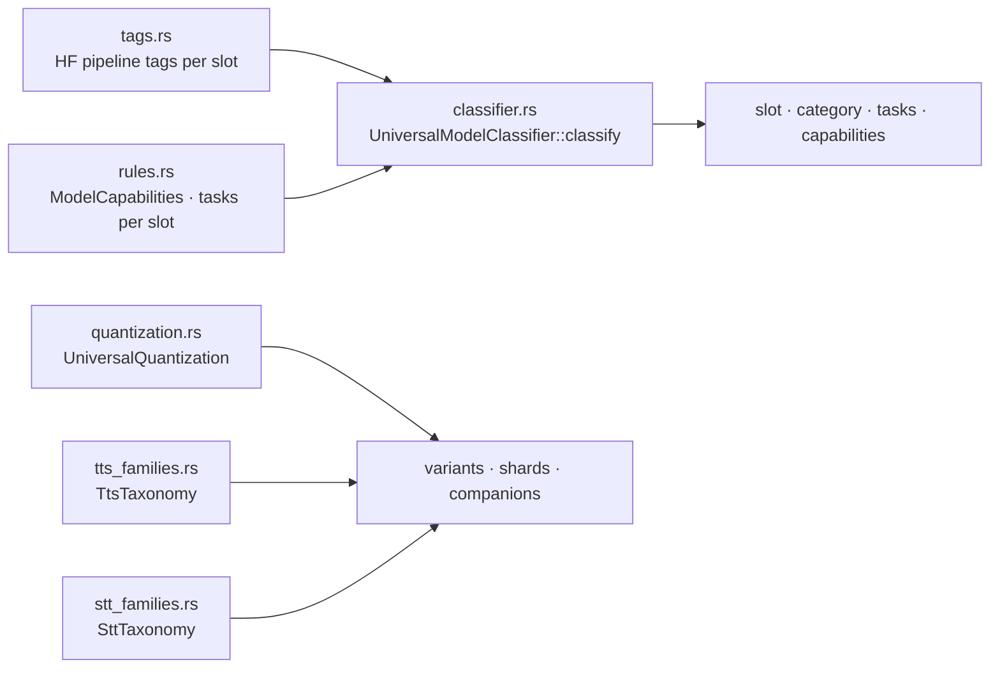

# Component: `engine/models/src/taxonomy/`

## Technical Specification

- **Purpose:** What kind of model something is, from what the model declares, never from its
  name: the slot (chat, ingest, embedding, TTS, STT) from its Hugging Face pipeline tag and tags
  or the tasks in its weights; which files of a repository are quantization variants of the same
  model, shards of one file or companions; and which speech family (TTS / STT) a package
  belongs to. Used by the fetcher (variants, file grouping), the registry (slot of an installed
  model) and the ONNX runtime (family).
- **Platform Support:** Any (pure functions over strings).
- **Reusability Level:** Single source of truth for model kinds and file grouping in
  `cluaiz-models`.

## Architectural Flow

## API Contract (Interface)

- **`classifier.rs`:** `UniversalModelClassifier::classify(pipeline_tag, tags) ->
  ClassificationResult { slot, category, supported_tasks, capabilities, tts_family }`.
- **`tags.rs`:** `HF_TAGS_CHAT`, `HF_TAGS_INGEST`, `HF_TAGS_EMBEDDING`, `HF_TAGS_TTS`,
  `HF_TAGS_STT`.
- **`rules.rs`:** `ModelCapabilities` (`is_tts`, `is_asr`, `is_embedding`, …, `all_true`),
  `UniversalTaskRules::{get_tasks_for_slot, get_tasks_for_category}`.
- **`quantization.rs`:** `UniversalQuantization` with `QUANT_CANDIDATES`, `SHARD_PATTERNS`,
  `ONNX_COMPANION_SUFFIXES`, `strip_quant`, `extract_shard_base`,
  `strip_onnx_companion_suffix`, …
- **`tts_families.rs`:** `TtsFamily` (Piper, Kokoro, Supertonic, Matcha, CosyVoice, Chatterbox,
  OmniVoice, ParlerTts, ChatTts, Vits, Bark, Whisper, GenericOnnxTts, Unknown), `TtsTaxonomy`
  (`is_tts_asset`, `strip_quant`, `is_same_model_different_quant`, `is_scale_mismatch`, …).
- **`stt_families.rs`:** `SttFamily` (WhisperGguf, WhisperOnnx, SenseVoice, Moonshine,
  Paraformer, Zipformer, GenericOnnxStt, Unknown), `SttTaxonomy` (`is_stt_asset`,
  `is_subcomponent_file`, `is_primary_entrypoint`, …).
- **Export Type:** Public Rust API of `cluaiz-models`.

## Deep File Breakdown

- `classifier.rs`:
  - **Logic:** Checks the declared tags in a fixed order: TTS, STT, embedding (also the plain
    `embedding` / `embeddings` tags), ingest, then chat. A model that declares nothing is a chat
    model. Names of models and files are never read; the TTS family comes from the registry
    entry or the graph when the model loads.
  - **Why:** A name like "whisper-chat" must not decide what a model does.
- `tags.rs`: the Hugging Face pipeline tags that mean each slot, as data.
- `rules.rs`: the tasks a slot or a category offers, and the capability flags.
- `quantization.rs`: recognises quantization names (`Q4_K_M`, `IQ3_XXS`, `fp16`, …) in file
  paths so variants of one model group together; recognises shard names
  (`-00001-of-00004.gguf`) so a multi-file model downloads whole; recognises ONNX companion files
  (`.onnx_data` and the like) so they follow their graph.
- `tts_families.rs` / `stt_families.rs`: which files of a speech package belong together
  (graphs, voices, tokens, configs), which file is the entry point, and which ONNX files are the
  same model at another precision or a different scale.

## Failure & Recovery Logic

- **No tags at all:** chat slot.
- **Unknown speech package:** `Unknown` / `GenericOnnx*` family; the runtime then checks the
  graph's inputs before loading.
- **File that matches no pattern:** treated as its own file, not grouped.
