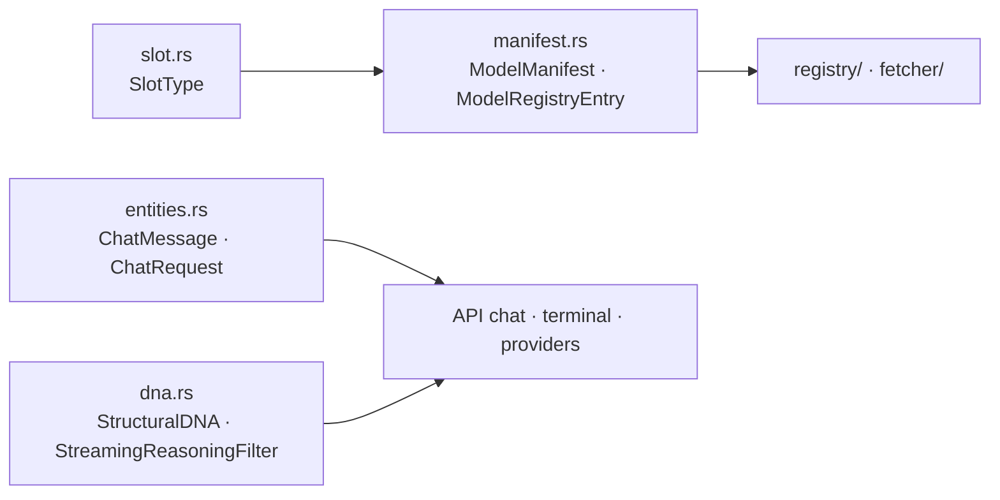

# Component: `engine/models/src/types/`

## Technical Specification

- **Purpose:** The shared data shapes of `cluaiz-models`: a model's manifest and registry entry,
  its slot, chat entity types, and `StructuralDNA` with the streaming reasoning filter that
  separates thinking from the answer for every caller (API chat, terminal, providers).
- **Platform Support:** Any.
- **Reusability Level:** Imported across the Engine (`cluaiz_models::*`).

## Architectural Flow

## API Contract (Interface)

- **`manifest.rs`:** `ModelManifest`, `ModelAsset`, `InstallationModel`, `InstallationFile`,
  `ModelRegistry` / `ModelRegistryEntry` (`primary_path`, `size_bytes`, `find(query)`), serde
  defaults (`default_bit_depth`, `default_context`, `default_category`).
- **`slot.rs`:** `SlotType` (chat, ingest, embedding, TTS, STT): `as_str`, `from_category`,
  `supported_inputs`, `supported_outputs`.
- **`entities.rs`:** `MessageRole`, `ChatMessage`, `ChatRequest`, `ChatResponse`,
  `ChatSession`, `SlotTypeTasksExt`.
- **`dna.rs`:** `StructuralDNA` (thinking tags read from the model, `separate_reasoning`,
  `parse_context_string`, `requires_fp16_kv`, `supports_flash_attention`, `calc_safe_hold_len`),
  `KernelSignature`, `StreamingReasoningFilter::{new, reset_turn, process_token, flush_final}`.
- **Export Type:** Public Rust API.

## Deep File Breakdown

- `manifest.rs`:
  - **Logic:** A manifest lists a model's files; the weight file to load is the one marked
    primary, else the first listed file that exists. `ModelRegistry::find(query)` gives the exact
    id (ignoring case, `- _ . :` and spaces) when there is one, else every id containing the
    query, sorted; more than one means the name is ambiguous.
- `slot.rs`: the five slots and the inputs and outputs each takes (text, image, audio).
- `entities.rs`: plain chat message and request shapes.
- `dna.rs`:
  - **Logic:** `separate_reasoning(text, start, end)` splits a finished answer into thinking and
    answer with the model's own tags. `StreamingReasoningFilter` does the same on a token stream:
    it buffers only as much text as could be the start of a tag (`calc_safe_hold_len`, on UTF-8
    character boundaries), sends thinking and answer apart, and `flush_final` empties the buffer
    at the end.
  - **Flow:** `new(start_tag, end_tag, prompt_starts_in_think, disabled)`: with `disabled` it
    passes everything as answer (a model with no thinking tags); a prompt that already opened
    the block starts inside it; without known tags it recognises a leading `<tag>` / `[tag]`.
  - **Why:** One filter for every path, so thinking never leaks into the answer in one place
    and not in another.

## Failure & Recovery Logic

- **Primary file missing:** `primary_path()` is `None`; the registry drops or refuses the entry.
- **Thinking left open at the end:** `flush_final` returns what was buffered; the engine closes
  the block once so the model answers outside it.
- **A tag split across tokens:** held back until it is whole or proven not to be a tag.
