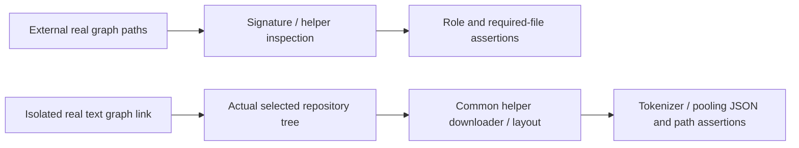

# Component: Model package capability acceptance

## Technical Specification
- **Purpose:** Opt-in read-only graph audits and genuine missing-helper completion in a separately owned temporary package.
- **Platform Support:** Host file/protobuf/HTTP support. Metadata success does not certify GPU/platform inference.
- **Reusability Level:** Test-only; no production CLI diagnostics.

## Architectural Flow

## Interface and Lifecycle
- **media_capabilities.rs:** the read-only audit takes `CLUAIZ_ONNX_*_MODEL` graph paths, checks actual roles/helpers and does not run synthesis/encoding.
- **Completion:** the fixture owns a temporary graph link and helpers. `CLUAIZ_FIXTURE_REPO`, `CLUAIZ_FIXTURE_REMOTE_PRIMARY` and `CLUAIZ_FIXTURE_HTTP_TIMEOUT_MS` supply the genuine source. It cleans only its temporary directory.
- **Command:** `cargo test -p cluaiz-models --release --test media_capabilities --offline -- --ignored --nocapture`. Cargo offline resolves dependencies locally; this opt-in fixture itself downloads its declared helper assets.

## Failure and Boundaries

- `package_install.rs` is an opt-in real fresh package download/repair acceptance. It requires a nonexistent isolated `CLUAIZ_HOME`, `CLUAIZ_PACKAGE_REPO`, and `CLUAIZ_ALLOW_PACKAGE_DOWNLOAD=1`. It checks the manifest-owned plan, complete install gate, upstream LFS SHA256 identities and missing-tokenizer repair without rewriting retained valid weights. It does not modify the normal installed vault or run inference; native speech acceptance is separate. Run it with `cargo test -p cluaiz-models --test package_install -- --ignored --nocapture` only when that download is intended.
- **Errors:** missing environment/assets, corrupt graph and HTTP errors fail instead of returning mock success. Normal tests skip the external fixtures.
- **Not established:** full CLI/HTTP installer workflow, numerical inference, semantic quality, native EP support, all external-reference forms or all TTS helpers.
