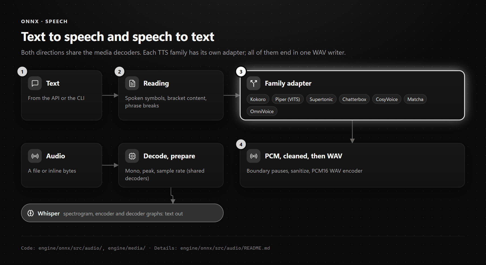
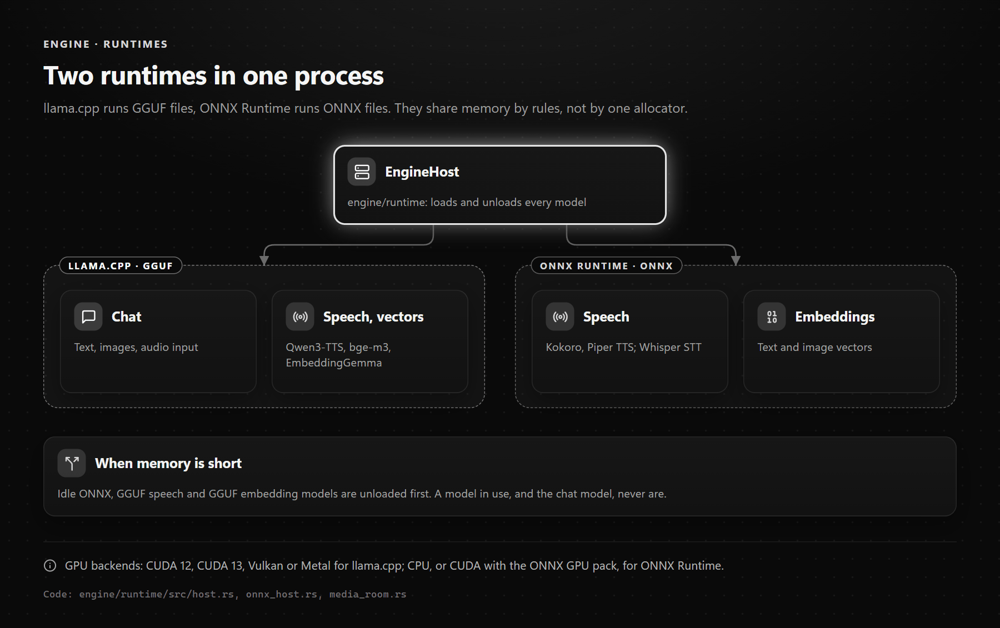
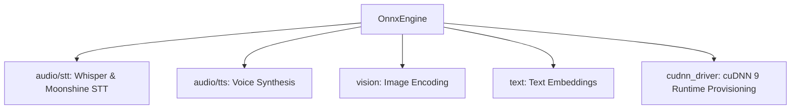

<!-- name: engine/onnx
description: The ONNX Runtime backend: speech to text, text to speech, vision and embeddings. -->

# ONNX Runtime backend (`engine/onnx/`)

The ONNX Runtime backend: speech to text, text to speech, image and text embeddings.

Unified ONNX compute engine for Audio STT (Whisper, Moonshine), TTS (Kokoro and Piper/VITS; the CosyVoice, Matcha, Chatterbox, Supertonic and OmniVoice code is experimental, see [`models.md`](../../models.md)), and Multimodal Vision.

TTS control discovery lives in `audio/tts/capabilities.rs`: languages are separate from named voices, using the existing family/configuration/voice metadata owners. Audio8's protocol declares automatic text-language selection; the API rejects an explicit language-forcing option instead of silently ignoring it. Audio8 stage logs separate prefill, Slow AR, Fast AR and codec/output, including tensor transfers and sink backpressure. The runtime applies shared package admission to graph and external-weight bytes before loading sessions; estimates are not peak-memory guarantees or realtime claims.

## Architecture

## Components

| Module | Responsibility |
|---|---|
| [`audio/stt/`](src/audio/stt/) | Typed PCM and legacy source entries for supported uncached Whisper (`input_features`) and Moonshine (`input_values`) encoder/decoder graphs. |
| [`audio/stt/families/`](src/audio/stt/families/) | Modular STT family adapters (`whisper.rs` for fixed-window Mel-spectrogram encoders, `moonshine.rs` for variable-length raw-waveform encoders). |
| [`audio/tts/`](src/audio/tts/) | Existing family pipelines for voice synthesis; family acceptance is measured separately. |
| [`cudnn_driver.rs`](src/cudnn_driver.rs) | Detects, downloads, SHA-256 verifies, and extracts pinned NVIDIA cuDNN 9 (`9.8.0.87`) runtime shared libraries into `<cluaiz_home>/bin/`, beside `cluaiz` and the GPU packs. |
| [`vision.rs`](src/vision.rs) | CLIP and ViT visual embedding extraction. |
| [`engine.rs`](src/engine.rs) | ONNX Runtime session pooling and execution. |
| [`media.rs`](src/media.rs) | Typed audio tasks/results, session probing, captured provider policy and processor/signature validation. |
| [`ort_env.rs`](src/ort_env.rs) | The one ONNX Runtime environment of the process, made on first use; every session is built on it. |

Image byte decoding now calls `cluaiz_media::image::decode_image` directly with core media limits. ONNX retains its current CLIP resize/normalization step; processor-config-driven normalization and runtime/API vision dispatch are separate pending phases.

STT input preparation directly imports shared source/audio/resample functions. Original encoded audio is decoded to interleaved F32 once, then ONNX explicitly chooses mono, peak limiting and its configured model sample rate. The old stt/loader.rs and its exported entry are removed; downstream Rust callers must use the actual shared APIs. Task-specific STT/TTS/vision acceptance remains separate from provider and compilation checks.

## Provider selection reference

- **Owner:** `engine.rs` owns primary, encoder and vision session construction. These loaders attempt CUDA, then Windows DirectML, then CPU. `n_gpu_layers: 0` bypasses their GPU attempts.
- **CUDA and cuDNN 9 runtime provisioning:** Before registering the CUDA Execution Provider on an NVIDIA system, `cudnn_driver::is_cuda_runtime_ready_or_spawn_background` checks the libraries the provider's CUDA major needs (cudart, cuBLAS, cuFFT, cuRAND on Linux, cuDNN 9). cudart, cuBLAS, cuFFT and cuRAND may come from `<cluaiz_home>/bin/` or the system library search path, since their file names carry the CUDA major. cuDNN counts only from `bin/`, installed there for the provider's variant (`cuda_runtime.ready`): a system cuDNN built for another CUDA major aborted the process. Missing libraries are downloaded in the background from the official NVIDIA redistributables pinned in `src/data/cudnn_sources.json`, checked against their byte length and SHA-256, and extracted into `bin/`; `CLUAIZ_DISABLE_CUDNN_AUTODOWNLOAD=1` turns this off. The libraries are then loaded by full path before the first CUDA session (`load_runtime_libraries`): Linux `dlopen` with `RTLD_GLOBAL`, Windows `LoadLibraryExW`, because glibc reads `LD_LIBRARY_PATH` only at process start and Windows searches the executable's folder before `PATH`. Every name in the list carries its CUDA major (`libcublas.so.12`, `cublas64_12.dll`) and cuDNN comes only from `bin/` for the provider's variant, so no library of another major is loaded. If any of them does not open (or none is found), the CUDA provider is not registered, one warn line is logged, and the session falls back to DirectML/CPU; before 2026-11-27 a failed load only warned and CUDA was registered anyway, and Windows relied on `PATH` order alone. Not taken: checking the major by reading each library's file (the versioned name already says it) and a Windows crate dependency (one `LoadLibraryExW` declaration is enough). Tested without a GPU in `cudnn_driver` unit tests (decision logic, retry order, other-major files ignored).
- **Registration failure:** CUDA and DirectML attempts use `error_on_failure()` so a failed registration cannot be reported as successful GPU registration. A registered provider still does not prove every operator executes on the GPU; unsupported operators can use CPU.
- **TTS execution failure:** `is_gpu_provider_fault` (used by `permits_cpu_execution_retry`) identifies returned errors that show the GPU provider failed: the Windows missing-cuDNN error, DirectML `80070057`, and (added 2026-11-27) `CUDA failure`, `CUDNN failure`, `CUBLAS failure`, `Cannot load symbol cublas...` and a CUDA arena allocation failure. The runtime may retry a whole, undelivered TTS request once on CPU (`engine/runtime/src/onnx_host.rs:593-627`). Tensor shape/type errors and missing package assets do not qualify; a CPU request cannot loop back into this retry. Session creation already falls back CUDA, DirectML, CPU (`engine.rs` load loop). Not taken: matching every error as retryable (a bad request would run twice) and catching the abort in Rust (a C `abort()` ends the process; run 4b's `Invalid handle. Cannot load symbol cublasLtCreate` was printed by native code and its server log is no longer in git, so whether it was an `Err` or an abort is unproven; the message list above covers the `Err` case only).
- **DirectML configuration:** One private `try_directml_session` implementation disables memory patterns and parallel execution, as required by the [ONNX Runtime DirectML contract](https://onnxruntime.ai/docs/execution-providers/DirectML-ExecutionProvider.html#configuration-options). Non-Windows builds skip this attempt and continue to the CPU path. No forwarding-only platform module is used.
- **Auxiliary sessions:** `media.rs` owns `build_session()` with captured settings, strict CUDA registration, Windows DirectML fallback and CPU fallback. Main legacy loaders retain their own established construction flow. Some TTS families still construct sessions directly; those paths are not comprehensively consolidated or certified.
- **Resource fallback:** The existing last CPU retry disables the CPU arena and lowers graph optimization. It does not implement an explicit SSD streaming allocator; existing source log labels must not be treated as evidence of SSD execution.
- **Verification boundary:** Small real ONNX graph tests check CPU execution and retry-builder preservation after provider failure. They do not establish speech quality, visual embeddings, GPU execution, Linux builds, memory peaks or API task routing.

## Typed audio contract

- **Input/output:** `AudioInput::Text` -> `AudioOutput::WavDataUri`; shared `DecodedAudio` -> `AudioOutput::Transcript`. `execute_prepared_audio` rejects a task/modality mismatch. The TTS family computation and WAV encoder are reused through `route_tts_text`; no new synthesis algorithm is introduced.
- **STT graph selection:** `load_audio_package` probes actual sessions from the selected package for either `input_features` (Mel-spectrogram encoder, e.g. Whisper) or `input_values` (raw-waveform encoder, e.g. Moonshine) paired with an uncached decoder declaring `input_ids`, `encoder_hidden_states` and `logits`. Dtypes, ranks, static dimensions and encoder/decoder hidden-state compatibility are checked. Ambiguous/missing graphs or cache-only packages return errors. No fixed empty KV tensor is injected.
- **Processor:** For `input_features` encoders, `preprocessor_config.json` must supply positive feature size, sampling rate, hop, FFT, sample count and frame count. For `input_values` encoders, `preprocessor_config.json` supplies `sampling_rate` (and optional `do_normalize` / `n_samples`), while `config.json` / `tokenizer.json` supply `decoder_start_token_id` (`bos_token_id`), `eos_token_id`, and `max_position_embeddings`. Unsupported lengths fail instead of silently discarding recording tails.
- **Failures:** encoder/decoder run errors, invalid tensor extraction, missing tokenizer/text and stopped output consumer propagate. Existing spectrogram, language probing and greedy sampling remain model-owned routines; universal language/quality equivalence is not asserted.
- **Audio8:** the native family owner executes the exported Slow/Fast AR graphs, FP16 cache deltas and codec decoder with the package tokenizer/protocol. Registered reference profiles are optional; reference-free generation does not establish a persistent speaker identity. Required graphs, external weights and tokenizer are validated before loading. Successful English fixtures do not certify every language, export layout or device.

## Embedding execution contract

- **Owners:** `vision.rs` prepares shared RGB using the package processor; `text.rs` supplies real tokenizer/graph inputs, validates output shape and applies explicit pooling plus the shared `cluaiz_core::contracts::normalize_embedding` L2 normalization. Both image and text use `execute_embedding`; the existing `EmbeddingDriver` image method delegates to it.
- **Sessions:** `load_embedding_package` builds only the selected primary graph through the same captured provider policy as auxiliary audio sessions. `load_vision_model` uses this real owner and replaces the pool rather than appending stale models.
- **Supported processor:** batch-one F32 NCHW/NHWC with one unambiguous RGB axis; config-controlled direct/shortest-edge resize, supported resampling, center crop without padding, rescale and per-channel normalize. Required metadata is not inferred from a model's folder name. Explicit legacy CLIP feature-extractor scaling follows the [pinned integer normalization implementation](https://github.com/huggingface/transformers/blob/v4.11.3/src/transformers/image_utils.py); interpolation parity with Pillow is unverified.
- **Supported output:** one pooled rank-two vector, or text rank-three sequence with package-declared CLS or attention-mask mean pooling. Ambiguous outputs, unsupported inputs/dtypes and invalid vector norms return errors. No empty synthetic image/text tensors satisfy another graph branch.
- **Integration:** the runtime invokes computation on its blocking worker; API `/v1/embeddings` translates text/image requests and reuses existing file authorization. This produces retrieval embeddings, not image Q&A/OCR prose.
- **Scope:** all-family, all-language, quality-ranking, GPU/Linux/macOS, peak allocation and simultaneous chat/audio planning are not certified by these contracts. Installed packages missing processor/tokenizer/pooling assets need those genuine assets before their route can succeed.

## Build step

[`build.rs`](build.rs) embeds every per-language JSON file of the TTS data folders (letter-to-sound rules in `src/audio/tts/data/g2p_rules/`, romanized-writing rules in `transliteration/`, number words in `numbers/`) as generated constants (`RULE_FILES`, `TRANSLITERATION_FILES`, `NUMBER_FILES`). Adding a language is adding a file; no code lists them.

## Tests

69 unit tests and `tests/media_integration.rs`; 11 are ignored (need model files or a GPU provider).
`onnx-engine` builds ONNX Runtime, so the tests were not run on 2026-11-21. Speech and embeddings
were measured in cloud runs (voice and embedding table in `test/benchmarks/`).

## Pending

| Item | Why it matters | Needs |
|---|---|---|
| cuDNN loading fix (2026-10-29) not re-run on a Linux GPU | found on a Tesla T4 on 2026-10-28 | a GPU run |
| Windows `LoadLibraryExW` preload and the 'do not register CUDA on a failed load' rule (2026-11-27) never run on a GPU | unit tests cover only the decision | a Windows NVIDIA run and the T4 rerun of run 4b below |
| Rerun of run 4b (Kokoro on CUDA 12 pack with a CUDA 13 system cuDNN) to see whether the failure is now an `Err` with CPU retry, or still a process abort | the retry list only covers returned errors | a Tesla T4 run |
