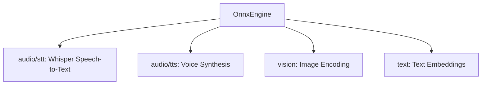

# 🎙️ Cluaiz ONNX Audio & Multimodal Engine (`engine/onnx`)

Unified ONNX compute engine for Audio STT (Whisper), TTS (Kokoro, CosyVoice, Matcha, Chatterbox, Vits), and Multimodal Vision.

## 📐 Architecture

## 📦 Components

| Module | Responsibility |
|---|---|
| [`audio/stt/`](src/audio/stt/) | Typed PCM and legacy source entries for supported uncached Whisper encoder/decoder graphs. |
| [`audio/tts/`](src/audio/tts/) | Existing family pipelines for voice synthesis; family acceptance is measured separately. |
| [`vision.rs`](src/vision.rs) | CLIP and ViT visual embedding extraction. |
| [`engine.rs`](src/engine.rs) | ONNX Runtime session pooling and execution. |
| [`media.rs`](src/media.rs) | Typed audio tasks/results, session probing, captured provider policy and processor/signature validation. |

Image byte decoding now calls `cluaiz_media::image::decode_image` directly with core media limits. ONNX retains its current CLIP resize/normalization step; processor-config-driven normalization and runtime/API vision dispatch are separate pending phases.

STT input preparation directly imports shared source/audio/resample functions. Original encoded audio is decoded to interleaved F32 once, then ONNX explicitly chooses mono, peak limiting and its configured model sample rate. The old stt/loader.rs and its exported entry are removed; downstream Rust callers must use the actual shared APIs. Task-specific STT/TTS/vision acceptance remains separate from provider and compilation checks.

## Provider selection reference

- **Owner:** `engine.rs` owns primary, encoder and vision session construction. These loaders attempt CUDA, then Windows DirectML, then CPU. `n_gpu_layers: 0` bypasses their GPU attempts.
- **Registration failure:** CUDA and DirectML attempts use `error_on_failure()` so a failed registration cannot be reported as successful GPU registration. A registered provider still does not prove every operator executes on the GPU; unsupported operators can use CPU.
- **DirectML configuration:** One private `try_directml_session` implementation disables memory patterns and parallel execution, as required by the [ONNX Runtime DirectML contract](https://onnxruntime.ai/docs/execution-providers/DirectML-ExecutionProvider.html#configuration-options). Non-Windows builds skip this attempt and continue to the CPU path. No forwarding-only platform module is used.
- **Auxiliary sessions:** `media.rs` owns `build_session()` with captured settings, strict CUDA registration, Windows DirectML fallback and CPU fallback. Main legacy loaders retain their own established construction flow. Some TTS families still construct sessions directly; those paths are not comprehensively consolidated or certified.
- **Resource fallback:** The existing last CPU retry disables the CPU arena and lowers graph optimization. It does not implement an explicit SSD streaming allocator; existing source log labels must not be treated as evidence of SSD execution.
- **Verification boundary:** Small real ONNX graph tests check CPU execution and retry-builder preservation after provider failure. They do not establish speech quality, visual embeddings, GPU execution, Linux builds, memory peaks or API task routing.

## Typed audio contract

- **Input/output:** `AudioInput::Text` -> `AudioOutput::WavDataUri`; shared `DecodedAudio` -> `AudioOutput::Transcript`. `execute_prepared_audio` rejects a task/modality mismatch. The TTS family computation and WAV encoder are reused through `route_tts_text`; no new synthesis algorithm is introduced.
- **STT graph selection:** `load_audio_package` probes actual sessions from the selected package for `input_features` and an uncached decoder with `input_ids`, `encoder_hidden_states` and `logits`. Dtypes, ranks, static dimensions and encoder/decoder hidden-state compatibility are checked. Ambiguous/missing graphs or cache-only packages return errors. No fixed empty KV tensor is injected.
- **Processor:** `preprocessor_config.json` must supply positive feature size, sampling rate, hop, FFT, sample count and frame count. These dimensions govern PCM conversion and mel tensor construction. Decoder token IDs come from the installed tokenizer; model encoder positions do not replace processor frame counts. Unsupported lengths fail instead of silently discarding recording tails.
- **Failures:** encoder/decoder run errors, invalid tensor extraction, missing tokenizer/text and stopped output consumer propagate. Existing spectrogram, language probing and greedy sampling remain model-owned routines; universal language/quality equivalence is not asserted.

## Embedding execution contract

- **Owners:** `vision.rs` prepares shared RGB using the package processor; `text.rs` supplies real tokenizer/graph inputs, validates output shape and applies explicit pooling plus L2 normalization. Both image and text use `execute_embedding`; the existing `EmbeddingDriver` image method delegates to it.
- **Sessions:** `load_embedding_package` builds only the selected primary graph through the same captured provider policy as auxiliary audio sessions. `load_vision_model` uses this real owner and replaces the pool rather than appending stale models.
- **Supported processor:** batch-one F32 NCHW/NHWC with one unambiguous RGB axis; config-controlled direct/shortest-edge resize, supported resampling, center crop without padding, rescale and per-channel normalize. Required metadata is not inferred from a model's folder name. Explicit legacy CLIP feature-extractor scaling follows the [pinned integer normalization implementation](https://github.com/huggingface/transformers/blob/v4.11.3/src/transformers/image_utils.py); interpolation parity with Pillow is unverified.
- **Supported output:** one pooled rank-two vector, or text rank-three sequence with package-declared CLS or attention-mask mean pooling. Ambiguous outputs, unsupported inputs/dtypes and invalid vector norms return errors. No empty synthetic image/text tensors satisfy another graph branch.
- **Integration:** the runtime invokes computation on its blocking worker; API `/v1/embeddings` translates text/image requests and reuses existing file authorization. This produces retrieval embeddings, not image Q&A/OCR prose.
- **Scope:** all-family, all-language, quality-ranking, GPU/Linux/macOS, peak allocation and simultaneous chat/audio planning are not certified by these contracts. Installed packages missing processor/tokenizer/pooling assets need those genuine assets before their route can succeed.
