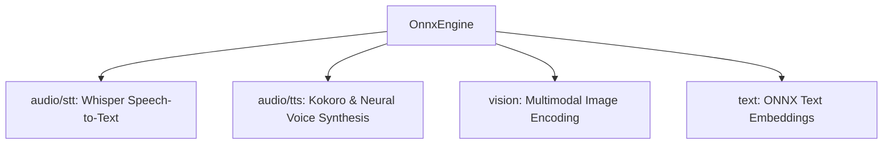

# 🎙️ Cluaiz ONNX Audio & Multimodal Engine (`engine/onnx`)

Unified ONNX compute engine for Audio STT (Whisper), TTS (Kokoro, CosyVoice, Matcha, Chatterbox, Vits), and Multimodal Vision.

## 📐 Architecture

## 📦 Components

| Module | Responsibility |
|---|---|
| [`audio/stt/`](src/audio/stt/) | Local streaming Whisper speech-to-text inference with VAD support. |
| [`audio/tts/`](src/audio/tts/) | Ultra-low latency voice synthesis (Kokoro, CosyVoice, Matcha, Chatterbox). |
| [`vision.rs`](src/vision.rs) | CLIP and ViT visual embedding extraction. |
| [`engine.rs`](src/engine.rs) | ONNX Runtime session pooling and execution. |
