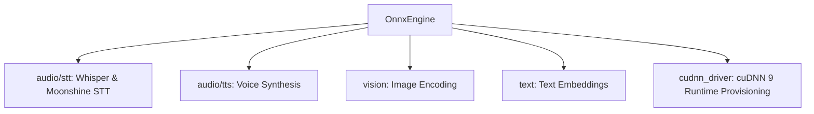

# 🎙️ Cluaiz ONNX Audio & Multimodal Engine (`engine/onnx`)

Unified ONNX compute engine for Audio STT (Whisper, Moonshine), TTS (Kokoro, CosyVoice, Matcha, Chatterbox, Vits), and Multimodal Vision.

TTS control discovery lives in `audio/tts/capabilities.rs`: languages are separate from named voices, using the existing family/configuration/voice metadata owners. Audio8's protocol declares automatic text-language selection; the API rejects an explicit language-forcing option instead of silently ignoring it. Audio8 stage logs separate prefill, Slow AR, Fast AR and codec/output, including tensor transfers and sink backpressure. The runtime applies shared package admission to graph and external-weight bytes before loading sessions; estimates are not peak-memory guarantees or realtime claims.

## 📐 Architecture

## 📦 Components

| Module | Responsibility |
|---|---|
| [`audio/stt/`](src/audio/stt/) | Typed PCM and legacy source entries for supported uncached Whisper (`input_features`) and Moonshine (`input_values`) encoder/decoder graphs. |
| [`audio/stt/families/`](src/audio/stt/families/) | Modular STT family adapters (`whisper.rs` for fixed-window Mel-spectrogram encoders, `moonshine.rs` for variable-length raw-waveform encoders). |
| [`audio/tts/`](src/audio/tts/) | Existing family pipelines for voice synthesis; family acceptance is measured separately. |
| [`cudnn_driver.rs`](src/cudnn_driver.rs) | Detects, downloads, SHA-256 verifies, and extracts pinned NVIDIA cuDNN 9 (`9.8.0.87`) runtime shared libraries into `<cluaiz_home>/bin/`, beside `cluaiz` and the GPU packs. |
| [`vision.rs`](src/vision.rs) | CLIP and ViT visual embedding extraction. |
| [`engine.rs`](src/engine.rs) | ONNX Runtime session pooling and execution. |
| [`media.rs`](src/media.rs) | Typed audio tasks/results, session probing, captured provider policy and processor/signature validation. |

Image byte decoding now calls `cluaiz_media::image::decode_image` directly with core media limits. ONNX retains its current CLIP resize/normalization step; processor-config-driven normalization and runtime/API vision dispatch are separate pending phases.

STT input preparation directly imports shared source/audio/resample functions. Original encoded audio is decoded to interleaved F32 once, then ONNX explicitly chooses mono, peak limiting and its configured model sample rate. The old stt/loader.rs and its exported entry are removed; downstream Rust callers must use the actual shared APIs. Task-specific STT/TTS/vision acceptance remains separate from provider and compilation checks.

## Provider selection reference

- **Owner:** `engine.rs` owns primary, encoder and vision session construction. These loaders attempt CUDA, then Windows DirectML, then CPU. `n_gpu_layers: 0` bypasses their GPU attempts.
- **CUDA and cuDNN 9 runtime provisioning:** Before registering the CUDA Execution Provider on an NVIDIA system, `cudnn_driver::is_cuda_runtime_ready_or_spawn_background` checks the libraries the provider's CUDA major needs (cudart, cuBLAS, cuFFT, cuRAND on Linux, cuDNN 9). cudart, cuBLAS, cuFFT and cuRAND may come from `<cluaiz_home>/bin/` or the system library search path, since their file names carry the CUDA major. cuDNN counts only from `bin/`, installed there for the provider's variant (`cuda_runtime.ready`): a system cuDNN built for another CUDA major aborted the process. Missing libraries are downloaded in the background from the official NVIDIA redistributables pinned in `src/data/cudnn_sources.json`, checked against their byte length and SHA-256, and extracted into `bin/`; `CLUAIZ_DISABLE_CUDNN_AUTODOWNLOAD=1` turns this off. On Linux the loader reads `LD_LIBRARY_PATH` only at process start, so the libraries are loaded by full path before the first CUDA session.
- **Registration failure:** CUDA and DirectML attempts use `error_on_failure()` so a failed registration cannot be reported as successful GPU registration. A registered provider still does not prove every operator executes on the GPU; unsupported operators can use CPU.
- **TTS execution failure:** `permits_cpu_execution_retry` identifies the observed Windows missing-cuDNN execution error and DirectML `80070057` operator failure. The runtime may retry a whole, undelivered TTS request once on CPU. Tensor shape/type errors and missing package assets do not qualify; a CPU request cannot loop back into this retry.
- **DirectML configuration:** One private `try_directml_session` implementation disables memory patterns and parallel execution, as required by the [ONNX Runtime DirectML contract](https://onnxruntime.ai/docs/execution-providers/DirectML-ExecutionProvider.html#configuration-options). Non-Windows builds skip this attempt and continue to the CPU path. No forwarding-only platform module is used.
- **Auxiliary sessions:** `media.rs` owns `build_session()` with captured settings, strict CUDA registration, Windows DirectML fallback and CPU fallback. Main legacy loaders retain their own established construction flow. Some TTS families still construct sessions directly; those paths are not comprehensively consolidated or certified.
- **Resource fallback:** The existing last CPU retry disables the CPU arena and lowers graph optimization. It does not implement an explicit SSD streaming allocator; existing source log labels must not be treated as evidence of SSD execution.
- **Verification boundary:** Small real ONNX graph tests check CPU execution and retry-builder preservation after provider failure. They do not establish speech quality, visual embeddings, GPU execution, Linux builds, memory peaks or API task routing.

## Typed audio contract

- **Input/output:** `AudioInput::Text` -> `AudioOutput::WavDataUri`; shared `DecodedAudio` -> `AudioOutput::Transcript`. `execute_prepared_audio` rejects a task/modality mismatch. The TTS family computation and WAV encoder are reused through `route_tts_text`; no new synthesis algorithm is introduced.
- **STT graph selection:** `load_audio_package` probes actual sessions from the selected package for either `input_features` (Mel-spectrogram encoder, e.g. Whisper) or `input_values` (raw-waveform encoder, e.g. Moonshine) paired with an uncached decoder declaring `input_ids`, `encoder_hidden_states` and `logits`. Dtypes, ranks, static dimensions and encoder/decoder hidden-state compatibility are checked. Ambiguous/missing graphs or cache-only packages return errors. No fixed empty KV tensor is injected.
- **Processor:** For `input_features` encoders, `preprocessor_config.json` must supply positive feature size, sampling rate, hop, FFT, sample count and frame count. For `input_values` encoders, `preprocessor_config.json` supplies `sampling_rate` (and optional `do_normalize` / `n_samples`), while `config.json` / `tokenizer.json` supply `decoder_start_token_id` (`bos_token_id`), `eos_token_id`, and `max_position_embeddings`. Unsupported lengths fail instead of silently discarding recording tails.
- **Failures:** encoder/decoder run errors, invalid tensor extraction, missing tokenizer/text and stopped output consumer propagate. Existing spectrogram, language probing and greedy sampling remain model-owned routines; universal language/quality equivalence is not asserted.
- **Audio8:** the native family owner executes the exported Slow/Fast AR graphs, FP16 cache deltas and codec decoder with the package tokenizer/protocol. Registered reference profiles are optional; reference-free generation does not establish a persistent speaker identity. Required graphs, external weights and tokenizer are validated before loading. Successful English fixtures do not certify every language, export layout or device.

## Embedding execution contract

- **Owners:** `vision.rs` prepares shared RGB using the package processor; `text.rs` supplies real tokenizer/graph inputs, validates output shape and applies explicit pooling plus the shared `cluaiz_core::contracts::normalize_embedding` L2 normalization. Both image and text use `execute_embedding`; the existing `EmbeddingDriver` image method delegates to it.
- **Sessions:** `load_embedding_package` builds only the selected primary graph through the same captured provider policy as auxiliary audio sessions. `load_vision_model` uses this real owner and replaces the pool rather than appending stale models.
- **Supported processor:** batch-one F32 NCHW/NHWC with one unambiguous RGB axis; config-controlled direct/shortest-edge resize, supported resampling, center crop without padding, rescale and per-channel normalize. Required metadata is not inferred from a model's folder name. Explicit legacy CLIP feature-extractor scaling follows the [pinned integer normalization implementation](https://github.com/huggingface/transformers/blob/v4.11.3/src/transformers/image_utils.py); interpolation parity with Pillow is unverified.
- **Supported output:** one pooled rank-two vector, or text rank-three sequence with package-declared CLS or attention-mask mean pooling. Ambiguous outputs, unsupported inputs/dtypes and invalid vector norms return errors. No empty synthetic image/text tensors satisfy another graph branch.
- **Integration:** the runtime invokes computation on its blocking worker; API `/v1/embeddings` translates text/image requests and reuses existing file authorization. This produces retrieval embeddings, not image Q&A/OCR prose.
- **Scope:** all-family, all-language, quality-ranking, GPU/Linux/macOS, peak allocation and simultaneous chat/audio planning are not certified by these contracts. Installed packages missing processor/tokenizer/pooling assets need those genuine assets before their route can succeed.
