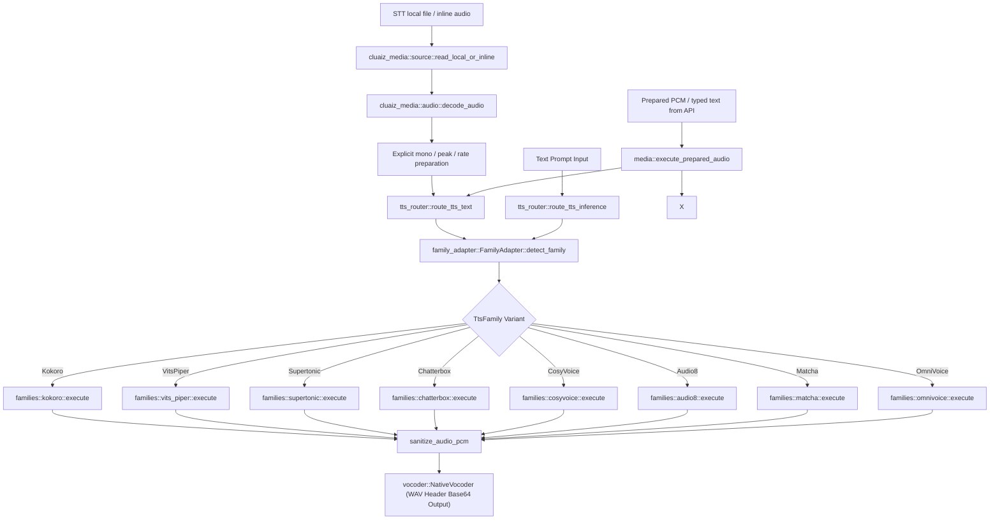

# Component: Cluaiz ONNX Audio & TTS Subsystem (`src/audio/`)

## Technical Specification
- **Purpose:** ONNX STT model preprocessing/graphs and multi-family TTS orchestration. Input source reading, codec decoding and PCM preparation are shared through cluaiz-media.
- **Platform Support:** Linux x86_64, macOS ARM64, Windows x86_64, Android AArch64.
- **Reusability Level:** Backend-owned model processing; common audio preparation is imported directly from cluaiz-media.

---

## Architectural Flow

---

## API Contract (Interface)

### Hindi pronunciation input boundaries

`tts/rules_g2p.rs` uses per-language `data/g2p_rules/*.json` rules. Abugida files may declare `ignored_characters` (formatting controls or elision signs) and `word_separators` (internal word boundaries). Hindi declares ZWJ/ZWNJ and avagraha as ignored, and selected hyphens, slash and apostrophes as separators. Each piece runs through the existing vowel/schwa rules independently; formatting controls do not split consonant conjuncts. Other languages retain their own policy; Hindi does not override a preferred same-script language merely because it accepts a separator.

Hindi examples include decomposed nasal vowels (`में`, `एँ`), anusvara before non-stop consonants, Om, vocalic vowels/signs and avagraha. Vocalic R/L mappings follow this Hindi rule file's existing pronunciation convention; they do not certify Vedic/Sanskrit recitation. Nasalization and vowel length remain separate phoneme symbols and must survive the selected model's symbol conversion.

`PhonemeMap::require_phonemes` rejects sequences containing only that package's pad/BOS/EOS IDs before either Kokoro or Piper inference. A nonempty token vector alone does not prove any speech content was encoded. This prevents unsupported-only input from producing a meaningless waveform. It does not detect every omitted symbol or certify pronunciation quality.

Run `cargo test -p onnx-engine --offline --lib -- audio::tts` in an isolated home. The ignored `actual_hindi_vowels_fit_installed_model_symbols` test additionally requires `CLUAIZ_TTS_TEST_MODEL` pointing to a staged genuine package and checks actual symbol coverage. Real waveform/listening acceptance is separate from IPA, token-count and HTTP-success tests.

- **Core Router Entry:** `tts_router::route_tts_inference(engine, session, prompt, tokenizer) -> Result<String>`
- **Typed entries:** `route_tts_text(engine, session, text)` preserves text at the transport boundary; `OnnxEngine::execute_stt_prepared` accepts shared PCM without source fetching. Legacy tagged prompts adapt to these entries.
- **Audio Sanitizer:** `tts_router::sanitize_audio_pcm(pcm: Vec<f32>) -> Result<Vec<f32>>`
- **Family Inspector:** `family_adapter::FamilyAdapter::detect_family(model_dir, sessions) -> TtsFamily`
- **Asset Gate:** `family_adapter::FamilyAdapter::validate_package_inventory(family, model_dir) -> Result<()>`
- **Export Type:** Public Rust modules through `onnx_engine`; native inference is delegated to ONNX Runtime through `ort`.

---

## Deep File Breakdown

### A. Core Audio Subsystem (`src/audio/`)
- [`config.rs`](./config.rs):
  - **Logic:** Dynamic JSON config parser (`config.json`, `preprocessor_config.json`, `generation_config.json`).
  - **Why:** Resolves model parameters and special token IDs across Whisper and TTS pipelines.
- **Shared input preparation:** `cluaiz_media::source`, `cluaiz_media::audio`, `cluaiz_media::resample` own bounded local/data URI reads, codec decoding, channel conversion and rate conversion. `stt/loader.rs` and its re-exports are removed. Remote audio must first be resolved by the asynchronous shared source resolver; this synchronous legacy STT entry does not download URLs.
- [`spectrogram.rs`](./stt/spectrogram.rs):
  - **Logic:** Computes log-mel features using the validated processor configuration. Numerical parity with every upstream processor has not been measured.
- [`mel_bank.rs`](./stt/mel_bank.rs):
  - **Logic:** Builds dynamic Slaney mel filterbank matrices (80 and 128 channels).
- [`decoder.rs`](./stt/decoder.rs):
  - **Logic:** Autoregressive ONNX inference loop executing encoder-decoder transformer layers.
  - **Input policy:** Typed calls retain shared PCM and choose mono plus `LimitToUnit` peak policy before resampling at the processor rate. Legacy calls decode through shared utilities first. Oversized recording windows and native errors fail explicitly. Cached decoder topologies are rejected until their cache contract is implemented.

### B. Registered ONNX TTS Engine (`src/audio/tts/`)
- [`tts_router.rs`](./tts/tts_router.rs):
  - **Logic:** High-level router that parses prompts, groups sentences toward a 140 UTF-8-byte target and splits long sentences at whitespace, detects family variant, validates inventory, executes model family pipelines, sanitizes PCM output, and encodes base64 WAV URIs. Whole words stay intact; a single oversized word remains subject to the model's native token guard.
  - **Pronunciation normalization:** Abugida files can opt into canonical Unicode normalization with `normalize_unicode`; Hindi enables it so canonical-equivalent nukta spellings reach the same pronunciation keys. Other rule files keep their existing behavior. Regression inputs live in test-only `data/pronunciation_tests.json`.
- [`family_adapter.rs`](./tts/family_adapter.rs):
  - **Logic:** Pre-boot asset inventory validator and priority family detector checking `model_registry.json`, `model_manifest.json`, and ONNX session signature inputs.
- [`manifest_loader.rs`](./tts/manifest_loader.rs):
  - **Logic:** Parses manifest JSON configs to dynamically determine model sample rates (22.05kHz, 24kHz, 44.1kHz), mel channels, and token offsets.
- [`phoneme_map.rs`](./tts/phoneme_map.rs):
  - **Logic:** IPA & G2P phoneme-to-ID lookup mapper for VITS/Piper models.
- [`g2p.rs`](./tts/g2p.rs):
  - **Logic:** Rule-based and lexicon-assisted Grapheme-to-Phoneme converter.
- [`vocoder.rs`](./tts/vocoder.rs):
  - **Logic:** Native WAV encoder constructing standard PCM RIFF headers from float32 audio buffers.
- [`neural_vocoder.rs`](./tts/neural_vocoder.rs):
  - **Logic:** Executes HiFi-GAN / Vocos neural vocoder ONNX graphs converting mel-spectrogram matrices into PCM audio waveforms.

### C. 8 Model Family Handlers (`src/audio/tts/families/`)
- [`kokoro.rs`](./tts/families/kokoro.rs):
  - **Logic:** Family 2 (Kokoro-82M). Loads voice style vector `.bin` matrices (`[1, 256]`) and passes phoneme IDs through `model_uint8.onnx`.
- [`vits_piper.rs`](./tts/families/vits_piper.rs):
  - **Logic:** Family 1 (Piper/VITS). Inserts inter-phoneme zero-padding (`token 0`) for acoustic alignment and executes single-stage end-to-end variational inference.
- [`supertonic.rs`](./tts/families/supertonic.rs):
  - **Logic:** Family 3 (Supertonic-3). Runs 4-stage pipeline (Text Encoder -> Duration Predictor -> 8-step Euler ODE Denoising Loop -> Vocoder). Uses linear duration interpolation across token boundaries to eliminate 2-3x word repetition.
- [`chatterbox.rs`](./tts/families/chatterbox.rs):
  - **Logic:** Family 7 (Chatterbox Turbo). Runs 4-stage multi-codec pipeline. Uses clean reference speech embedding extraction and top-p temperature-scaled logit decoding (0.7) with repetition penalty (1.2) to eliminate static burning noise.
- [`cosyvoice.rs`](./tts/families/cosyvoice.rs):
  - **Logic:** Family 6 (CosyVoice2). Extracts speaker embeddings via `campplus.onnx` and dynamically maps all 6 required flow estimator input tensors (`prompt_token`, `prompt_speech`, `embedding`, `len`, `token_ids`) before feeding `hift.onnx` vocoder.
- [`audio8.rs`](./tts/families/audio8.rs):
  - **Status:** Audio8 native synthesis is not implemented for the exported FP16 KV-cache/logits topology. The former guessed tensor inputs and fabricated codec codebooks are removed. The route returns an explicit error; genuine tokenizer/reference-voice handling and stateful Slow/Fast AR generation remain required. No Audio8 speech quality or synthesis success is claimed.
- [`matcha.rs`](./tts/families/matcha.rs):
  - **Logic:** Family 5 (Matcha/LuxTTS). Executes 2-stage flow matching pipeline (`text_encoder_int8` -> `fm_decoder_int8` ODE loop -> `vocos.bin` / neural vocoder). Uses rank-1 unit slice tensor mapping for ORT scalar inputs.
- [`omnivoice.rs`](./tts/families/omnivoice.rs):
  - **Logic:** Family 8 (OmniVoice GenAI). Executes multi-head audio decoder (`audio_embeddings_encoder` -> 28-layer `llm_decoder` KV-cache -> `audio_heads_decoder` -> 8-codebook argmax decoding).

---

## Failure & Recovery Logic
- **Invalid Output PCM Buffer:** `sanitize_audio_pcm` checks generated float32 samples for `NaN` or `Infinite` values and aborts synthesis to prevent speaker buzzing/clipping damage.
- **Low Signal Noise Amplification:** If max amplitude is below `0.01`, peak scaling is skipped to avoid multiplying background neural floating-point noise into blowing air sound ("fhoor fhoor").
- **Asset Inventory Failure:** `validate_package_inventory` checks required ONNX sub-components before allocating GPU/RAM session memory and returns `PackageContractException`.

