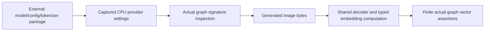

# Component: ONNX native media acceptance

## Technical Specification
- **Purpose:** Opt-in real graph/EmbeddingDriver proof with externally supplied read-only image package paths.
- **Platform Support:** The test uses configured CPU ONNX Runtime. A run on one host does not certify other OS/GPU combinations.
- **Reusability Level:** Integration test only; no diagnostic command is added to production binaries.

## Architectural Flow

## Interface and Files
- **media_integration.rs:** `real_image_graph_signature_and_embedding_driver` prints actual declared input/output types and runs the existing `EmbeddingDriver::gen_multimodal_embedding` boundary. `CLUAIZ_ONNX_IMAGE_MODEL` supplies the graph path; its package must contain genuine processor and tokenizer assets when the graph requires them.
- **TTS acceptance:** `real_installed_tts_packages_produce_nonempty_waveforms` takes `CLUAIZ_TTS_TEST_PACKAGES` (JSON array of selected graph paths), `CLUAIZ_TTS_TEST_TEXT` and `CLUAIZ_TTS_TEST_OUTPUT`. It runs each package through the existing typed TTS boundary, checks empty-input refusal and a real nonempty/non-silent PCM WAV, saves each successful WAV, and reports each real failure. A WAV signal assertion alone does not establish intelligible speech or pronunciation; listen to the saved artifacts before claiming synthesis quality.
- **Execution:** `cargo test -p onnx-engine --release --test media_integration --offline -- --ignored --nocapture`.
- **Lifecycle:** The test owns its engine/session and image buffers. It does not modify supplied weights; owner Drop releases sessions.

## Failure and Evidence Boundaries
- **Failure:** Missing external environment/assets, unsupported signatures or failed inference return the actual error. Normal test runs skip this fixture.
- **Limits:** Finite vectors do not prove semantic ranking, OCR output, numerical processor parity, platform-wide support or a process memory ceiling. HTTP request/rejection acceptance is separately exercised by the API embedding fixture.
