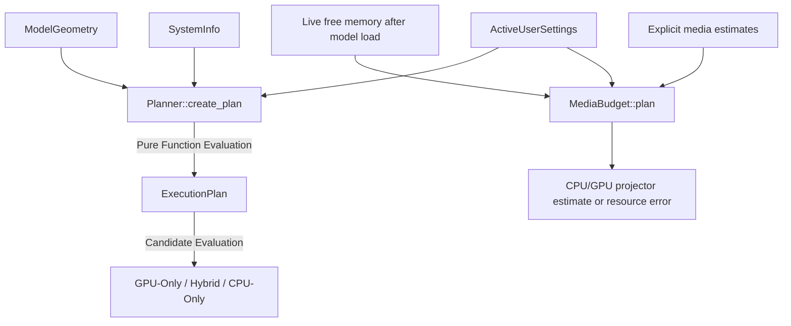

# Cluaiz Execution Planner (`engine/plan`)

Pure mathematical negotiation and placement engine for Cluaiz.

## Architecture

## Components

| Module | Responsibility |
|---|---|
| [`types.rs`](src/types.rs) | Typed data structures for Candidates, Tiers, and ExecutionPlans. |
| [`planner.rs`](src/planner.rs) | Pure mathematical calculation of memory budgets and candidate selection. |
| [`margin.rs`](src/margin.rs) | VRAM a model really took on this machine, kept in `config/vram_margins.json`. |
| [`speed.rs`](src/speed.rs) | STEP 4: speeds measured by `cluaiz bench`; a placement measured faster replaces the rule-order pick. |
| [`report.rs`](src/report.rs) | The plan as `cluaiz show` prints it (see Plan report below). |
| [`moe_cache.rs`](src/moe_cache.rs) | Size and CPU share of llama.cpp's MoE GPU cache for a MoE split (see below). |
| [`media_budget.rs`](src/media_budget.rs) | Additive media preflight after model load. Reuses safety policies without changing text placement math. |

## Auto context and KV cache

With context and KV cache on Auto, the model stays on the GPU first and the KV cache gets smaller
before the context does. Each step uses the first VRAM buffer; the 512 MiB fallback buffer only
reaches the floor (so less free memory never gives a bigger context).

| Step | When | Context, KV |
|---|---|---|
| 1 | 16384 tokens of F16 KV fit | 16384 (`AUTO_CONTEXT_TARGET`), F16 |
| 2 | at least 4096 tokens of Q8 KV fit | largest that fits up to 16384, Q8 (near lossless) |
| 3 | 4096 tokens of Q4 KV fit | 4096, Q4 (only to stay on the GPU) |
| 4 | 2048-4095 tokens fit | that, Q4 (CTX rule 3a: speed first) |
| 5 | nothing fits on the GPU | split between GPU and RAM: 8192 (`AUTO_SPLIT_CONTEXT`), Q8; 4096 when RAM is too short |

Sliding-window layers (Gemma, gpt-oss) keep their window plus one batch of cells, as llama-server
does (`swa_full` off). With llama.cpp's context default (`swa_full` on) they keep the whole context: on
Gemma 4 26B at 4096 tokens, Q8 KV, 479 MiB of KV instead of 213.

On the CPU only, Auto keeps 4096 (RAM is not filled with context). A context, KV type, GPU layers
or VRAM buffer set by the user is used as given. Max gives the model's native limit.

Hybrid models (Qwen3.5, Qwen3-Next) keep a KV cache only in their attention layers; their
linear-attention layers hold a fixed state (`ModelGeometry::recurrent_layers`), counted the way
llama.cpp allocates it.

## MoE GPU cache

When a MoE model does not fit on the GPU, the MoE split keeps attention and KV on the GPU and
the experts of the first `n_cpu_moe` layers in RAM. llama.cpp's MoE cache can then keep the most
used experts in VRAM for generation:

- `moe_cache_size` is the cache size, `--moe-cache-mib` in llama-server.
- `moe_cache_cpu_share` is the share of the misses the CPU computes instead of uploading them,
  `--moe-cache-cpu-share`.
- Sources: llama.cpp #29887, #30966 and `docs/moe-cache.md`.

Prompt batches of more than 32 tokens do not use the cache. The planner sets it
([`moe_cache.rs`](src/moe_cache.rs), `moe_cache_split` in [`planner.rs`](src/planner.rs)), and
[`native_load.rs`](../runtime/src/native_load.rs) passes it to llama.cpp's context params.

| When | What the planner does |
|---|---|
| The model fits on the GPU, CPU only, Apple Silicon (unified memory), user `n_gpu_layers` / `n_cpu_moe` | no cache; placement unchanged |
| MoE split that needs experts read from disk (model bigger than the RAM limit) | no cache; placement unchanged |
| MoE split in RAM, the VRAM left with every expert in RAM is at least 20% of the experts | every expert in RAM (`n_cpu_moe` = all layers), all that VRAM as the cache |
| MoE split in RAM, less VRAM left | a cache of 10% of the experts (or the VRAM left, if less), plus the expert layers that still fit in VRAM |
| A cache under 256 MiB | no cache |

The CPU share comes from the cache's share of the experts:

| Cache / experts | CPU share |
|---|---|
| up to 12% | 0.95 |
| up to 25% | 0.9 |
| up to 45% | 0.8 |
| more | 0 |

The cache is counted in the plan's VRAM, so the learned pool gap and the load retry
(`after_failed_load`) include it. A placement with the cache keeps its own speed measurements
(`speed.rs`, keys with `mc:`). The keys of placements without the cache are unchanged.

### Where the numbers come from

[Run 13](../../test/cloud/runs/2026-11-15-run13-moe-cache/SUMMARY.md) used official llama.cpp
`b54752d` on an L4 GPU. Generation, tokens/s:

| Model | GPU | `--fit`, no cache | With the cache |
|---|---|---|---|
| Qwen3-30B-A3B Q4_K_M | 8 GB | 26.7 | 57.4 (every expert in RAM, 5.4 GB cache) |
| Qwen3-30B-A3B Q4_K_M | 4 GB | 20.8 | 31.8 (10% cache) / 26.8 (every expert in RAM) |
| gpt-oss-20b MXFP4 | 8 GB | 27.9 | 37.2 (every expert in RAM, 5.6 GB cache) |
| gpt-oss-20b MXFP4 | 4 GB | 15.5 | 17.4 (10% cache) / 16.8 (every expert in RAM) |
| gpt-oss-120b MXFP4, 59 GiB > 31 GB RAM | 22 GB | 10.15 (experts of 11 layers in VRAM) | 7.4 at best (every expert in RAM, 17 GB cache) |

Cluaiz itself on a Windows 11 laptop (2026-11-16): RTX 3050 4 GB with 2.5 GB free, CUDA, OLMoE-1B-7B Q4_K_M
(3.9 GB), `cluaiz bench -r 3`, generation t/s (tg128):

| Placement | t/s |
|---|---|
| Planner with the cache: every expert in RAM, 1.40 GB cache, CPU share 0.8 | **68.3 ± 3.9** |
| Planner with `CLUAIZ_MOE_CACHE=off`: experts of 11 / 16 layers in RAM | 53.5 ± 3.6 |
| Every expert in RAM without a cache (`--n-cpu-moe 16`) | 39.6 ± 3.2 |

Prompt speed (pp512) stayed within the run-to-run spread: 929 ± 254 with the cache, 1004 ± 292 without.
With less free RAM (3.57 GB allowed, 3.69 GB needed for every expert in RAM) the same planner kept the
placement without a cache, as the rule says.

The share rule is the lowest share within 5% of the fastest, from llama.cpp's own tuner
(`scripts/moe-cache-tune.py`), with the experts mmap'd. With a share of 0, a small cache was slower
than no cache. A model read from disk is limited by the disk, so it keeps the placement without a
cache.

### Debugging a speed change

- **Planner log line:** the plan banner shows `MoE cache : X GB … CPU share …`, and the MoE split
  reason ends with `MoE cache X GB in VRAM`.
- **llama.cpp log lines:** `MoE cache size = … MiB for … MiB of host experts, N% of the misses on the CPU`
  at load. llama.cpp prints the hit rate per ubatch only at its debug level (`llama-server -lv 4`).
- **Turning it off:** set `CLUAIZ_MOE_CACHE=off` in the environment of `cluaiz serve` / `cluaiz run`.
  The plan is then exactly the plan without the cache, so a speed difference shows up directly.
- **Not tested yet:** Windows laptops, Vulkan and ROCm builds, and pinned experts (`-lm mlock`, which
  run 13 found faster but Cluaiz does not set). The measured rows above are CUDA on Linux.

## VRAM buffer

| Model | Kept free |
|---|---|
| Not measured, no llama.cpp dry run | 1024 MiB, else 512 MiB (llama.cpp's `--fit-target` rule) |
| Not measured, dry run done (every GPU load runs it first) | desktop reserve + 0.30 GB for the GPU pool, at most 1.0 GB (0.50 GB on a 4 GB GPU) |
| Measured | its GPU pool growth after a full-batch warmup (largest seen) + a desktop reserve of 5% of the GPU, at least 0.15 GB and at most 1.0 GB; 0.15 GB when NVML shows the GPU is used by nothing else (no display, not a Windows WDDM device, no other process) |
| Tight gap | when the gap above leaves less of the model on the GPU (a split instead of Full GPU, part of the attention instead of all of it, fewer blocks, CPU only): 0.15 GB + the measured pool. Never for a Full GPU plan, never when it reads more from disk |
| User setting | the user's value |

The dry run is llama.cpp's own size of the model fully on the GPU (no allocation). Its difference to
the estimate is added to each placement in proportion to the weights that placement puts on the GPU.

After a load:
- a load that leaves the GPU nearly full (less than 0.15 GB free, or more planned than was free) may have
  moved memory to Windows' shared GPU memory, so its size is not known; it is kept as needing all the
  VRAM that was free, and the model is planned again on the same free memory and loaded once with the
  smaller placement. The same plan is not loaded twice.
- a load that llama.cpp cannot allocate records the miss and loads the next smaller placement.

## RAM buffer

Auto keeps 5% of total RAM free, at most 4 GB (`RAM_RESERVE_MAX_GB`), counting what other apps use now.
A GB buffer set by the user (`custom_ram_buffer_gb`) replaces it.

## Plan report

`cluaiz show` prints, per device: free now, kept free (and why), what Cluaiz may use, what goes there
(weights, KV, llama.cpp's working space, MoE cache) and whether the total fits; then what is read from
the SSD, a one-line summary, the context and KV choice, the same placement as llama.cpp flags, the
measured speed, and the other placements with what each needs. A rejected plan shows the placement
closest to fitting, its shortfall per device and what would make it fit. Every number comes from the
plan (`vram_weights_gb`, `ram_weights_gb`, `vram_free_gb`, `ram_free_gb` and the candidate fields);
`system.plan` returns the same values as data.

Memory is in GB of 1024³ bytes, as the OS reports RAM and VRAM. File sizes are in GB as Hugging Face
counts them (10⁹ bytes), as `cluaiz pull` and `cluaiz list` show them. A negative measured gap is
shown as 0 kept free: it only removes the margin, it never adds VRAM.

## Media preflight contract

- **Input:** `MediaRequirements` has non-zero weight/workspace estimates and a decoded-buffer byte count, including simultaneous copies. `SystemInfo` must describe current free memory after existing model allocations; do not subtract the resident model again.
- **Host check:** weights + workspace + decoded data must fit `ram_budget_bytes`; decoded data also obeys the configured media ceiling. Invalid RAM telemetry/settings and checked-sum overflow return errors.
- **Device check:** when requested and GPU telemetry is usable, weights + workspace + one of the existing VRAM buffer choices must fit. Otherwise use CPU if the host check fits. GPU placement is an estimate, not proof that a driver loaded successfully.
- **Output:** immutable `MediaBudget` placement and estimated host/device/safety-buffer bytes. A resource failure allocates nothing. This helper does not modify `ExecutionPlan` or reserve OS memory.
- **Request recheck:** `check_request_ram` charges only conservative workspace plus additional native conversion buffers against fresh usable RAM. Resident weights and already-prepared buffers are excluded from new allocation costs. The configured decoded ceiling remains a ceiling, not the request size. A refusal reports required/free/reserve/usable bytes; the existing Chat plan and its safety-buffer policy are unchanged.
- **Limits:** estimates must cover native expansion/temporary work supplied by the caller. Peak encoder allocations and concurrent external memory use are not bounded by this arithmetic alone. The native session performs fresh live probes before new projector allocation.
