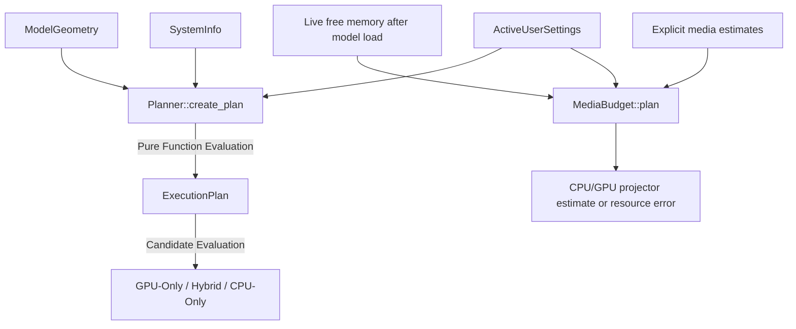

# 🎯 Cluaiz Execution Planner (`engine/plan`)

Pure mathematical negotiation and placement engine for Cluaiz.

## 📐 Architecture

## 📦 Components

| Module | Responsibility |
|---|---|
| [`types.rs`](src/types.rs) | Typed data structures for Candidates, Tiers, and ExecutionPlans. |
| [`planner.rs`](src/planner.rs) | Pure mathematical calculation of memory budgets and candidate selection. |
| [`media_budget.rs`](src/media_budget.rs) | Additive media preflight after model load. Reuses safety policies without changing text placement math. |

## Media preflight contract

- **Input:** `MediaRequirements` has non-zero weight/workspace estimates and a decoded-buffer byte count, including simultaneous copies. `SystemInfo` must describe current free memory after existing model allocations; do not subtract the resident model again.
- **Host check:** weights + workspace + decoded data must fit `ram_budget_bytes`; decoded data also obeys the configured media ceiling. Invalid RAM telemetry/settings and checked-sum overflow return errors.
- **Device check:** when requested and GPU telemetry is usable, weights + workspace + one of the existing VRAM buffer choices must fit. Otherwise use CPU if the host check fits. GPU placement is an estimate, not proof that a driver loaded successfully.
- **Output:** immutable `MediaBudget` placement and estimated host/device/safety-buffer bytes. A resource failure allocates nothing. This helper does not modify `ExecutionPlan` or reserve OS memory.
- **Limits:** estimates must cover native expansion/temporary work supplied by the caller. Peak encoder allocations and concurrent external memory use are not bounded by this arithmetic alone. The native session performs fresh live probes before new projector allocation.
