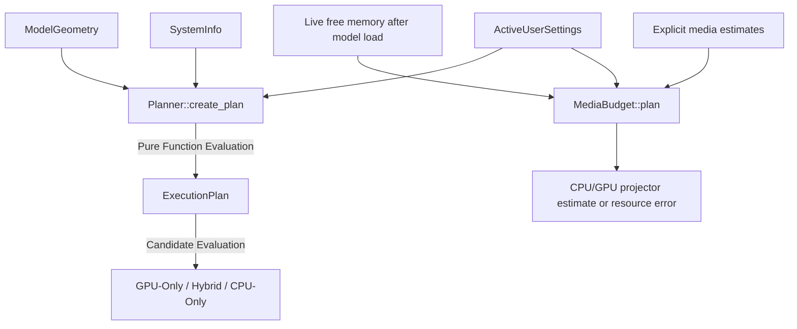
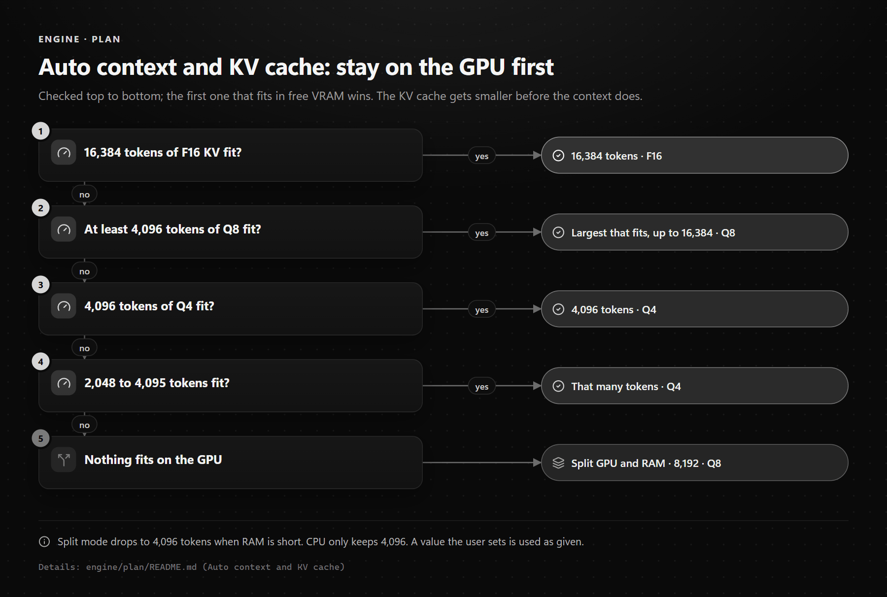
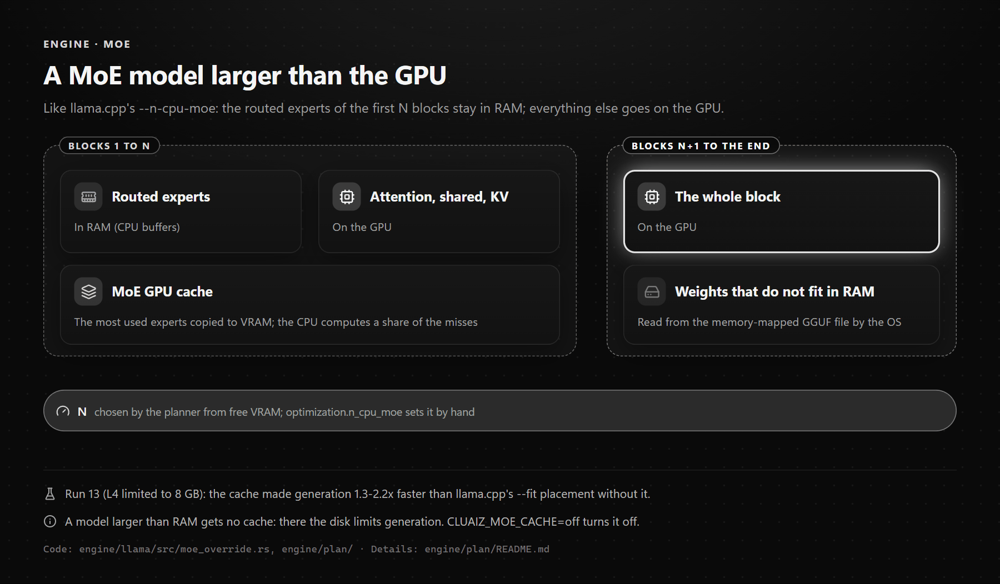

<!-- name: engine/plan
description: The load planner: decides where a model's layers, KV cache and experts go (GPU, CPU, disk) before loading. -->

# Load planner (`engine/plan/`)

Pure mathematical negotiation and placement engine for Cluaiz.

## Architecture

## Components

| Module | Responsibility |
|---|---|
| [`types.rs`](src/types.rs) | Typed data structures for Candidates, Tiers, and ExecutionPlans. |
| [`planner.rs`](src/planner.rs) | Pure mathematical calculation of memory budgets and candidate selection. |
| [`margin.rs`](src/margin.rs) | VRAM a model really took on this machine, kept in `config/vram_margins.json`: llama.cpp's dry-run correction (`proj3:` keys) and the largest pool gap seen (`pool2:` keys). The prefixes carry a version: when the estimate changes, the prefix changes too, so values measured against the old estimate are dropped instead of being applied to the new one (run 21: a gap learned while the estimate was 4 GB too high under-planned Gemma 3 by 0.64 GB). |
| [`speed.rs`](src/speed.rs) | STEP 4: speeds measured by `cluaiz bench`; a placement measured faster replaces the rule-order pick. |
| [`report.rs`](src/report.rs) | The plan as `cluaiz show` prints it (see Plan report below). |
| [`moe_cache.rs`](src/moe_cache.rs) | Size and CPU share of llama.cpp's MoE GPU cache for a MoE split (see below). |
| [`expert_prefetch.rs`](src/expert_prefetch.rs) | Bytes the llama.cpp fork may prefetch per MoE cache upload (`expert_prefetch_bytes`), from the setting, the cache, the experts and the platform (Auto's rule); never changes the placement (see below). |
| [`load_prefetch.rs`](src/load_prefetch.rs) | Whether a load leaves the CPU-mapped weights out of llama.cpp's load-time OS prefetch (fork patch 3); only for a plan that reads from disk; Auto off (see below); never changes the placement. |
| [`media_budget.rs`](src/media_budget.rs) | Additive media preflight after model load. Reuses safety policies without changing text placement math. |

## Auto context and KV cache

With context and KV cache on Auto, the model stays on the GPU first and the KV cache gets smaller
before the context does. Each step uses the first VRAM buffer; the 512 MiB fallback buffer only
reaches the floor (so less free memory never gives a bigger context).

| Step | When | Context, KV |
|---|---|---|
| 1 | 16384 tokens of F16 KV fit | 16384 (`AUTO_CONTEXT_TARGET`), F16 |
| 2 | at least 4096 tokens of Q8 KV fit | largest that fits up to 16384, Q8 (near lossless) |
| 3 | 4096 tokens of Q4 KV fit | 4096, Q4 (only to stay on the GPU) |
| 4 | 2048-4095 tokens fit | that, Q4 (CTX rule 3a: speed first) |
| 5 | nothing fits on the GPU | split between GPU and RAM: 8192 (`AUTO_SPLIT_CONTEXT`), Q8; 4096 when RAM is too short |

Sliding-window layers (Gemma, gpt-oss) keep their window plus one batch of cells, as llama-server
does (`swa_full` off). With llama.cpp's context default (`swa_full` on) they keep the whole context: on
Gemma 4 26B at 4096 tokens, Q8 KV, 479 MiB of KV instead of 213.

On the CPU only, Auto keeps 4096 (RAM is not filled with context). A context, KV type, GPU layers
or VRAM buffer set by the user is used as given. Max gives the model's native limit.

Hybrid models (Qwen3.5, Qwen3-Next) keep a KV cache only in their attention layers; their
linear-attention layers hold a fixed state (`ModelGeometry::recurrent_layers`), counted the way
llama.cpp allocates it.

## MoE GPU cache

When a MoE model does not fit on the GPU, the MoE split keeps attention and KV on the GPU and
the experts of the first `n_cpu_moe` layers in RAM. llama.cpp's MoE cache can then keep the most
used experts in VRAM for generation:

- `moe_cache_size` is the cache size, `--moe-cache-mib` in llama-server.
- `moe_cache_cpu_share` is the share of the misses the CPU computes instead of uploading them,
  `--moe-cache-cpu-share`.
- Sources: llama.cpp #29887, #30966 and `docs/moe-cache.md`.

Prompt batches of more than 32 tokens do not use the cache. The planner sets it
([`moe_cache.rs`](src/moe_cache.rs), `moe_cache_split` in [`planner.rs`](src/planner.rs)), and
[`native_load.rs`](../runtime/src/native_load.rs) passes it to llama.cpp's context params.

| When | What the planner does |
|---|---|
| The model fits on the GPU, CPU only, Apple Silicon (unified memory), user `n_gpu_layers` / `n_cpu_moe` | no cache; placement unchanged |
| MoE split that needs experts read from disk (model bigger than the RAM limit) | no cache; placement unchanged (`CLUAIZ_MOE_CACHE=on`, a test switch, applies the two rows below here too) |
| MoE split in RAM, the VRAM left with every expert in RAM is at least 20% of the experts | every expert in RAM (`n_cpu_moe` = all layers), all that VRAM as the cache |
| MoE split in RAM, less VRAM left | a cache of 10% of the experts (or the VRAM left, if less), plus the expert layers that still fit in VRAM |
| A cache under 256 MiB | no cache |

The CPU share comes from the cache's share of the experts:

| Cache / experts | CPU share |
|---|---|
| up to 12% | 0.95 |
| up to 25% | 0.9 |
| up to 45% | 0.8 |
| more | 0 |

The cache is counted in the plan's VRAM, so the learned pool gap and the load retry
(`after_failed_load`) include it. A placement with the cache keeps its own speed measurements
(`speed.rs`, keys with `mc:`). The keys of placements without the cache are unchanged.

### Where the numbers come from

[Run 13](../../test/cloud/runs/2026-11-15-run13-moe-cache/SUMMARY.md) used official llama.cpp
`b54752d` on an L4 GPU. Generation, tokens/s:

| Model | GPU | `--fit`, no cache | With the cache |
|---|---|---|---|
| Qwen3-30B-A3B Q4_K_M | 8 GB | 26.7 | 57.4 (every expert in RAM, 5.4 GB cache) |
| Qwen3-30B-A3B Q4_K_M | 4 GB | 20.8 | 31.8 (10% cache) / 26.8 (every expert in RAM) |
| gpt-oss-20b MXFP4 | 8 GB | 27.9 | 37.2 (every expert in RAM, 5.6 GB cache) |
| gpt-oss-20b MXFP4 | 4 GB | 15.5 | 17.4 (10% cache) / 16.8 (every expert in RAM) |
| gpt-oss-120b MXFP4, 59 GiB > 31 GB RAM | 22 GB | 10.15 (experts of 11 layers in VRAM) | 7.4 at best (every expert in RAM, 17 GB cache) |

Cluaiz itself on a Windows 11 laptop (2026-11-16): RTX 3050 4 GB with 2.5 GB free, CUDA, OLMoE-1B-7B Q4_K_M
(3.9 GB), `cluaiz bench -r 3`, generation t/s (tg128):

| Placement | t/s |
|---|---|
| Planner with the cache: every expert in RAM, 1.40 GB cache, CPU share 0.8 | **68.3 ± 3.9** |
| Planner with `CLUAIZ_MOE_CACHE=off`: experts of 11 / 16 layers in RAM | 53.5 ± 3.6 |
| Every expert in RAM without a cache (`--n-cpu-moe 16`) | 39.6 ± 3.2 |

Prompt speed (pp512) stayed within the run-to-run spread: 929 ± 254 with the cache, 1004 ± 292 without.
With less free RAM (3.57 GB allowed, 3.69 GB needed for every expert in RAM) the same planner kept the
placement without a cache, as the rule says.

The share rule is the lowest share within 5% of the fastest, from llama.cpp's own tuner
(`scripts/moe-cache-tune.py`), with the experts mmap'd. With a share of 0, a small cache was slower
than no cache. A model read from disk is limited by the disk, so it keeps the placement without a
cache.

### Debugging a speed change

- **Planner log line:** the plan banner shows `MoE cache : X GB … CPU share …`, and the MoE split
  reason ends with `MoE cache X GB in VRAM`.
- **llama.cpp log lines:** `MoE cache size = … MiB for … MiB of host experts, N% of the misses on the CPU`
  at load. llama.cpp prints the hit rate per ubatch only at its debug level (`llama-server -lv 4`).
- **Turning it off:** set `CLUAIZ_MOE_CACHE=off` in the environment of `cluaiz serve` / `cluaiz run`.
  The plan is then exactly the plan without the cache, so a speed difference shows up directly.
- **Forcing it on (test switch, not a speed setting):** `CLUAIZ_MOE_CACHE=on` applies the same split
  rules to a MoE split that reads experts from disk, which the table above leaves without a cache. It
  exists so that "cache + expert prefetch" can be measured on a model larger than RAM. **Warning (run 13):**
  on gpt-oss-120b (59 GiB, 31 GB RAM) the cache was slower than no cache (7.4 against 10.15 t/s), and
  every expert the cache split moves from VRAM to RAM is read from disk too, so `disk_stream_gb` can grow
  (in the rule table: gpt-oss-120b-like, 24 GB GPU, from 36.6 to 44.7 GB). Use it only to compare.
  - A split that fits in RAM without the cache keeps the rules, so `on` never turns a plan in RAM into
    one read from disk. CPU only, Apple Silicon, a model that fits on the GPU and a user placement get no
    cache, as with the rules. A value other than `on` / `off` keeps the rules.
  - Code: `moe_cache::mode()` reads the variable once per plan; `moe_cache_split` in
    [`planner.rs`](src/planner.rs) drops its "fits in RAM" check only when the split without a cache
    already reads from disk.
  - Tested (2026-11-22, `cargo test -p cluaiz-plan`): `forced_on_a_model_read_from_disk_gets_a_cache`
    (cache counted in VRAM, VRAM within the GPU, disk reads not lower than without the cache) and
    `forced_on_changes_only_plans_that_read_from_disk` (every rule-table row planned again with `on`: the
    chosen placement of each plan in RAM is identical; with the default no disk plan has a cache). In
    the table, 69 of the 201 plans that read from disk get a cache with `on`; the others have too little
    VRAM left for a 256 MiB cache. The rule table was also dumped before and after the change (a test
    kept out of the commit): 882 of 882 plans byte-identical with the variable not set.
  - Decision: the switch is an environment variable only, like `off`, and no setting, because the cache
    has no setting and this is for test runs. Alternative not taken: a cache size in MiB (the planner
    would need a second sizing rule; the existing rule already sizes it from the free VRAM).
- **Not tested yet:** Windows laptops, Vulkan and ROCm builds, and pinned experts (`-lm mlock`, which
  run 13 found faster but Cluaiz does not set). The measured rows above are CUDA on Linux.

## MoE expert prefetch (llama.cpp fork; Auto on only for the measured shape)

Right before llama.cpp's MoE cache uploads the experts a layer selected, the fork asks the OS to read
those experts (and the misses left to the CPU) from the model file in one call, with llama.cpp's own
`llama_prefetch` (`engine/llama/llama.cpp/CLUAIZ_PATCHES.md`, `engine/llama/README.md`). The planner
only decides the number: [`expert_prefetch.rs`](src/expert_prefetch.rs) sets the plan's
`expert_prefetch_bytes` after the placement is chosen, and
[`native_load.rs`](../runtime/src/native_load.rs) hands it to the loaded context.

| Setting `optimization.expert_prefetch` / `CLUAIZ_EXPERT_PREFETCH` | `expert_prefetch_bytes` |
|---|---|
| Auto (default), on Linux, MoE cache at least 20% of the experts (`ALL_EXPERTS_IN_RAM_FROM`) | the MoE cache size (run 43) |
| Auto, smaller cache, or not Linux | 0 (run 44: slower with a small cache; Windows and macOS have no positive run) |
| Off, or the env set to `off` | 0 |
| On, or the env set to `on`, with a MoE cache in the plan | the MoE cache size |
| On without a MoE cache | 0: the prefetch runs only in the cache's upload path |

The env value wins over the setting; a value other than `on` / `off` is ignored.

| Decision | Why | Alternative not taken |
|---|---|---|
| The value is added to the chosen plan and never takes part in choosing it | the owner's condition: the planner's existing outputs stay identical | a new candidate kind with prefetch |
| Auto = on only for a cache of at least 20% of the experts, on Linux | run 43 (L4, Linux, cache 3602.69 of 14514.00 MiB = 24.8%): 1.27-1.43x over the cache alone on all 4 prompts. Run 44 (laptop, Windows, caches 258-452 of 11797.50 MiB = 2.2-3.8%): 10.23 and 8.68 t/s against 20.09 and 17.48 for the cache alone in the same rounds. 20% is the planner's own share for "whole VRAM as cache" (`moe_cache::ALL_EXPERTS_IN_RAM_FROM`): run 43 came from that branch, run 44 from the other one (at most 10%). Shares between 3.8% and 24.8% are not measured (?), so the threshold reuses the existing constant instead of a new number | Auto = on whenever there is a cache (run 44 shows it hurts); a threshold on free RAM or disk reads (the planner saw 30 GB free in run 43, it did not know the 12 GB cgroup cap, so no plan-time RAM signal separates the two runs); a run-time guard in the fork (needs a fork rebuild; the plan-time share already separates the two measured runs) |
| Cap = the MoE cache size | one upload never fills more than the cache holds, so the prefetch never reads further ahead than the upload that follows it | a fixed number of MiB (no measurement behind any number yet) |
| No change to "no MoE cache when the model needs the disk" (table above) | run 13 found the cache slower there; a change needs a run with cache plus prefetch against no cache. For that run, `CLUAIZ_MOE_CACHE=on` forces the cache on such a model (see Debugging above) | turning the cache on for disk models now |

**Tested:** `the_setting_changes_no_placement_and_auto_follows_its_rule` plans every row of the rule
table (882 plans) again with the setting Off and On, and checks that each plan, as JSON without
the prefetch field, is identical, that Off gives 0 and that Auto gives what `auto_on` says; the table holds
plans on both sides of the share (52 plans with a MoE cache, 22 of them at 20% or more, 2026-11-23).
`auto_follows_the_measured_shapes` checks the run 42, 43 and 44 shapes. On 2026-11-23 the rule table was
dumped before and after the Auto change (a test kept out of the commit): `rows 882`, `cmp` identical, md5
`6265d804fe64212f84c332a4338d8069` both, so no placement changed. On 2026-11-22 the rule table was also dumped before
and after the change (a test kept out of the commit): 882 of 882 plans identical without the new field, the
new field 0 in all of them.

## Load prefetch skip for a model larger than free RAM (Auto off)

At load, llama.cpp asks the OS to read the whole model file. When the plan reads experts from disk
(`disk_stream_gb > 0`), the fork can leave the weights mapped in the CPU's default buffer (the experts) out of
that read (`engine/llama/README.md`, "Load prefetch skip"). [`load_prefetch.rs`](src/load_prefetch.rs) decides;
[`native_load.rs`](../runtime/src/native_load.rs) sets the fork's thread-local switch right before the load and
resets it right after. No plan field, so every plan stays as it was.

| `CLUAIZ_LAZY_HOST_WEIGHTS` | Plan reads from disk | Plan fits in RAM |
|---|---|---|
| not set (Auto) | off | off |
| `on` | on | off (the runtime asks only for disk plans) |
| `off` | off | off |

| Decision | Why | Alternative not taken |
|---|---|---|
| Auto off | run 61 (laptop, 9 pairs): load 8.0 -> 4.3 s and load disk read 2.90 -> 0.80 GB, generation 15.77 against 15.54 t/s (ranges overlap), but at 0 MiB free RAM the prompt pass was 7-12x slower in 2 of 9 pairs (4.53 and 7.63 against 52.90 and 57.18 t/s). Not proven better in every state, so the default stays | Auto on for disk plans on Windows (the median says faster load; the two bad pairs say a release risk) |
| Only for disk plans, even with the env set to `on` | a model that fits in RAM loses nothing to the whole-file read and is read once | the env forcing it on for every load |
| A function, not a plan field | the 882-plan dump stays byte-identical (`rows 882`, md5 `a8436037085a3d6429884140b15c9558` at HEAD and with the module, 2026-11-24) and no API shape changes | a `lazy_host_weights` plan field like `expert_prefetch_bytes` |

**Tested:** `load_prefetch::tests::auto_follows_its_rule_and_the_environment_overrides_it` (env on/off/unknown on
both platforms, Auto off with no disk read). Live: run 61.

## VRAM buffer

| Model | Kept free |
|---|---|
| Not measured, no llama.cpp dry run | 1024 MiB, else 512 MiB (llama.cpp's `--fit-target` rule) |
| Not measured, dry run done (every GPU load runs it first) | desktop reserve + 0.30 GB for the GPU pool, at most 1.0 GB (0.50 GB on a 4 GB GPU) |
| Measured | its GPU pool growth after a full-batch warmup (largest seen) + a desktop reserve of 5% of the GPU, at least 0.15 GB and at most 1.0 GB; 0.15 GB when NVML shows the GPU is used by nothing else (no display, not a Windows WDDM device, no other process) |
| Tight gap | when the gap above leaves less of the model on the GPU (a split instead of Full GPU, part of the attention instead of all of it, fewer blocks, CPU only): 0.15 GB + the measured pool. Never for a Full GPU plan, never when it reads more from disk |
| User setting | the user's value |

The dry run is llama.cpp's own size of the model fully on the GPU (no allocation). Its difference to
the estimate is added to each placement in proportion to the weights that placement puts on the GPU.

After a load:
- a load that leaves the GPU nearly full (less than 0.15 GB free, or more planned than was free) may have
  moved memory to Windows' shared GPU memory, so its size is not known; it is kept as needing all the
  VRAM that was free, and the model is planned again on the same free memory and loaded once with the
  smaller placement. The same plan is not loaded twice.
- a load that llama.cpp cannot allocate records the miss and loads the next smaller placement; the host
  stops after three loads in all.

Both decisions are planner functions with unit tests (`Planner::after_low_vram`,
`Planner::after_failed_load`); the host only loads what they return.

## RAM buffer

Auto keeps 5% of total RAM free, at most 4 GB (`RAM_RESERVE_MAX_GB`), counting what other apps use now.
A GB buffer set by the user (`custom_ram_buffer_gb`) replaces it.

## Plan report

Two sizes, built from the same parts in [`report.rs`](src/report.rs):

- `cluaiz show`: MODEL, THIS MACHINE NOW, YOUR SETTINGS (only the ones that change the plan), then
  PLAN. For a MoE split it first says how the blocks are split (attention / experts and where each
  goes). Then, per device: free now, kept free and why, what Cluaiz may use, what goes there
  (weights, KV, llama.cpp's working space, MoE cache) and whether the total fits; what is read from
  the SSD; a one-line summary; context, KV, the same placement as llama.cpp flags, speed; and the
  other placements with what each needs.
- After a load (`run`, chat header, `bench`, `/plan`): placement, GPU and RAM totals with what goes
  there, SSD, context and KV, llama.cpp flags and the reason.
- With the expert prefetch on, the load banner adds `Expert prefetch : on, at most X GB per MoE cache
  upload` and the short report a `prefetch` line; with it off neither line is printed.

A rejected plan shows the placement closest to fitting, its shortfall per device and what would make
it fit. Every number comes from the plan (`vram_weights_gb`, `ram_weights_gb`, `vram_free_gb`,
`ram_free_gb` and the candidate fields); `system.plan` returns the same values as data. A test builds
both reports for every plan of the rule table.

Memory is in GB of 1024³ bytes, as the OS reports RAM and VRAM. File sizes are in GB as Hugging Face
counts them (10⁹ bytes), as `cluaiz pull` and `cluaiz list` show them. A negative measured gap is
shown as 0 kept free: it only removes the margin, it never adds VRAM.

## Media preflight contract

- **Input:** `MediaRequirements` has non-zero weight/workspace estimates and a decoded-buffer byte count, including simultaneous copies. `SystemInfo` must describe current free memory after existing model allocations; do not subtract the resident model again.
- **Host check:** weights + workspace + decoded data must fit `ram_budget_bytes`; decoded data also obeys the configured media ceiling. Invalid RAM telemetry/settings and checked-sum overflow return errors.
- **Device check:** when requested and GPU telemetry is usable, weights + workspace + one of the existing VRAM buffer choices must fit. Otherwise use CPU if the host check fits. GPU placement is an estimate, not proof that a driver loaded successfully.
- **Output:** immutable `MediaBudget` placement and estimated host/device/safety-buffer bytes. A resource failure allocates nothing. This helper does not modify `ExecutionPlan` or reserve OS memory.
- **Request recheck:** `check_request_ram` charges only conservative workspace plus additional native conversion buffers against fresh usable RAM. Resident weights and already-prepared buffers are excluded from new allocation costs. The configured decoded ceiling remains a ceiling, not the request size. A refusal reports required/free/reserve/usable bytes; the existing Chat plan and its safety-buffer policy are unchanged.
- **Limits:** estimates must cover native expansion/temporary work supplied by the caller. Peak encoder allocations and concurrent external memory use are not bounded by this arithmetic alone. The native session performs fresh live probes before new projector allocation.

## Tests

`cargo test -p cluaiz-plan` on 2026-11-24 (Windows 11): 63 passed, 1 ignored (`tests/real_models.rs`, needs installed
models). Real loads: runs 11, 12, 21 (L4), 17, 20 (laptop), 15-19 (VPS) in `test/cloud/BENCHMARKS.md`.

## Pending

| Item | Why it matters | Needs |
|---|---|---|
| Memory estimate for MLA and Kimi-Linear models | run 21 found the estimate off for these | parked with the planner (2026-11-19) until a big-GPU run |
| Proof that the out-of-memory retry steps down correctly on big models | built, not measured on a big model | the same big-GPU run |
| First load with other apps holding VRAM (run 20 chose CPU only) | the dry run before every GPU load may have fixed it | a rerun of the run 20 case |
| Expert prefetch between 4% and 25% cache share, and on Windows with a big cache | Auto is off there because nothing is measured. Run 44's slowdown is explained (run 60): the fork re-asked resident experts every upload and Windows `PrefetchVirtualMemory` costs 43-85 us per MiB of resident pages on the compute thread; the fork now asks each slice once on Windows, which a replay measured at -48-68% prefetch time, but still not faster than no prefetch with resident pages | a laptop A/B with a cache (free VRAM), and a Linux run with a small cache |
| Load prefetch skip Auto | off: 7-12x slower prompts at 0 MiB free RAM in run 61 | a free-RAM guard, or the skip with the ask-once prefetch on a MoE cache |
| Prompt speed (pp) with the prefetch | not measured fairly yet (run 43 reloaded per prompt) | the owner's run 45 |
| Forced MoE cache (`CLUAIZ_MOE_CACHE=on`) on a model read from disk | run 13 measured it slower without prefetch; whether cache + prefetch beats no cache is the question of Phase 0/2 | the L4 script in `test/cloud/remote/` (not run) |
| Expert prefetch cap | the cache size is a rule, not a measured value; in runs 43 and 44 it never limited anything (4.8 and 15.0-18.6 MiB asked per call against caps of 3602 and 258-452 MiB) | a run that compares a smaller cap |
| Expert prefetch on macOS, Vulkan, Metal, CPU only | Linux + CUDA (run 43) and Windows + CUDA (runs 44, 46) were run; CPU only and Metal have no MoE cache upload path | runs on those machines; a CPU-only path (eval callback) is a later phase |
