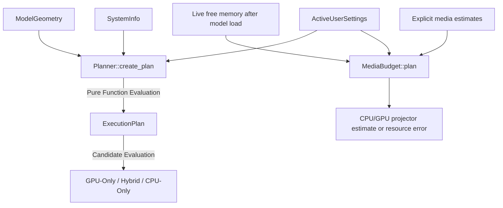

# 🎯 Cluaiz Execution Planner (`engine/plan`)

Pure mathematical negotiation and placement engine for Cluaiz.

## 📐 Architecture

## 📦 Components

| Module | Responsibility |
|---|---|
| [`types.rs`](src/types.rs) | Typed data structures for Candidates, Tiers, and ExecutionPlans. |
| [`planner.rs`](src/planner.rs) | Pure mathematical calculation of memory budgets and candidate selection. |
| [`media_budget.rs`](src/media_budget.rs) | Additive media preflight after model load. Reuses safety policies without changing text placement math. |

## Auto context and KV cache

With context and KV cache on Auto, the model stays on the GPU first and the KV cache gets smaller
before the context does. Each step uses the first VRAM buffer; the 512 MiB fallback buffer only
reaches the floor (so less free memory never gives a bigger context).

| Step | When | Context, KV |
|---|---|---|
| 1 | 16384 tokens of F16 KV fit | 16384 (`AUTO_CONTEXT_TARGET`), F16 |
| 2 | at least 4096 tokens of Q8 KV fit | largest that fits up to 16384, Q8 (near lossless) |
| 3 | 4096 tokens of Q4 KV fit | 4096, Q4 (only to stay on the GPU) |
| 4 | 2048-4095 tokens fit | that, Q4 (CTX rule 3a: speed first) |
| 5 | nothing fits on the GPU | split between GPU and RAM: 8192 (`AUTO_SPLIT_CONTEXT`), Q8; 4096 when RAM is too short |

On the CPU only, Auto keeps 4096 (RAM is not filled with context). A context, KV type, GPU layers
or VRAM buffer set by the user is used as given. Max gives the model's native limit.

Hybrid models (Qwen3.5, Qwen3-Next) keep a KV cache only in their attention layers; their
linear-attention layers hold a fixed state (`ModelGeometry::recurrent_layers`), counted the way
llama.cpp allocates it.

## VRAM buffer

| Model | Kept free |
|---|---|
| Not measured on this machine yet | 1024 MiB, else 512 MiB (llama.cpp's `--fit-target` rule) |
| Measured | its GPU pool growth after a full-batch warmup (largest seen) + a desktop reserve of 5% of the GPU, at least 0.15 GB and at most 1.0 GB |
| User setting | the user's value |

## Media preflight contract

- **Input:** `MediaRequirements` has non-zero weight/workspace estimates and a decoded-buffer byte count, including simultaneous copies. `SystemInfo` must describe current free memory after existing model allocations; do not subtract the resident model again.
- **Host check:** weights + workspace + decoded data must fit `ram_budget_bytes`; decoded data also obeys the configured media ceiling. Invalid RAM telemetry/settings and checked-sum overflow return errors.
- **Device check:** when requested and GPU telemetry is usable, weights + workspace + one of the existing VRAM buffer choices must fit. Otherwise use CPU if the host check fits. GPU placement is an estimate, not proof that a driver loaded successfully.
- **Output:** immutable `MediaBudget` placement and estimated host/device/safety-buffer bytes. A resource failure allocates nothing. This helper does not modify `ExecutionPlan` or reserve OS memory.
- **Request recheck:** `check_request_ram` charges only conservative workspace plus additional native conversion buffers against fresh usable RAM. Resident weights and already-prepared buffers are excluded from new allocation costs. The configured decoded ceiling remains a ceiling, not the request size. A refusal reports required/free/reserve/usable bytes; the existing Chat plan and its safety-buffer policy are unchanged.
- **Limits:** estimates must cover native expansion/temporary work supplied by the caller. Peak encoder allocations and concurrent external memory use are not bounded by this arithmetic alone. The native session performs fresh live probes before new projector allocation.
