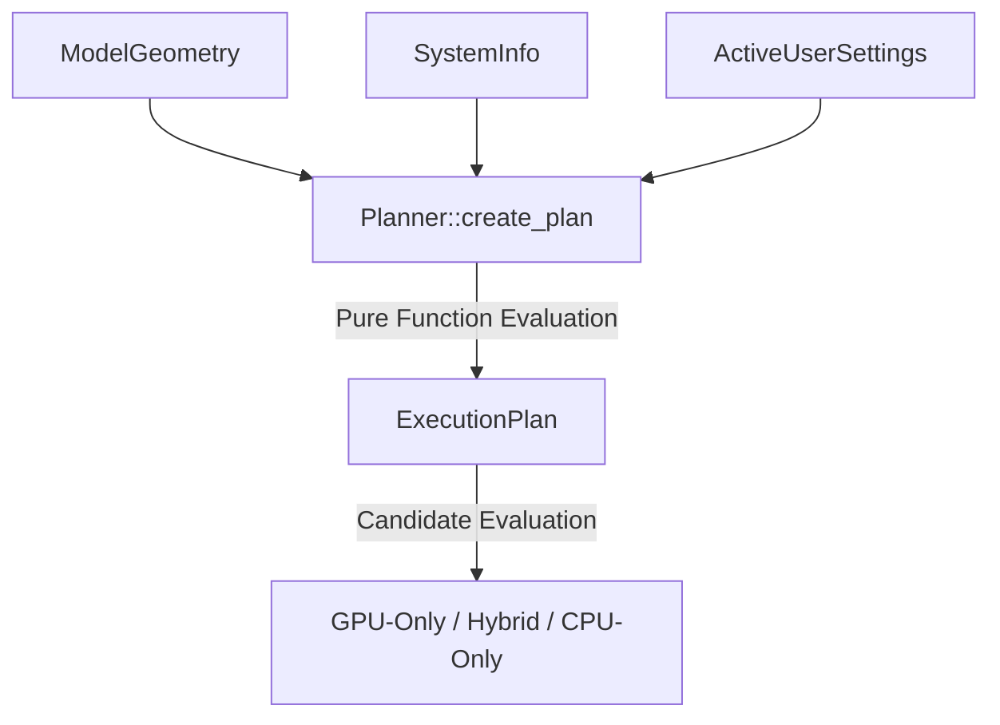

# 🎯 Cluaiz Execution Planner (`engine/plan`)

Pure mathematical negotiation and placement engine for Cluaiz.

## 📐 Architecture

## 📦 Components

| Module | Responsibility |
|---|---|
| [`types.rs`](src/types.rs) | Typed data structures for Candidates, Tiers, and ExecutionPlans. |
| [`planner.rs`](src/planner.rs) | Pure mathematical calculation of memory budgets and candidate selection. |
