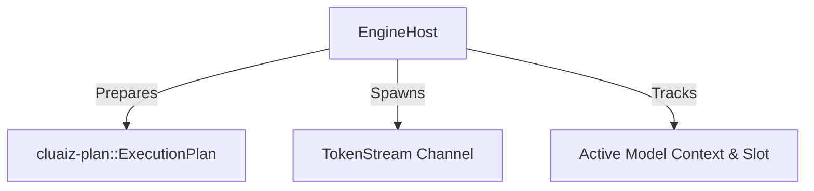

# 🏛️ Cluaiz Engine Runtime & Host (`engine/runtime`)

Single unified model host and execution supervisor. Replaces the fragmented `dispatcher`, `CoreRouter`, and `EngineRunner`.

## 📐 Architecture

## 📦 Components

| Module | Responsibility |
|---|---|
| [`host.rs`](src/host.rs) | Unified engine host for model preparation and streaming dispatch. |
