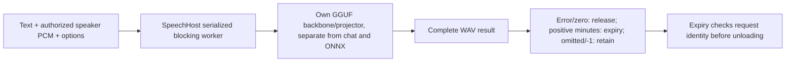
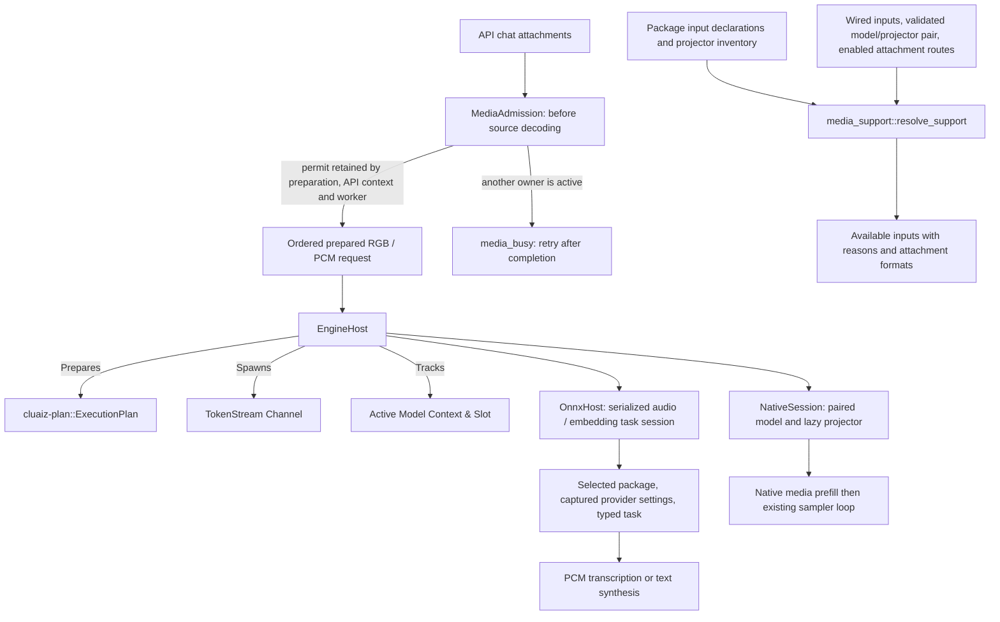

# 🏛️ Cluaiz Engine Runtime & Host (`engine/runtime`)

Model execution supervisor with separate chat, ONNX-task and GGUF-speech owners.

## GGUF speech retention

`speech_host.rs` serializes generation and native destruction behind one mutex. Each request replaces the resident's lease identity, including requests for the same model, so an old timer cannot unload a newer request or replacement. Timers weakly reference the owner and do not extend the host lifetime. Positive minutes start after successful generation; failures and keep_alive0release the resident. The native handles stay on the blocking side. Reference source authorization/decoding happens in the shared API media path before dispatch. GGUF `stream:true` currently produces the final result only; it does not imply progressive native PCM.

## 📐 Architecture

## 📦 Components

| Module | Responsibility |
|---|---|
| [`host.rs`](src/host.rs) | Unified engine host for model preparation and streaming dispatch. |
| [`media_admission.rs`](src/media_admission.rs) | Per-host prepared-chat permit and owned preparation lifetime; separate from byte budgets and model planning. |
| [`media_generation.rs`](src/media_generation.rs) | Native prepared dispatch, retained admission and selected-package execution, as a child of the host. |
| [`media_support.rs`](src/media_support.rs) | Effective request input/attachment availability from declared capability, real assets and trusted backend evidence. |
| [`onnx_host.rs`](src/onnx_host.rs) | Selected ONNX audio package validation, serialized graph execution, typed chunk/result/error events and generation-scoped retention. |

## Media availability contract

- **Inputs:** `resolve_support` accepts package evidence, actually wired backend inputs, an optional trusted loaded model/projector pairing and enabled attachment routes. That pairing cannot be deserialized from a user request.
- **Planning:** `EngineHost::input_support` reads session/model state without waiting behind generation. A busy or different selected model remains unverified; another model's loaded encoder flags do not redefine this selected model's support. `media_support` adds attachment descriptors after releasing those locks, using the same resolver. The Chat planner presents one concise input contract and keeps the full internal evidence private.
- **Output:** intrinsic `inputs`, effective `available_inputs`, per-input `model_support`/`available`/`reason` and deduplicated usable attachment formats. Missing, ambiguous or incompatible assets, missing encoder, unwired dispatch and unverified pairing have distinct reasons.
- **Current route:** `CURRENT_NATIVE_CHAT_INPUTS` lists text/image/audio. `dispatch_prepared` owns decoded buffers through its blocking worker, checks the selected load fingerprint, probes package declarations and lazily loads the compatible projector before native generation. `dispatch_stream` retains the legacy text entry; API text uses `dispatch_chat_text` with selected-model identity and per-request cancellation.
- **Validation:** model and projector paths are canonicalized before comparing the trusted pairing, including Windows extended-path representation. Metadata alone never sets an image/audio input available. Unknown model capability is not promoted to support.
- **Scope:** the pure resolver reports availability; `EngineHost::media_support` supplies actual loaded encoder/pairing evidence. Decoder-library descriptors supply attachment extensions. Before lazy initialization, declared image/audio inputs can have `projector_pairing_unverified`; after initialization, reporting follows the loaded encoder. Shared media prepares document text/OCR and sampled video frames for these existing native chat routes. Sampled frames are image inputs, not intrinsic temporal-model support. General ONNX generative chat remains unwired.

## Request ownership and failure behavior

- **Model transitions:** one transition mutex serializes native load/unload allocations and publication; generation uses the paired session mutex. Requests queued after a selected-model/configuration change fail with an error instead of running on the new model. Native pointers are private to the session.

## ONNX audio ownership

- **Boundary:** `EngineHost.onnx.dispatch` receives `OnnxModel`, `AudioTask`, typed `AudioInput`, STT options, captured settings and keep-alive minutes. It uses the selected ONNX graph and never invokes llama text generation. Audio and chat have separate native owners.
- **Package identity:** declared asset paths must resolve inside the selected package. An explicit primary ONNX graph and its known required helper/external files must be present. The existing `PackageCapabilities` inventory is reused before a lease/native load and again when a queued request begins. Registry metadata, listed asset stamps, package snapshots, task and provider settings form the reuse key. This is cache invalidation, not cryptographic integrity; snapshot traversal has a depth ceiling and does not follow directory symlinks.
- **Concurrency:** one blocking worker holds the audio mutex through load and execution. Old sessions are dropped before replacement. Decoded input is retained by the queued request; it is not fetched again inside the ONNX backend. Model switches do not publish partially loaded sessions.
- **Retention:** zero unloads the audio owner after execution; null/-1 retain it until replacement. Positive minutes schedule expiry after completion. A key and monotonically increasing request generation must still match when the timer runs; old timers cannot unload a newer request's resident session. Execution errors discard the failed resident owner. An incomplete package rejected before the lease does not unload the existing valid resident.
- **Output:** `AudioEvent::Chunk` carries real incremental STT text. `Completed` carries a transcript or the existing TTS WAV data URI. Native/model failures are errors. TTS currently completes a whole WAV rather than streaming PCM chunks.
- **Limits:** a dropped STT output consumer stops at the callback boundary. Deep encoder interruption, TTS mid-synthesis cancellation, process peak bounds, concurrent chat/audio resource coordination, positive-GPU/other-OS execution and comprehensive multi-family quality remain unverified.

## Native request continuation and resource policy

- **Preparation admission:** Chat attachment requests acquire one per-host permit before model/media preparation. A second attachment request receives `media_busy` before reading/decoding its source, rather than growing a decoded waiting queue. Plain text chat bypasses this permit. The API context, owned preparation task and native worker share its lifetime, including document-to-text dispatch and tool continuations. Disconnect does not release admission while detached decoding/native work still owns buffers. This is a concurrency bound, not a memory reservation or a capacity guarantee; ONNX/audio/embedding admission remains separate.
- **Media history:** each media turn re-evaluates its full typed input; text-only prefix history is cleared and no synthetic prefix cache is returned. The existing text sampler/prefill remains the single generation implementation. Oversized media context fails explicitly; whole-message auto fitting remains pending.
- **Cancellation:** API chat callbacks use their own retained atomic flag. The legacy CLI entry retains its global cancellation source. A cancelled queued API request fails before encoding; an active request stops at callback/evaluation boundaries. Long native encode/decode operations have no newly certified immediate-abort latency.
- **Skip reasoning:** text, prepared attachments and tool continuations retain the same request-owned skip flag created before dispatch. The serialized worker binds it to `NativeSession` only for that generation and clears the binding on success or error. Another queued request keeps its own flag. The shared native token loop invokes the upstream reasoning sampler and continues the existing answer stream; skipping does not cancel or reload the model.
- **Budget:** `media_generation` derives retained input bytes from the prepared request instead of charging the entire configured ceiling. Projector file size remains the weight-estimate lower bound; `media.projector_workspace_bytes` remains a conservative non-zero workspace estimate. Before copying native bitmaps, the session checks additional conversion buffers against fresh free memory and the existing safety reserve. A decoded-size change does not change projector identity. An idle projector can be reclaimed under RAM pressure and admitted again without changing the loaded Chat model/plan. These checks are estimates, not OS reservations or measured native peaks; native driver allocation failure has no automatic CPU retry.
- **Observations:** optional shared processing reporters cross the serialized native worker separately from token strings. The shared source decoder reports reads/decodes; the native adapter reports actual encode slices and prefill batches. API observation queues are bounded and opt-in. The separate ONNX task transport has not been changed.
- **Delivery:** the worker sends its existing error token on failure. The API interprets it as an SSE error object or a non-success JSON response, clears stale generation telemetry and retains decoded media across tool continuation requests.

## ONNX task lease

- **Owner:** `OnnxModel` validates the selected package/primary/assets. `OnnxHost::with_engine` is the single serialized load/reuse/replace/error/unload implementation shared by audio dispatch and embedding batches.
- **TTS provider recovery:** After an observed missing-cuDNN or DirectML operator failure, the owner releases the failed GPU session before loading the same package on CPU and executing once more. The effective CPU owner retains the requested package/settings key, so a retained session does not retry the failed GPU on every utterance. Original settings are unchanged. CPU execution can be slower; unrecognized failures propagate. STT and embeddings do not retry after execution because this path has only been validated for whole-WAV TTS delivery.
- **Identity:** resident reuse includes declared asset/config stamps, task and captured provider settings. The existing generation guard protects newer requests from old positive keep-alive timers. This is cache identity, not cryptographic file integrity.
- **Embedding:** `embed` sends typed text/RGB to a blocking worker and returns actual vector/token results. Its byte and graph errors propagate to the API. Audio and embedding replace each other's ONNX resident task; neither calls chat unload. Simultaneously loaded chat/ONNX memory scheduling remains separate work.

## ONNX readiness ownership

- **Evidence:** the resident records successful native task, standalone input, package identity and captured provider settings. `readiness` returns only matching evidence and never accepts a client's readiness claim.
- **Resolver:** `media_support::resolve_onnx_support` combines it with graph declarations, known helper presence and common decoder formats. Auxiliary text is not a standalone image-graph text route; unknown/unimplemented task routes stay unavailable.
- **Invalidation:** failure/replacement/expiry/zero retention removes the resident; changed helpers/settings invalidate old readiness. Inspection never loads a session to manufacture readiness. First valid tasks may lazily initialize the owner.
