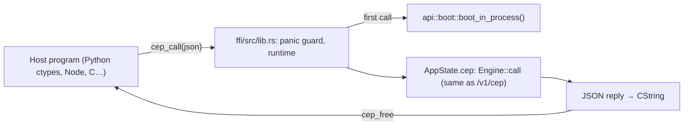

# The Engine as a C library (`ffi/`, crate `cluaiz-ffi`)

`cluaiz_cep.dll` / `libcluaiz_cep.so` / `libcluaiz_cep.dylib` runs the Cluaiz Engine inside another program. The library exports two functions (header: [`include/cep.h`](include/cep.h)):

```c
char *cep_call(const char *request_json);  /* JSON-RPC 2.0 in, the reply out (NULL for notifications only) */
void  cep_free(char *reply);               /* frees a reply */
```

The messages are the same as `POST /v1/cep`. Ask `rpc.discover` for the methods.



## How it runs

- **Start-up.** The first call starts the Engine with `CLUAIZ_HOME` (or the default home). It uses the same start-up code as `cluaiz serve`, but does **not** write `session.token`, so a daemon running on the same home keeps working.
- **Who is calling.** The caller is the owner: the calls come from the host process, under the same OS user.
- **Threads.** `cep_call` blocks until the answer. Several threads may call at once. A thread that is running an async runtime gets an error reply instead of a deadlock.
- **Panics.** A panic inside the Engine becomes a `-32603` reply. It never unwinds into the host.
- **Long work.** It returns a task handle, which the host polls with `tasks.get` / `tasks.result`.

## Building

Build it together with the CLI, so both share one GPU backend build:

```bash
cargo build --release -p cmd -p cluaiz-ffi
```

The library is not named `cluaiz`, because its debug files would clash with `cluaiz.exe`'s in `target/release`.

## Loading on Windows

The library needs the same runtime DLLs as `cluaiz.exe`. For a CUDA build that includes cuBLAS from `CUDA_PATH\bin`. Python 3.8 and later does not search `PATH` for a DLL's dependencies, so add the folder first:

```python
os.add_dll_directory(os.path.join(os.environ["CUDA_PATH"], "bin"))
lib = ctypes.CDLL(r"...\cluaiz_cep.dll")
```

## Tests

- `cargo test --release -p cluaiz-ffi`: the panic guard and NULL handling.
- `python test/cep/ffi_python.py --lib <dll> --home <isolated home>`: the whole library through ctypes.
