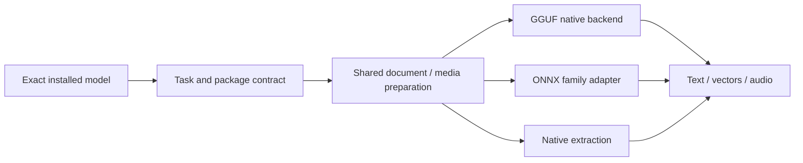

# Models and Architecture Support

Updated: **October 22, 2026**

Cluaiz runs GGUF models through its bundled **llama.cpp/libmtmd** backend and ONNX models through **ONNX Runtime with task-specific adapters**. This catalogue covers chat, vision, speech, embeddings and document ingest.

The tables distinguish model families, complete model packages and individual components. Newer and older architectures are included according to the bundled source—not a changing list of every Hugging Face upload.

## Reading the catalogue

| Status | Meaning |
|:---|:---|
| **Tested** | A selected package has recorded Cluaiz acceptance for the listed task. |
| **Backend available** | The bundled backend implements the architecture; that package still needs Cluaiz acceptance. End-to-end status: UNVERIFIED. |
| **Adapter available** | Cluaiz has family-specific code; complete-package acceptance is pending. |
| **Experimental** | Available for evaluation, with incomplete integration or known quality/performance limits. |
| **Not supported** | No matching task pipeline, or the required package contract is not supported. |

A family can have many sizes, quantizations and fine-tunes. The architecture in the actual file, its tokenizer/template and companion assets determine compatibility. A large model can have backend support without fitting the available hardware.

## Choose by task

| Task | Model path | Main examples | API |
|:---|:---|:---|:---|
| Text chat | GGUF language model | Llama, Qwen, Gemma, compatible Mistral derivatives | `/v1/chat/completions` |
| Image questions / image-to-text | GGUF vision backbone + matching projector | Gemma 4, Gemma 3, Qwen-VL, MiniCPM-V | Chat or selected-model ingest |
| Audio questions / transcription through chat | GGUF audio-capable backbone + projector | Tested Gemma 4 E4B; other backend families below | Chat |
| Video questions | Sampled, timestamped frames; compatible visual model | Tested Gemma 4 E4B | Chat |
| Text-to-speech | ONNX TTS family or GGUF speech pair | Piper, Kokoro; experimental Audio8/Qwen3-TTS | `/v1/audio/speech` |
| Dedicated speech-to-text | Compatible ONNX STT package | Whisper; Moonshine adapter | `/v1/audio/transcriptions` |
| Text vectors | ONNX or GGUF embedding model | BGE, EmbeddingGemma-2 | `/v1/embeddings` |
| Image/page vectors | Compatible ONNX image embedding graph | FashionCLIP / compatible CLIP-style exports | Embeddings or ingest |
| Document text/OCR | Native providers; optional model processing | PDF, DOCX, DOC, text/code, images | `/v1/ingest` |

The example column identifies families; it does not give every family the same status. Use the detailed tables below.

## GGUF chat and language models

These are family names and exact GGUF architecture IDs from the bundled backend. **Backend available** is the default for families without a recorded Cluaiz test.

| Family | Architecture IDs | Cluaiz status |
|:---|:---|:---|
| Llama and compatible derivatives | `llama` | Tested with selected Llama 3.2 package |
| Bonsai selected exports | Follows the architecture recorded in each base-model export | Selected packages in the historical regression matrix |
| Llama 4 | `llama4` | Backend available |
| Qwen / Qwen2 / compatible Qwen2.5 exports | `qwen`, `qwen2`, `qwen2moe` | Backend available |
| Qwen3 dense / MoE | `qwen3`, `qwen3moe` | Selected dense Qwen3 package tested; MoE package acceptance pending |
| Qwen3-Next | `qwen3next` | Backend available |
| Qwen3.5 dense / MoE | `qwen35`, `qwen35moe` | Backend available |
| Gemma / Gemma 2 / Gemma 3 / Gemma 3n | `gemma`, `gemma2`, `gemma3`, `gemma3n` | Backend available |
| Gemma 4 | `gemma4` | Selected E4B package tested for chat and supported media |
| Mistral / Mixtral-compatible earlier exports | Often `llama`; inspect the export | Backend available |
| Newer Mistral architectures | `mistral3`, `mistral4` | Backend available |
| Phi | `phi2`, `phi3`, `phimoe` | Backend available |
| DeepSeek | `deepseek`, `deepseek2`, `deepseek32`, `deepseek4` | Backend available |
| ChatGLM / GLM | `chatglm`, `glm4`, `glm4moe`, `glm-dsa`, `glm5-next` | Backend available |
| Liquid LFM | `lfm2`, `lfm2moe` | Backend available; task also depends on the export |
| GPT-OSS | `gpt-oss` | Backend available |
| MiniMax | `minimax-01`, `minimax-m2`, `minimax-m3` | Backend available |
| Cohere Command | `command-r`, `cohere2`, `cohere2moe` | Backend available |
| Granite | `granite`, `granitemoe`, `granitehybrid`, `graniteswitch`, `granite_swa` | Backend available |
| Nemotron | `nemotron`, `nemotron_h`, `nemotron_h_moe` | Backend available |
| EXAONE | `exaone`, `exaone4`, `exaone-moe` | Backend available |
| Kimi | `kimi-linear`, `kimi-k3` | Backend available |
| Hunyuan / ERNIE | Hunyuan and ERNIE IDs in the full inventory below | Backend available |
| Other current/earlier families | OLMo, Falcon, Plamo, Jais, Mamba, RWKV, StarCoder, GPT-NeoX and others | Full architecture inventory below |

Fine-tune names are not separate architecture guarantees. A Qwen-derived reasoning model uses the architecture stored in its export; it does not become a new runtime family because its repository name changes. Base models can generate text, while conversational behavior also depends on instruction tuning and a suitable chat template.

### Small and large model examples

These examples come from the bundled backend's model/conversion references and existing Cluaiz tests. They illustrate family variants, not measured memory requirements or a claim that every listed size was tested.

| Family | Example variants | Notes |
|:---|:---|:---|
| Qwen3 | 8B, 30B-A3B; Qwen3-Next 80B-A3B | Dense and MoE use different architectures |
| Qwen3.5 | 0.8B, 9B, 35B-A3B | Backend references include dense and MoE examples |
| Llama 3.2 / Llama 4 | Llama 3.2 1B/3B; Llama 4 Scout 17B-16E | Same brand does not mean same architecture or modality |
| Bonsai | 4B, 8B, 27B examples in the regression matrix | Quantized derivatives; inspect each file's base architecture |
| Gemma 3 | 1B, 4B, 12B, 27B | Gemma 3 1B is text-only; compatible larger visual packages need a projector |
| Gemma 4 | E2B, E4B, 26B-A4B, 31B | Media support depends on the exact package |
| Mistral / Mixtral / Pixtral | Mistral 7B, Mixtral 8x7B, Mistral Small 3.1 24B, Pixtral 12B | Text and vision variants have different companion requirements |
| SmolVLM / SmolVLM2 | 256M, 500M, 2.2B examples | Vision packages use the appropriate projector |
| InternVL | 2.5: 1B/4B; 3: 1B/2B/8B/14B examples | Conversion/export format matters |
| Liquid LFM | LFM2.5 350M, LFM2 1.2B, LFM2 8B-A1B | Small size alone does not select the task |
| Speech | Kokoro 82M, Audio8 0.6B, Qwen3-TTS Base 1.7B | Different synthesis pipelines; not interchangeable |

`B` refers to billions of parameters; `M` to millions. MoE names may show total and active parameter counts. Quantized file size, peak memory and inference speed are separate properties.

Sources: [conversion families](engine/llama/llama.cpp/conversion/), [multimodal examples](engine/llama/llama.cpp/docs/multimodal.md), [backend quick start](engine/llama/llama.cpp/README.md), [recorded chat regression](test/engine_regression/RESULTS.md).

## GGUF vision, OCR and audio understanding

A vision language model reads pixels and generates text. It needs both the language backbone and its **matching `mmproj`**. A text-only backbone or an unrelated projector is insufficient.

| Family | Input / use | Status in Cluaiz |
|:---|:---|:---|
| Gemma 4 E4B | Images, PDF page pixels, audio input and sampled video frames | Tested selected package |
| Gemma 3 / Gemma 3n | Package-specific visual/audio input | Backend available; do not infer audio support from the Gemma 3 name alone |
| Qwen2-VL / Qwen2.5-VL / Qwen3-VL | Image understanding | Backend available |
| Qwen2.5-Omni / Qwen3-Omni | Visual and audio input with matching components | Backend available; audio generation is not established by input support |
| LLaVA / MobileVLM / GLM-Edge | Visual input | Backend available |
| SmolVLM / SmolVLM2 / Idefics3 | Visual input; sampled video for compatible packages | Backend available |
| Pixtral / visual Mistral packages | Visual input | Backend available |
| InternVL | Visual input | Backend available; export restrictions apply |
| MiniCPM-V / MiniCPM-o | Package-specific visual/audio input | Backend available; complete package required |
| Llama 4 Scout / Moondream2 | Visual input | Backend available |
| Ultravox / Voxtral / Qwen2-Audio / Qwen3-ASR | Audio input / recognition through compatible chat packages | Backend available; not enabled on the dedicated GGUF STT route |
| Other projector families | Phi, Kimi, LFM, GLM, Hunyuan, Granite and others | Complete registered projector list below |
| Specialized OCR | PaddleOCR-VL, GLM-OCR, DeepSeek-OCR, Dots.OCR, HunyuanOCR; LightOnOCR projector | Backend components available; model-specific prompts and Cluaiz workflow acceptance still needed |

Chat video is prepared as ordered timestamped frames. Audio is separate and requires audio support when requested. This is not a dedicated full-video encoder or an unlimited-duration pipeline.

For PDFs, compatible visual packages receive rendered page pixels. Text-only packages use native text/OCR extraction. DOCX embedded graphics are not automatically exposed as visual input.

## Text-to-speech models

| Family | Format / runtime | Status | Voice / package |
|:---|:---|:---|:---|
| Piper / compatible VITS | ONNX | Tested selected Piper packages | Usually one embedded speaker; graph/config and phoneme assets |
| Kokoro | ONNX | Tested selected English/Hindi synthesis | Preset voice styles; matching model/tokenizer/config and voice bank |
| Audio8 | ONNX | Experimental; actual audio generation recorded | Slow AR + Fast AR + codec, external weights, tokenizer/runtime manifest; automatic language and encoded reference profiles |
| Supertonic | ONNX | Experimental; unfinished pipeline | Compatible text encoder, duration predictor, vector estimator and vocoder |
| Matcha | ONNX | Experimental; incomplete integration | Acoustic flow estimator and vocoder |
| CosyVoice | ONNX | Experimental; incomplete integration | Compatible speech/flow pipeline and vocoder |
| Chatterbox | ONNX | Experimental; incomplete integration | Semantic generation and matching codec |
| OmniVoice | ONNX | Experimental; incomplete integration | Compatible generation graph/config and external weights |
| Qwen3-TTS Base | GGUF + speech projector | Experimental; selected Base package tested | Generated voice or supported reference audio source |
| Pocket TTS | GGUF + speech projector | Backend available; Cluaiz package acceptance pending | Native instructions require speaker reference audio |

Audio8, Supertonic, Matcha, CosyVoice, Chatterbox and OmniVoice are excluded from automatic ONNX TTS selection. Explicit selection remains available for evaluation.

Qwen3-TTS Base's inspected package supports Chinese, English, German, Italian, Portuguese, Spanish, Japanese, Korean, French and Russian. Hindi is not in that package's forced-language inventory. A dedicated Qwen3-TTS **ONNX** adapter is not implemented.

Voice selection is model-specific: a Kokoro style ID is not a Qwen speaker reference. Audio8 uses package-local encoded profiles, not arbitrary reference audio through that control. Separate unconditioned narration requests can change speaker identity. Streaming can pause when synthesis is slower than playback.

### Recognized names that are not additional synthesis engines

The installer taxonomy also recognizes **Parler-TTS, ChatTTS, Bark, F5-TTS, generic ONNX TTS and Whisper-related tags**. These labels do not have dedicated completed TTS runtimes in the current adapter set. Whisper is a recognition family, not a speech synthesis family. Kitten/MMS/LuxTTS aliases or comments likewise do not establish independent package support; compatible exports must satisfy an existing runtime contract.

Sources: [runtime family adapters](engine/onnx/src/audio/tts/family_adapter.rs), [experimental policy](engine/onnx/src/audio/tts/data/tts_families.json), [installer taxonomy](engine/models/src/taxonomy/tts_families.rs), [native speech families](engine/llama/llama.cpp/tools/tts/README.md).

## Speech-to-text models

| Family | Format | Status | Runtime contract |
|:---|:---|:---|:---|
| Whisper | ONNX | Selected large-v3-turbo export tested | Log-Mel encoder, compatible decoder/cache graphs, tokenizer/config |
| Moonshine | ONNX | Adapter available; package acceptance pending | Compatible raw-waveform encoder/decoder and tokenizer |
| SenseVoice / Paraformer / Zipformer / wav2vec2 | Installer recognizes these names | Not supported by dedicated current STT adapters | Different preprocessing/decoding needed |
| Generic ONNX STT | ONNX label | Not a universal decoder | Must match an implemented family signature |
| Whisper GGUF / GGML | Installer recognition only | Not supported on the current transcription endpoint | A downloader category does not add whisper.cpp execution |
| Parakeet | ONNX or native backend components | No dedicated ONNX transcription adapter; native audio package acceptance pending | Native projector presence does not enable the STT API |

`/v1/audio/transcriptions` accepts compatible ONNX packages. GGUF audio understanding belongs to the chat route. Language coverage follows the selected export. Longer recordings use ordered model windows; SSE returns incremental text from a recording. Word timestamps, diarization and bidirectional live-microphone transcription are not included.

Sources: [STT adapters](engine/onnx/src/audio/stt/families/mod.rs), [installer STT taxonomy](engine/models/src/taxonomy/stt_families.rs), [transcription API](docs/api/inference/audio_transcriptions.md).

## Embedding models

| Family / export | Format | Result | Status |
|:---|:---|:---|:---|
| BGE / BGE-M3 selected exports | GGUF | 1024-dimensional text vectors in tested package | Tested |
| EmbeddingGemma-2 Q8_0 | GGUF | Projected 768-dimensional text vectors | Tested |
| BGE selected export | ONNX | 1024-dimensional text vectors | Tested |
| FashionCLIP selected export | ONNX | 512-dimensional image vectors | Tested |
| BERT, ModernBERT, Nomic, NeoBERT, Jina, EuroBERT, EmbeddingGemma, Llama embedding families | GGUF | Text vectors when package pooling/output meet the endpoint contract | Backend available; other package acceptance pending |
| Other compatible text/image graphs | ONNX | Declared embedding output and supported preprocessing/pooling | Contract-dependent; not a brand-name allowlist |

GGUF supports native mean, CLS or last-token sequence pooling. ONNX uses the actual tokenizer/processor and compatible vector output or explicit supported pooling configuration. Image tensors currently require compatible batch-one F32 RGB input.

An image embedding is a vector for similarity/search, not recognized text. FashionCLIP is not a caption/OCR decoder. Equal dimensions do not make different models' vector spaces interchangeable.

GGUF image/audio/video embeddings, arbitrary rerankers as embedding models, unsupported pooling and encoder-decoder combinations are not supported by this route. See [embedding contracts and examples](docs/api/inference/embeddings.md).

## Ingest: which model belongs here?

Ingest is a processing task, not a separate model architecture. The selected model determines the output.

| Mode | Compatible inputs | Output |
|:---|:---|:---|
| Native extraction, no model | Text/code/Markdown/CSV, PDF, DOCX, legacy DOC, images | Native text/OCR, chunks and extraction metadata |
| ONNX/GGUF text embedding model | Native-extracted document text or OCR | Text vectors, optional extracted text |
| ONNX image embedding graph | Images or rendered PDF pages | Image/page vectors |
| GGUF generative vision pair | Images/PDF pixels; native-extracted text for text documents | Model-generated text following the extraction instruction |

Native extraction uses the shared document providers: `pdf-extract` for PDF text, PDFium for page rendering, Tesseract for OCR, and dedicated Word/text readers. It does not require a vision model.

A folder named `ingest`, or a registry label such as `document-ocr`, does not turn an embedding graph into a generative OCR model. Dedicated ONNX Florence-2/TrOCR/Donut-style generation pipelines are not implemented. General XLSX/PPTX parsing, DOCX embedded-image reasoning and a persistent vector index are outside current ingest support.

Use [ingest payload examples](docs/api/inference/ingest.md) for native, model text, text-vector and image-vector requests.

## Package and device requirements

| Package | Required companions can include |
|:---|:---|
| GGUF chat | Complete weights/shards, compatible tokenizer and chat template |
| GGUF visual/audio input or speech output | The correct modality-specific projector and package components |
| ONNX embeddings | External weight data, tokenizer/image processor, pooling/config |
| ONNX speech | Compatible multigraph bundle, decoder/cache configuration, phonemes/tokenizer and voice/reference assets |

GGUF placement can use CPU, GPU or a supported split according to settings and resources. Speech backbone and codec/projector placement are separate. ONNX acceleration depends on available providers and operator support. A quantization suffix alone does not determine compatibility, speed or memory use.

Small and large variants can share architecture support but have different hardware requirements. Download size is not peak RAM/VRAM. A model already loaded on CPU does not move automatically when GPU memory becomes available.

Use the exact ID from `GET /v1/models/installed`. Request `model` selection chooses an installed package; a Hugging Face repository name is not always that installed ID.

## Complete bundled architecture inventory

The expandable references below include **every named entry** in the inspected native architecture and projector maps. They are backend inventories, not an additional promise of tested chat support. Encoders, codecs, draft models and registry-only entries are separated from normal language-model families.

GGUF architecture IDs: complete native registry

Source: [architecture names](engine/llama/llama.cpp/src/llama-arch.cpp) and [native model factory](engine/llama/llama.cpp/src/llama-model.cpp).

| Family / purpose | Exact architecture IDs |
|:---|:---|
| Llama | `llama`, `llama4` |
| Qwen text | `qwen`, `qwen2`, `qwen2moe`, `qwen3`, `qwen3moe`, `qwen3next`, `qwen35`, `qwen35moe` |
| Qwen vision backbones | `qwen2vl`, `qwen3vl`, `qwen3vlmoe` |
| Gemma | `gemma`, `gemma2`, `gemma3`, `gemma3n`, `gemma4` |
| Mistral | `mistral3`, `mistral4` |
| Phi | `phi2`, `phi3`, `phimoe` |
| DeepSeek | `deepseek`, `deepseek2`, `deepseek32`, `deepseek4` |
| GLM | `chatglm`, `glm4`, `glm4moe`, `glm-dsa`, `glm5-next` |
| Liquid LFM | `lfm2`, `lfm2moe` |
| Falcon | `falcon`, `falcon-h1` |
| Cohere | `command-r`, `cohere2`, `cohere2moe` |
| Granite | `granite`, `granitemoe`, `granitehybrid`, `graniteswitch`, `granite_swa` |
| Nemotron | `nemotron`, `nemotron_h`, `nemotron_h_moe` |
| EXAONE | `exaone`, `exaone4`, `exaone-moe` |
| MiniCPM | `minicpm`, `minicpm3` |
| MiniMax | `minimax-01`, `minimax-m2`, `minimax-m3` |
| Hunyuan | `hunyuan-moe`, `hunyuan-dense`, `hunyuan_vl`, `hy_v3`, `hy_v4` |
| ERNIE | `ernie4_5`, `ernie4_5-moe` |
| Kimi | `kimi-linear`, `kimi-k3` |
| OLMo | `olmo`, `olmo2`, `olmoe` |
| Plamo | `plamo`, `plamo2`, `plamo3` |
| Jais | `jais`, `jais2` |
| Mamba and hybrid families | `mamba`, `mamba2`, `maple`, `jamba` |
| RWKV | `rwkv6`, `rwkv6qwen2`, `rwkv7`, `arwkv7` |
| Code-oriented families | `starcoder`, `starcoder2`, `refact`, `codeshell`, `maincoder`, `mellum` |
| Earlier transformer families | `gpt2`, `gptneox`, `mpt`, `bloom`, `stablelm` |
| Bailing | `bailingmoe`, `bailingmoe2`, `bailingmoe3` |
| Dots | `dots1`, `dots3note` |
| Arcee and related entries | `arcee`, `afmoe`, `laguna` |
| Other open-model families | `gpt-oss`, `seed_oss`, `smollm3`, `apertus`, `smallthinker` |
| Other native entries A | `deci`, `grok`, `baichuan`, `orion`, `internlm2`, `xverse`, `dbrx`, `openelm`, `arctic` |
| Other native entries B | `muse-glimmer`, `bitnet`, `chameleon`, `plm`, `grovemoe`, `hrm_text`, `cogvlm`, `rnd1`, `pangu-embedded`, `mimo2`, `step35`, `spark2_5`, `talkie`, `nanbeige` |
| Diffusion/special generation | `dream`, `llada`, `llada-moe` |
| Additional backend-specific entries | `clef`, `qwen4exp` |
| Encoder and embedding families | `bert`, `modern-bert`, `nomic-bert`, `nomic-bert-moe`, `neo-bert`, `jina-bert-v2`, `jina-bert-v3`, `eurobert`, `gemma-embedding`, `gemma-embedding2`, `llama-embed` |
| Encoder-decoder / encoder-only | `t5`, `t5encoder` |
| OCR backbones | `deepseek2-ocr`, `paddleocr` |
| Speech backbone / codec | `qwen3tts`, `pockettts`, `wavtokenizer-dec` |
| Assistant and draft models | `gemma4-assistant`, `eagle3`, `dflash` |
| Registry name without model factory | `gptj` |
| Quantization-only native placeholder | `clip` |
| Unknown sentinel | `(unknown)` |

Most named entries have a native model factory. Important exceptions and special uses:

- `gptj` is named in the registry but has no model-factory branch in this snapshot; it is not supported through that loader.
- `(unknown)` is a sentinel, not a model.
- `clip` in the native model factory is a quantization-only placeholder. Actual multimodal encoding lives in libmtmd; it is not a chat model.
- `gemma4-assistant`, `eagle3` and `dflash` are assistant/draft architectures, not standalone chat support claims.
- `dream`, `llada` and `llada-moe` require special generation behavior; Cluaiz's ordinary chat route is not accepted for them here.
- Encoder/embedding, encoder-decoder, codec and OCR entries need the corresponding task contract. Factory presence does not enable every API.
- Backend-specific names such as `qwen4exp` are listed as exact source IDs, not claims about public model releases or downloadable packages.

Multimodal projector IDs: complete registered names

Source: [projector name map](engine/llama/llama.cpp/tools/mtmd/clip-impl.h). These are components for compatible backbone/projector pairs, not standalone model downloads. Registration alone does not establish a complete Cluaiz workflow.

| Family / purpose | Registered projector IDs |
|:---|:---|
| LLaVA / MobileVLM / GLM-Edge | `mlp`, `ldp`, `ldpv2`, `adapter` |
| MiniCPM vision | `resampler`, `minicpmv4_6` |
| Qwen vision / Omni | `qwen2vl_merger`, `qwen2.5vl_merger`, `qwen3vl_merger`, `qwen2.5o` |
| Qwen audio input | `qwen2a`, `qwen3a` |
| Gemma visual encoders | `gemma3`, `gemma3nv`, `gemma4v`, `gemma4uv` |
| Gemma audio encoders | `gemma3na`, `gemma4a`, `gemma4ua` |
| Phi / Idefics / Pixtral | `phi4`, `idefics3`, `pixtral` |
| InternVL / Llama 4 | `internvl`, `llama4` |
| Liquid LFM | `lfm2`, `lfm2a` |
| Kimi | `kimivl`, `kimik25` |
| GLM | `glma`, `glm4v`, `glm5v` |
| Other audio encoders | `ultravox`, `voxtral`, `meralion`, `musicflamingo`, `granite_speech`, `mimo_audio`, `parakeet` |
| Specialized OCR / Dots | `paddleocr`, `lightonocr`, `dots_ocr`, `dots3note_v`, `dots3note_a`, `deepseekocr`, `deepseekocr2` |
| Other vision projectors A | `ling3vl`, `step3vl`, `cogvlm`, `janus_pro`, `deepseek4v` |
| Other vision projectors B | `youtuvl`, `yasa2`, `nemotron_v2_vl`, `exaone4_5`, `hunyuanvl`, `mimovl`, `minimax_m3`, `granite4_vision`, `muse-glimmer` |
| Qwen3-TTS components | `qwen3tts_spkenc`, `qwen3tts_gen` |
| Pocket TTS components | `pockettts_spkenc`, `pockettts_gen` |

Input encoders, speaker encoders and speech generators serve different roles. An audio-input projector does not automatically provide speech synthesis; a vision projector does not provide vector output through the embeddings API.

## API and evidence references

| Task | Reference |
|:---|:---|
| Chat and typed media input | [Chat API](docs/api/inference/chat_completions.md) |
| Speech synthesis and voice/language selection | [Speech API](docs/api/inference/audio_speech.md) |
| Speech recognition | [Transcription API](docs/api/inference/audio_transcriptions.md) |
| Text/image vectors | [Embeddings API](docs/api/inference/embeddings.md) |
| Documents and selected-model processing | [Ingest API](docs/api/inference/ingest.md) |
| Overall release scope | [Release reference](RELEASE.md) |

Tested entries refer to recorded selected-package results, including Windows acceptance on October 20–21, 2026 and earlier chat/Kokoro records. This documentation update does not add a new inference test. Reproduction lives in [media acceptance](test/media_regression/README.md), [selected-model ingest tests](api/tests/ingest_models.rs) and [historical chat regression](test/engine_regression/RESULTS.md).

Current gaps include general ONNX generative chat/vision, image/video generation, GGUF STT on the dedicated transcription route, untested package/device combinations and the experimental speech integrations noted above.
