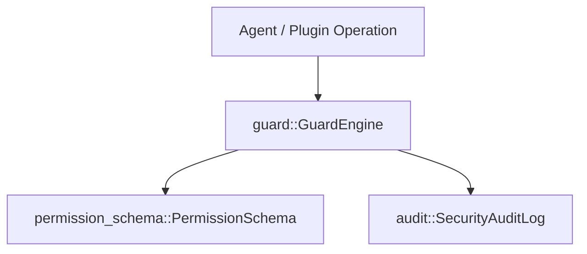

# 🛡️ Cluaiz Security Subsystem (`security/`)

Unified Permission Engine and Execution Guards.

## 📐 Architecture

## 📦 Components

| Module | Responsibility |
|---|---|
| [`permission_schema.rs`](src/permission_schema.rs) | Formal specification of permitted resources, paths, and actions. |
| [`guard.rs`](src/guard.rs) | Runtime interceptor enforcing permissions before tool execution. |
| [`audit.rs`](src/audit.rs) | Tamper-evident logging of security-sensitive operations. |
