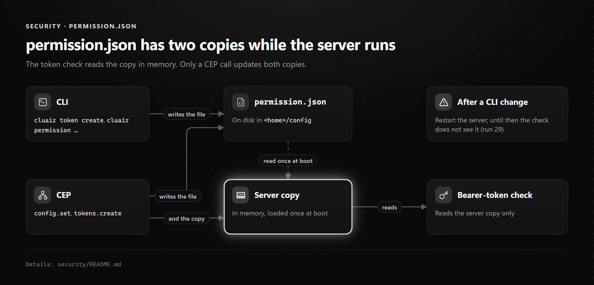

<!-- name: security
description: The data side of security: permission.json (listen address, API keys, approval and sandbox modes) and the CEP audit log. -->

# Security settings (`security/`, crate `cluaiz-security`)

The data side of security. It owns `permission.json` (what the server listens on, API keys, the agent's
approval mode, the OS sandbox mode, the `system.exec` policy, the active model slots) and the CEP audit log
file. It enforces nothing itself: each check runs where the call is made, and reads its setting from here.

## At a glance

- **Platform support:** all (plain files under the selected home; no OS calls).
- **Reusability level:** shared data crate. Read by `api`, `agents`, `cmd` and `automation`.
- **Dependencies:** `cluaiz-core` (`EnvironmentManager`: where the home and `config/` are),
  `cluaiz-cep` (the `Audit` trait and `AuditEntry` it implements), `serde`/`serde_json`, `chrono`
  (audit timestamps), `uuid` (new API keys).

## How it works



Two copies of the settings exist at run time:

- **The file**, read again by most callers each time (`PermissionSchema::load()`; 24 call sites outside tests on 2026-11-21, for
  example `api/src/handlers/chat/authorize.rs:105`, `agents/src/execution/os_sandbox.rs:258`).
- **The server's copy**, loaded once at boot into `AppState.permission_schema`
  (`api/src/state.rs:28`). The bearer-token check (`api/src/auth.rs:91-99`), `system.exec`
  (`system_exec.rs:44`), `tokens.*` and `config.*` use this copy. CEP `config.set` and `tokens.create`
  update both copies; the CLI (`cluaiz token create`, `cluaiz permission ...`) writes only the file,
  so a running server keeps its token setting until it restarts (recorded in run 29,
  `test/cloud/runs/2026-11-21-run29-docs-first-api-request/`).

## Interface
| Construct | Kind | What it is |
|---|---|---|
| `PermissionSchema` | struct, serde | The whole `permission.json`. Every field has a serde default, so an old or partial file loads |
| `PermissionSchema::load()`, `load_from(path)` | fn | Reads the file; a missing file gives `Default`; an unreadable or invalid one gives `Default` with a warning, and an invalid one is copied to `permission.json.broken` |
| `PermissionSchema::save()`, `save_to(path)` | fn | Writes `permission.json.tmp`, then renames it over the file |
| `PermissionSchema::save()` | fn | Writes the whole file, pretty JSON |
| `PermissionSchema::merge_patch(&Value)` | fn | Applies a CEP `config.set` patch: checks every known field first, then writes; unknown fields are ignored |
| `get_active_{chat,embedding,vision,audio}_model()` | fn | The model ID of a slot (`chat_slot`, `embed_slot`, ...), else the older `chat_models` / `vector_models` field |
| `set_active_{chat,embedding}_model(id)` | fn | Loads, sets slot and old field, saves |
| `ApiAuth` | struct | `required` (default `false`) and `tokens`; `generate_token`, `mask_token`, `remove_token`, `ensure_valid_token` |
| `ExecPolicy` | struct | `allow_shell`, `without_approval` for CEP `system.exec`; both `false` by default |
| `SECURITY_MODES` | const `[SecurityModeInfo; 3]` | `full_access`, `sandboxed` (default), `strict`, with the text a settings screen shows |
| `chat_security_mode(global, requested)` | fn | The mode one chat request runs in: the stricter of the global mode and the request's `approval_mode` (a chat can only tighten, because any API caller can send the field); an unknown id is an error naming `approval_mode`. Never writes the setting |
| `OS_SANDBOX_MODES` | const | `auto` (default), `required`, `off` |
| `UNUSED_FIELDS` | const | Six fields kept only so old files and the App's screen keep working; nothing in the Engine acts on them |
| `AuditFile` | struct, implements `cluaiz_cep::Audit` | Append-only JSON-lines log with rotation; `in_home()`, `recent(limit)` |

### `permission.json` fields and who reads them

| Field | Default | Read by |
|---|---|---|
| `api_host` | `0.0.0.0` | `api/src/lib.rs:90` (`CLUAIZ_HOST` wins), `automation/host/src/reach.rs` |
| `api_port` | `8000` | `api/src/lib.rs:133` (`CLUAIZ_PORT` wins), `cmd/src/main.rs` |
| `connection_protocol` | `http` | `cmd/src/cli/server.rs` (printed address) |
| `api_auth.required`, `api_auth.tokens` | `false`, `[]` | `api/src/auth.rs` (server copy), CEP `tokens.*`, `cmd/src/cli/provider.rs` |
| `agent_security_mode` | `sandboxed` | `api/src/handlers/chat/authorize.rs`, `cmd/src/agent/mod.rs`, `agents/src/installer/tools_client.rs`, `automation/host/src/tools.rs` |
| `os_sandbox` | `auto` | `agents/src/execution/os_sandbox.rs` (`CLUAIZ_OS_SANDBOX` wins) |
| `exec.allow_shell`, `exec.without_approval` | `false`, `false` | `api/src/cep/methods/system_exec.rs` |
| `active_slots` | `{}` | `api/src/utils/slots.rs`, chat preflight, audio, `cmd/src/cli/ingest.rs` |
| `lazy_load_model` | `true` | `api/src/lib.rs` (load the chat model at boot when `false`) |
| `stream_telemetry` | `false` | chat preflight (usage in every stream) |
| `model_header_info` | `false` | `api/src/handlers/chat/turn_end.rs`, `agent_loop.rs` |
| `chat_models`, `vector_models` | empty | fallback of the slot getters only |
| `wasm_firewall`, `vectorize_*`, `enable_kvcache`, `vector_models.vision/audio` | various | nothing (`UNUSED_FIELDS`) |

User-facing description of the same fields: [docs/engine/permission.md](../docs/engine/permission.md).

### Audit line

One line per call of a method whose scope is not `read`, and per denial of any call
(`cep/src/dispatch.rs:111-130`; denials are `UNAUTHENTICATED`, `FORBIDDEN`, `APPROVAL_REQUIRED`).
Automation webhooks write the same lines (`automation/host/src/webhook.rs:43`).

```json
{"ts":"2026-10-25T10:30:00.000Z","principal":"owner","method":"fs.write","scope":"write","params_sha256":"9f2c…","code":null,"ms":3}
```

## Files
- `src/permission_schema.rs`
  - **Logic:** serde struct with a default function per field; `load` / `save` against
    `EnvironmentManager::current().config_dir()/permission.json`.
  - **Flow of `merge_patch`:** every known field is validated into a local value first (enum fields
    against their allowed list, switches as booleans); only when all pass are they assigned. Object
    fields (`api_auth`, `active_slots`, `exec`, `chat_models`, `vector_models`) are replaced whole
    when they parse, skipped when they do not.
  - **Why the address is not patched:** `api_port`, `api_host`, `connection_protocol` change only
    through the CLI (`cluaiz permission port|host`) or the file, never through a remote CEP call.
  - **Why `remove_token` takes an index, the full key or a masked suffix:** the CLI and the App list
    keys masked (`sk-••••abcd`); a masked suffix that matches two keys is refused rather than guessed.
- `src/audit.rs`
  - **Logic:** `Mutex<()>` around append; rotation when the file reaches 10 MiB (`MAX_BYTES`), keeping
    3 old files (`KEEP`; `.1` is the newest).
  - **Why only a hash of the params:** the log must never hold file contents, keys or chat text; the
    SHA-256 lets two identical calls be matched without storing them.
- `src/lib.rs`: module list and re-exports.

## Decisions
| Decision | Why | Alternative not taken |
|---|---|---|
| Data here, enforcement at the call site | Each check needs its own context (the HTTP request in `auth.rs`, the tool entry in `agents`, the CEP scope in `cep/`); one crate for all checks would depend on all of them | A central `check(...)` API in this crate |
| Every field has a serde default | Files written by older versions or by the App load without migration | A versioned schema with migrations |
| `merge_patch` validates all fields before writing any | A patch with one bad value changed half the settings before (test `the_security_mode_and_switches_are_saved_and_a_wrong_value_changes_nothing`) | Apply field by field |
| Address fields not patchable over CEP | A remote caller with a key could otherwise move or expose the server | Allow with `admin` scope |
| Audit stores `params_sha256`, not params | Params can hold secrets and user text | Store params, redact by pattern |
| Unused fields kept, listed in `UNUSED_FIELDS` | Removing them breaks the App's settings screen and old files; listing them stops the next developer from wiring them by mistake | Delete them |

## Tested

| Test | What it proves | Run |
|---|---|---|
| `merge_tests::os_sandbox_patch_takes_only_known_modes` | only `auto`/`required`/`off` are saved; a bad value saves nothing | `cargo test -p cluaiz-security` |
| `merge_tests::the_security_mode_and_switches_are_saved_and_a_wrong_value_changes_nothing` | valid patch saved; a patch with one bad value changes nothing; `api_port` / `api_host` are not patched | same |
| `merge_tests::the_listed_modes_are_the_saved_values_and_one_is_the_default` | `SECURITY_MODES` and the stored values agree; exactly one default | same |
| `token_and_slot_tests::chat_mode_only_tightens` | a request mode never loosens the global one; absent = global; unknown global = sandboxed; a bad id is an error | same |
| `merge_tests::a_broken_file_loads_as_defaults_and_is_kept_for_recovery` | an invalid file gives defaults and is copied to `.broken`; a missing file gives defaults | same |
| `merge_tests::save_replaces_the_file_whole_and_leaves_no_temporary_file` | the saved values load back; no `.tmp` is left | same |
| `token_and_slot_tests::remove_token_by_index_counts_from_one` | `" 2 "` removes the second key; `0` and a number past the end are refused and remove nothing | same |
| `token_and_slot_tests::remove_token_by_the_full_key` | the full key, with spaces around it, removes that key; an unknown key gives `Token not found` | same |
| `token_and_slot_tests::remove_token_by_a_masked_suffix` | the masked form the CLI and the App show (`sk-••••2222`, or with `*`) removes the key with that ending | same |
| `token_and_slot_tests::a_masked_suffix_that_is_short_unknown_or_shared_removes_nothing` | fewer than 4 visible characters, no match, or two keys with the same ending: refused, all keys kept; a blank identifier is refused | same |
| `token_and_slot_tests::removing_a_key_also_drops_keys_that_are_not_valid` | records today's behaviour: after a removal `sanitize_tokens` also drops keys of 10 characters or fewer | same |
| `token_and_slot_tests::each_slot_getter_takes_the_slot_model_first_then_the_older_field` | chat, embedding, vision and audio getters: the slot's `model_id` wins; a missing slot or a slot without a model falls back to `chat_models.text` / `vector_models.*`; neither gives none | same |
| `audit::tests::test_lines_rotation_and_no_params` | lines are written, the newest is first, the hash is 64 hex chars, rotation at the size limit, no file past `KEEP` | same |

Result on 2026-11-22 (Windows 11): 12 passed, 0 failed (6 before the token and slot tests were added). By hand, `cluaiz -v permission` with a cut file in a temporary home printed the warning, showed port 8000 (the default) and left `permission.json.broken`.

Covered elsewhere: the bearer token on HTTP routes in several `api/tests/*_contract.rs` suites (for example
`embedding_contract.rs:91`, `document_contract.rs:44`: a request without a key gets 401), `system.exec` policy in `api/tests/cep_exec_contract.rs`,
the token restart behaviour by hand in run 29.

Not tested here: a crash between the write and the rename, concurrent writers.

## Failure and recovery

| Failure | What the code does |
|---|---|
| `permission.json` missing | `load()` returns defaults; the file is created on the first `save()` |
| `permission.json` is not valid JSON | `load()` returns defaults with a `warn` line naming the file and the error, and copies the file to `permission.json.broken`, so a later save cannot lose its tokens. Why defaults and not a refusal to start: the defaults are the owner's choice, unchanged; refusing would change the start-up behaviour |
| `save()` fails or is interrupted | the error goes to the caller (`anyhow::Result`); the new content is written to `permission.json.tmp` and renamed over the file, so a crash leaves the old file whole |
| Two processes save at once | the last writer wins; there is no lock across processes |
| Audit file cannot be written | a `warn` log line; the CEP call itself still succeeds |
| Audit rotation rename fails | ignored; the next line is appended to the current file |

## Sources

- CEP dispatch and its audit rule: [`cep/src/dispatch.rs`](../cep/src/dispatch.rs).
- Where each setting is enforced: [`api/src/auth.rs`](../api/src/auth.rs),
  [`agents/src/execution/os_sandbox.rs`](../agents/src/execution/os_sandbox.rs),
  [`api/src/cep/methods/system_exec.rs`](../api/src/cep/methods/system_exec.rs),
  [`api/src/handlers/chat/authorize.rs`](../api/src/handlers/chat/authorize.rs).

## Pending

| Item | Why it matters | Needs |
|---|---|---|
| CLI changes do not reach a running server | `cluaiz token create` needs a server restart (run 29) | the server re-reading the file, or the CLI calling CEP when a server runs |
